# IGS OS

> 🇪🇸 Sistema operativo para un operador de giras deportivas: agentes y flujos durables hacen el trabajo, las personas aprueban. **POC con datos ficticios.**

**IGS OS is an operating system for a sports tour operator.** Agents and durable flows do the operational work: qualifying coaches, building proposals, chasing payments and confirmations. People stay in control through an approvals inbox.

> **POC · fictional data, no real IGS information.** All clubs, people and companies are invented. Cities and stadiums are real places. This is an independent prototype built for a job application, **not an official Infinity Global Sports product**. It uses no IGS logo or photos.

**Live demo:** https://igs-os.vercel.app. Press **Start the 2-minute tour** on the landing page, or go straight to the [ops panel](https://igs-os.vercel.app/ops). No login. The public demo can read everything and *propose* actions, never approve them.

[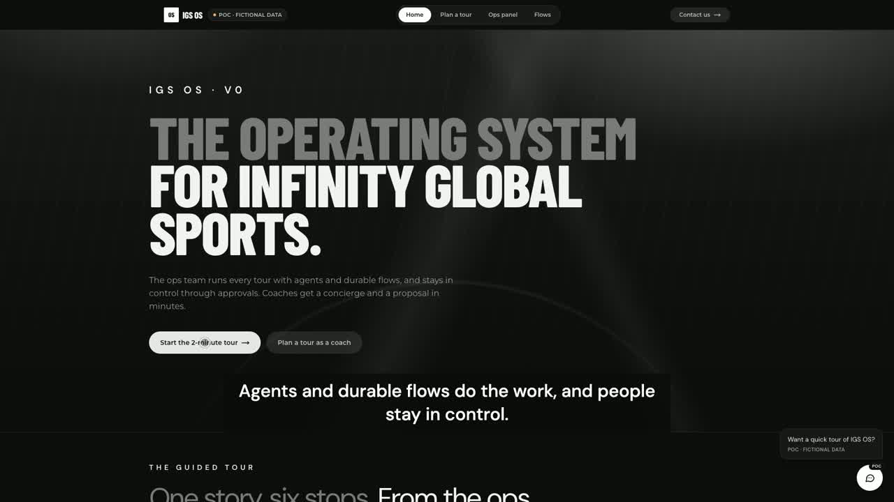](https://igs-os.vercel.app/demo/igs-os-demo.mp4)

**[▶ Watch the demo (2:27)](https://igs-os.vercel.app/demo/igs-os-demo.mp4)** · [30-second teaser](https://igs-os.vercel.app/demo/igs-os-teaser.mp4)

| Landing | Hoy (today's operation) |
|---|---|
| 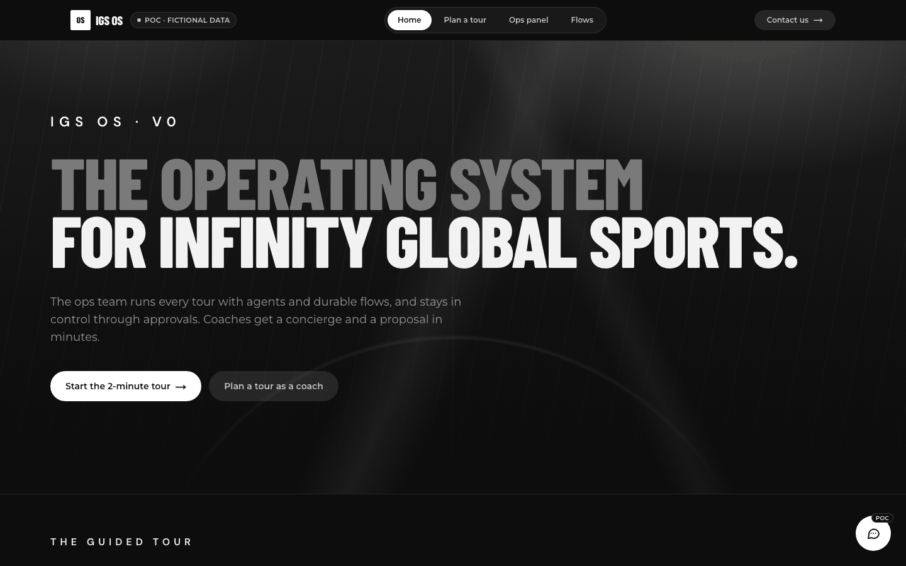 | 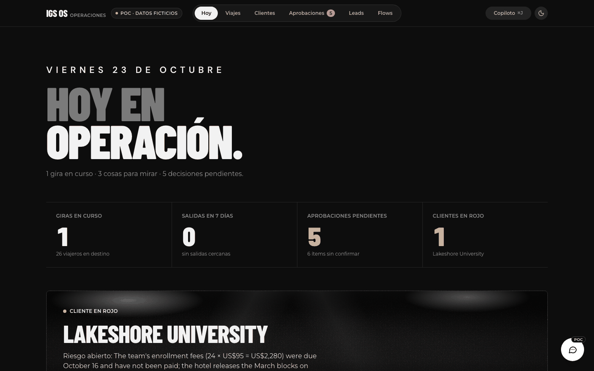 |
| **Account 360 (Lakeshore, red)** | **Flow editor (Voiceflow-style)** |
| 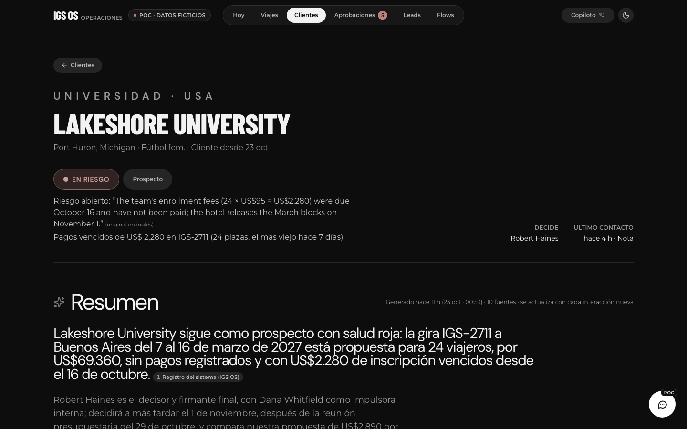 | 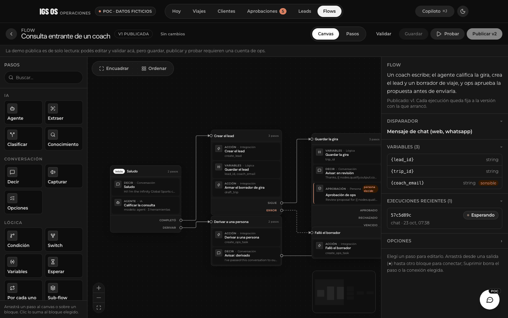 |

## What it does for a tour operator

- **Account 360 per client:** status, who decides, what was promised and what is at risk. Every line is cited to the email, call or chat it came from. Health comes from deterministic rules, never from the model.
- **Copilot for ops:** answers with sources and prepares actions. Anything that leaves the building becomes an approval bound to its exact content. The same tools are exposed to Claude or any MCP client.
- **Durable flows (Voiceflow/n8n concepts):** coach conversations, waits measured in days, provider confirmations and escalations, with a block editor, a live test panel and an execution viewer.
- **Money and paperwork:** the published payment terms (US$95 enrollment, US$500 at 30 and 90 days, balance 110 days before departure) become reminders that need approval. A per-traveler readiness check covers passports, the Brazil e-Visa and minors' authorizations.
- **Inbound:** "Plan a Tour" form posts and forwarded emails become scored inquiries, each with a drafted reply and a 1-business-day response clock.
- **Day one with real data:** a spreadsheet importer (Excel/CSV, English or Spanish headers) shows a dry-run diff before applying anything. A daily digest says what to look at first.

## User flows

🧑 = human-in-the-loop step. Nothing external happens without it.

### 1. Coach: from the site to a reservation

```mermaid
flowchart LR
  A[Coach on the site] --> B["/chat · concierge<br/>(inbound-inquiry flow)"]
  B -->|asks sport, level, age group,<br/>dates, group size| C[create_lead action]
  C --> D["Ops sees it<br/>/ops (Hoy) · /ops/leads"]
  D --> E[draft_trip + send_proposal<br/>drafted by the agent]
  E --> F{{"🧑 /ops/approvals<br/>approve exact content"}}
  F -->|approved| G["Coach opens /proposal/[id]"]
  G --> H[Reserve → deposit request]
  H --> I{{"🧑 ops approves the deposit"}}
```

### 2. Ops morning: the red client

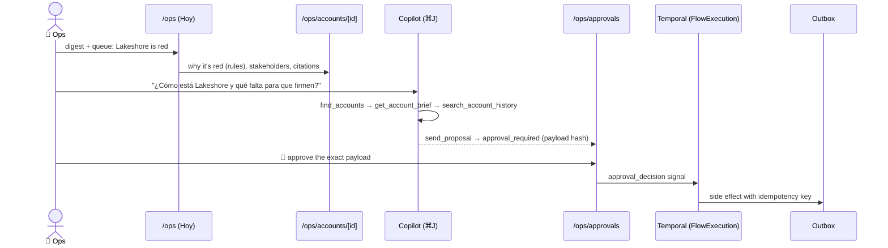

### 3. Payments and import

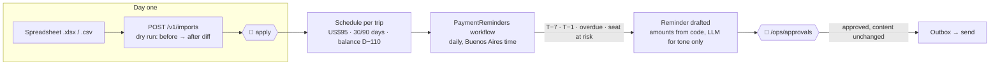

### 4. Pre-departure readiness

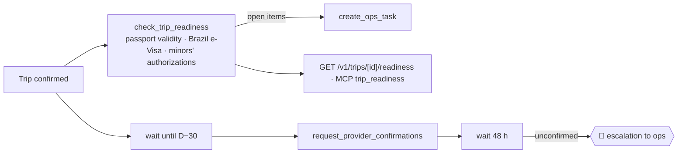

### 5. Inbound lead intake

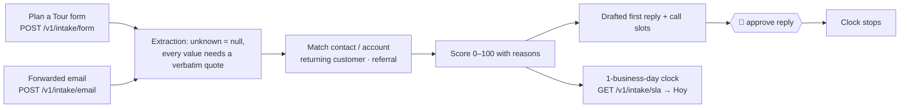

### 6. Flow builder

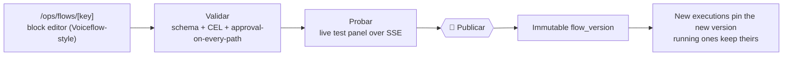

### 7. Visitor (the demo itself)

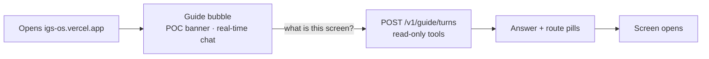

## Architecture

### System

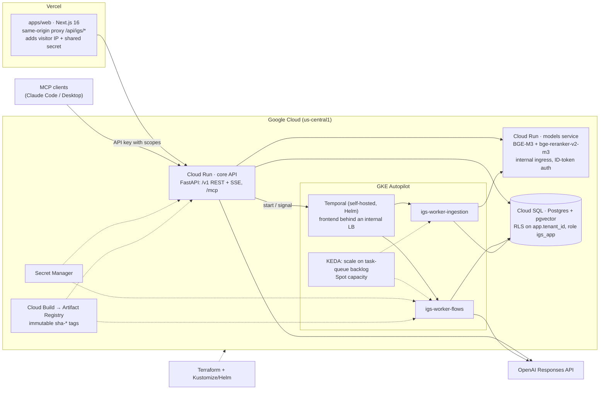

- **Web (`apps/web`):** Next.js 16 / React 19 on Vercel. The browser only talks to same-origin routes. The proxy (`src/proxy.ts`) forwards the visitor's address with a shared secret, so rate limits are per visitor and not per Vercel egress IP. The API URL and keys never reach the browser.
- **Core API (`services/core`):** FastAPI on Cloud Run. It serves `/v1` (trips, accounts, leads, approvals, flows, executions, events, imports, digest, intake, public chat, guide), the copilot SSE stream and the MCP server at `/mcp`.
- **Workers (`services/worker`):** Temporal workers on GKE, one Deployment per task queue (`flows`, `ingestion`). KEDA scales them on queue backlog, including to zero; timers and signals still wake them.
- **Temporal:** self-hosted with the official Helm chart, 512 history shards, persistence in its own Postgres.
- **Models service (`services/models`):** BGE-M3 (dense + sparse) and bge-reranker-v2-m3 on Cloud Run. Internal ingress only, called with Google ID tokens.
- **Postgres:** the single transactional source of truth, with pgvector for retrieval. Tenant isolation is enforced by row-level security.
- **Delivery:** Cloud Build images go to Artifact Registry with immutable `sha-<commit>` tags. Terraform owns the infrastructure and Kustomize/Helm own GKE. Secrets live in Secret Manager. See [`docs/infra/deployment.md`](docs/infra/deployment.md).

### Request flow: from a question to a sent proposal

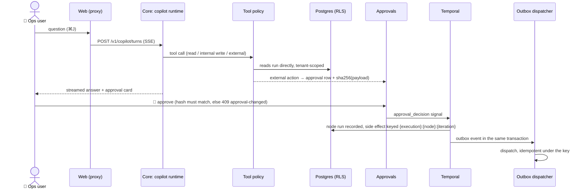

### Durable flows

- **Definition:** a flow is JSON validated by [`packages/flow-schema/flow.schema.json`](packages/flow-schema/flow.schema.json). Expressions are CEL: no loops, no side effects, the same semantics in Python and TypeScript. The schema generates both the Pydantic and the TypeScript types.
- **Node types:**
  - AI: `agent` (task or conversation mode), `extract`, `classify`, `knowledge_search`
  - conversation: `say`, `capture`, `choice`
  - logic: `condition`, `switch`, `set`, `map`, `subflow`, `wait`, `end`
  - integration: `http`, `action` (domain action registry), `send_message`, `emit_event`
  - human: `approval`
- **Triggers:** chat, webhook, schedule, event, manual.
- **Editor:** a straight run of steps is drawn as one Voiceflow-style block. Branches leave from labelled ports. What gets saved is still the plain graph. **Validar** checks the schema, the CEL expressions and that every path to an external action passes an approval. **Publicar** creates an immutable `flow_version` that executions pin.
- **Execution:**
  - Each execution is one `FlowExecution` workflow that interprets the version snapshot node by node. Pure nodes run inline; the rest run as activities.
  - Signals are `user_message`, `approval_decision` and `cancel`. Waits and approvals are durable timers, so they cost nothing while parked. Long runs continue-as-new.
  - Every node run is written to `flow_node_runs`, which feeds the execution viewer over SSE.
- **Safety:**
  - Every Temporal payload is compressed and encrypted (zlib + AES-256-GCM, `igs_common.temporal.codec`).
  - Side effects carry `{executionId}:{nodeId}:{iteration}` as an idempotency key.
  - Outbound events go through a transactional outbox.

Details: [`docs/architecture/flow-engine.md`](docs/architecture/flow-engine.md), [`docs/architecture/temporal.md`](docs/architecture/temporal.md).

### RAG pipeline

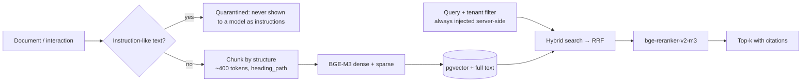

- **Embeddings chosen by measurement:** 60 golden questions in English and Spanish. BGE-M3 dense scored **recall@5 0.824, MRR 0.725**, against a lexical floor of 0.713 / 0.537. Naive BM25 fusion made it worse, and the benchmark shows that. See [`docs/research/embeddings-benchmark.md`](docs/research/embeddings-benchmark.md).
- **Tenant isolation:** the tenant filter is always added by the server, and a caller filter that mentions `tenant_id` is rejected.
- **Adapter:** the store sits behind a `VectorStore` interface. pgvector serves today; the Vertex AI Vector Search adapter is built and tested with fakes. See [`docs/architecture/rag.md`](docs/architecture/rag.md).

### Agents

- **Model per role:** `agent`, `chat`, `extractor`, `judge`, `fast`, `reasoning`. The mapping comes from `IGS_LLM_MODELS`, so code never names a model version. All calls go through the OpenAI Responses API behind a provider-agnostic `LLMClient`.
- **Tools per surface, from one registry and one policy:**

  | Surface | Tools | Can act? |
  |---|---|---|
  | Ops copilot / MCP | reads + internal writes; external actions become approvals | proposes; only `igs:approve` decides |
  | Flow `agent` nodes | the tools listed in the node, `approvalRequiredFor[]` | via approvals |
  | Coach chat (public) | knowledge search over documents only, fixed filter | no |
  | Guide bubble (public) | `find_accounts`, `get_account_brief`, `list_pending_approvals`, `daily_digest`, `suggest_route` | no, read-only |

- **Cost and abuse controls:**
  - a daily LLM spend cap shared by the API and every worker (`llm_spend_daily`);
  - a default ceiling on output tokens;
  - per-visitor rate limits (for example, 12 guide turns per 5 minutes and 5 chat starts per minute).

### Data model

Postgres, multi-tenant from day one. Every tenant table has RLS on `app.tenant_id` and the app connects as `igs_app`. No tenant set means zero rows.

| Area | Tables |
|---|---|
| Tenancy and access | `tenants`, `users`, `api_keys`, `audit_log` (append-only) |
| Sales and clients | `contacts`, `leads`, `lead_intakes`, `accounts`, `stakeholders`, `interactions`, `account_facts`, `account_briefs` |
| Trips | `trips` (with a `pricing` snapshot and payment terms), `trip_items`, `travelers`, `traveler_documents`, `providers`, `opponents`, `experiences`, `incidents` |
| Flows | `flows`, `flow_versions`, `flow_triggers`, `flow_executions`, `flow_node_runs`, `approvals` |
| Conversations and agents | `conversations`, `messages`, `agent_runs`, `agent_steps`, `llm_spend_daily` |
| Knowledge | `documents`, `document_chunks`, `ingestion_jobs`, `retrieval_eval_runs` |
| Integration | `outbox_events` |

Migrations (Alembic, `packages/py-common/migrations/versions`):

| Migration | Change |
|---|---|
| `0001` | initial schema |
| `0002` | schema gaps |
| `0003` | chunk payload |
| `0004` | node-run notify |
| `0005` | travelers |
| `0006` | LLM daily spend |
| `0007` | traveler documents |
| `0008` | lead intakes |

See [`docs/architecture/data-model.md`](docs/architecture/data-model.md).

### Security

- **Approvals bound to content:** the decision is tied to a `sha256` of the payload. If anything changes, it is rejected with `409` and must be reviewed again. First writer wins, and every decision is audited.
- **Isolation in the database:** RLS on every tenant table, plus the tenant filter in retrieval.
- **Minors:** only the birth year is stored. A minor can't have their own email or phone (a database check), and messages go to the responsible adults. Players' personal data never goes to a model or into the index, and documents are tracked as a status only, never as scans or passport numbers.
- **Secrets:** server-side only, in Secret Manager. API keys are stored hashed, and the browser never sees a key or the API host.
- **Red team** ([`docs/reviews/red-team-2026-10.md`](docs/reviews/red-team-2026-10.md)): 12 attack scenarios, all passing after the fixes (3 of 12 passed before):
  - prompt injection through inbound email;
  - quarantined content;
  - cross-tenant extraction;
  - minors' data;
  - approval bypass;
  - jailbreaks in ES/EN/PT;
  - invented prices and refunds.

Threat model: [`docs/architecture/security.md`](docs/architecture/security.md).

### Frontend

- **Containers and presentational components:** Server Components fetch through a typed client and pass plain props. Client components only hold the state they need.
- **Controlled and uncontrolled:** components work both ways through `useControllableState`.
- **HOCs for cross-cutting concerns:** `withPermission`, `withApprovalGate`, `withErrorBoundary`, `withTracking`, `withFeatureFlag`.
- **State:** Zustand stores scoped per feature, never one global store.
- **Typed API:** `openapi-fetch` with types generated from the FastAPI OpenAPI document (`apps/web/openapi.json` → `src/lib/api/schema.d.ts`, regenerated with `services/core/scripts/export_openapi.py`).
- **Design system:** measured from the public site. Dark by default, Barlow Condensed / DM Sans / Montserrat, pill navigation, and every token pair checked for WCAG AA contrast (`/design`).

See [`docs/architecture/frontend.md`](docs/architecture/frontend.md) and [`docs/design/igs-site-style.md`](docs/design/igs-site-style.md).

### Scalability

| Piece | How it scales |
|---|---|
| Core API, models service | Cloud Run autoscaling; the API is stateless |
| Workers | KEDA on Temporal task-queue backlog, per queue, down to zero |
| Temporal | 512 history shards; history stays small via continue-as-new and payloads kept out of history |
| Retrieval | pgvector now; Vertex AI Vector Search behind the same `VectorStore` when the corpus grows |
| Database | One Postgres with RLS. Reads served from projections (`flow_node_runs`), not from Temporal history |

**The lean path:** for an operator of IGS's size, the same product runs with one agent, a few scheduled jobs and Postgres, with Temporal and GKE switched off. They come back once volume or flow complexity calls for them. See [`docs/proposals/10-lean-ai-stack.md`](docs/proposals/10-lean-ai-stack.md).

## Tech stack

TypeScript, Next.js 16, React 19, Tailwind v4, Zustand, React Flow · Python 3.13, FastAPI, SQLAlchemy + Alembic, Pydantic, uv · Postgres, pgvector · Temporal (Python SDK) · OpenAI Responses API · BGE-M3, bge-reranker-v2-m3 · MCP · GCP: Cloud Run, Cloud SQL, GKE Autopilot, Secret Manager, Cloud Build, Artifact Registry · Vercel · Terraform, Helm, Kustomize, KEDA · pytest, Vitest, Playwright + axe, k6.

## Engineering highlights

- **Human-in-the-loop by construction:** external actions only ever create approvals bound to their exact content. A flow can't be published if any path reaches an external action without an approval.
- **Tenant isolation in Postgres (RLS)**, not in application code alone.
- **Hybrid RAG with a benchmark** behind the choice of embeddings, and citations on every answer.
- **Evals and red team:** offline evals run in CI, and paid runs need an explicit `--allow-paid`. The adversarial scenarios cover the copilot and both public chats.
- **MCP with scopes:** the copilot and external assistants share one tool surface and one policy. Approving needs its own `igs:approve` scope.
- **Everything as code:** Terraform, Helm, Kustomize, Cloud Build. Images use immutable tags.

## Repo map

```
apps/web/               Next.js: (app)/ops · (public) chat + proposal · (site) landing + design
services/core/          FastAPI: /v1, /mcp, copilot, guide, public chat, intake, digest, imports
services/worker/        Temporal workers: flow interpreter, ingestion, payment reminders
services/models/        BGE-M3 + reranker service (its own uv project)
packages/py-common/     igs_common (db, domain, llm, rag, accounts, flows, payments, readiness,
                        importer, digest, intake, seed, temporal), Alembic migrations, fixtures
packages/flow-schema/   Flow JSON Schema, example flows, codegen
evals/                  Retrieval and agent evals, red-team scenarios
loadtest/               k6 scripts + mock OpenAI-compatible server
infra/                  Terraform (GCP), Helm values (Temporal), K8s manifests (workers, KEDA)
scripts/                Deploy helpers, demo video, visual comparison
docs/                   Architecture, ADRs, design, ops, proposals, reviews, research, infra
```

## Run it locally

Requirements: Docker, [uv](https://docs.astral.sh/uv/), Node 24 and pnpm.

```bash
make up                      # Postgres (pgvector) on :5433 + Temporal on :7233 (UI on :8233)
uv sync --all-packages
make migrate                 # Alembic → head
make seed                    # demo tenant "igs" (idempotent)
make api                     # core API on :8000 (OpenAPI at /docs)
make worker                  # Temporal workers
pnpm install && make web     # http://localhost:3000
```

- Reset the demo with `uv run python -m igs_common.seed --reset-demo`.
- LLM features need `OPENAI_API_KEY` and `IGS_LLM_MODELS` (see `.env.example`). Without them, those endpoints answer `503`. `?copilot=fake` and `?guide=fake` give scripted modes.
- Embeddings and reranker are optional (about 4.5 GB of weights; a CPU is enough):
  ```bash
  cd services/models && uv run python scripts/prepare_models.py --out models \
    && uv run uvicorn igs_models.app:create_app --factory --port 8090
  ```

**Connect Claude Code over MCP:**

```bash
uv run python services/core/scripts/mint_api_key.py --tenant igs --name "Claude Code" \
  --scope igs:read --scope igs:write   # prints the igs_… key once
claude mcp add --transport http igs-os http://localhost:8000/mcp --header "Authorization: Bearer igs_…"
```

## Tests

| Suite | Count | Command |
|---|---|---|
| Python: domain, db + RLS, llm, rag, flows, payments, readiness, importer, intake, digest, api, mcp, copilot, guide, worker | 1129 | `uv run pytest -q` |
| Web unit (Vitest) | 81 | `pnpm --filter web test` |
| End to end (Playwright + axe WCAG AA, desktop + mobile) | 45 | `pnpm --filter web exec playwright test` |
| Evals (offline in CI; paid runs behind `--allow-paid`) | — | `make evals` |
| Load (k6 + mock LLM) | — | `loadtest/run.sh` ([results](loadtest/README.md)) |

CI runs ruff, pyright, pytest against Postgres, the flow-schema codegen check, the contrast check, web lint/typecheck/build and Playwright.

## What's fictional / not done

- **All data is fictional:** clients, people, trips, emails and prices beyond IGS's published terms. Nothing is connected to IGS systems.
- **Nothing is delivered:** approved emails, reminders and replies land in the outbox, with no real email or WhatsApp sending yet.
- **No user login:** the public demo is read and propose only, and MCP uses API keys.
- **No screens yet** for the daily digest and the intake inbox; they are reachable through the API, the copilot and MCP.
- **`http` flow nodes and conversation interrupts** are not implemented yet.
- **The retrieval benchmark corpus is small;** it needs real documents.

More: [`docs/OVERVIEW.md`](docs/OVERVIEW.md) · [`docs/ops/proceso-igs.md`](docs/ops/proceso-igs.md) · [`docs/proposals/README.md`](docs/proposals/README.md) · [`docs/delivery/use-cases.md`](docs/delivery/use-cases.md)

## License

All rights reserved.
