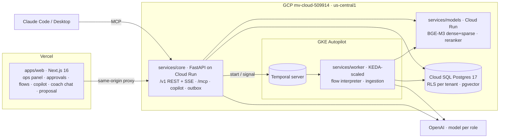

# IGS OS — Technical overview

## The problem

Infinity Global Sports sells 10–14 day team tours in Argentina, Brazil, Costa Rica and Spain to US college and club programs. Each tour is a small project with many moving parts: qualify a coach, propose an itinerary with opponents at the team's level, book hotels, buses, referees and venues, chase every confirmation, run the week on the ground, report after each match. Most of that work is coordination over email, WhatsApp and spreadsheets, and the knowledge of each client lives in a few people's heads.

## What IGS OS does

IGS OS is a working prototype of the operating system behind that work. Agents and durable flows do the repetitive parts; people approve anything that leaves the company.

- **Account 360.** Status, stakeholders, commitments, risks and next step for each client, every line cited to the email, call or chat it came from. Health is computed by deterministic rules; the model only writes the cited brief and answers questions, and says "I don't know" when it has no source.
- **Durable flows.** A Voiceflow/n8n-style engine on Temporal: chat-triggered inquiries, waits measured in days ("30 days before departure"), and human approval nodes. Flows are versioned graphs validated at publish time.
- **Approvals.** The inbox shows exactly what will be sent (recipient, message, price) bound to a payload hash; if anything changes, the approval is rejected and must be reviewed again.
- **One tool surface.** The in-app copilot, flow agent nodes and external MCP clients (Claude Code, Claude Desktop) use the same tools under one policy: reads run, internal writes are audited, external actions become approvals, nothing approves itself.
- **Coach-facing surfaces.** A public chat on the inbound-inquiry flow and a proposal page with one package price and a Reserve button that creates a deposit approval for ops.

All demo data is fictional. It is not an official IGS product.

## Architecture

Shared Python lives in `packages/py-common` (db, domain, llm, rag, ingest, accounts, flows, seed, temporal). The flow JSON Schema in `packages/flow-schema` generates both Pydantic and TypeScript types.

## Key decisions

| Decision | Why | ADR |
|---|---|---|
| Python backend, Next.js only for UI | AI/RAG/Temporal ecosystem; the browser never touches the database or a key | [0001](adr/0001-python-backend-nextjs-ui.md) |
| Temporal, self-hosted on GKE Autopilot; workers scaled by KEDA | Waits of days and human approvals cost nothing while parked; retries and replay built in; workers long-poll, so Cloud Run doesn't fit them | [0002](adr/0002-temporal-self-hosted-gke-autopilot.md) |
| Postgres as the source of truth, with row-level security | Tenant isolation enforced by the database, failing closed when no tenant is set | [0003](adr/0003-cloud-sql-operational-data.md) |
| pgvector now, Vertex Vector Search behind the same adapter | Cheap and local first; the managed store is a configuration swap | [0004](adr/0004-vertex-vector-search.md) |
| Embeddings chosen by benchmark (BGE-M3, self-hosted) | Measured on the demo tenant's golden sets instead of picked by reputation | [0005](adr/0005-embeddings-by-bake-off.md) |
| MCP as the single tool surface | Same tools and policy for the copilot, flow agents and external assistants | [0006](adr/0006-mcp-single-tool-surface.md) |
| Own flow engine, concepts from Voiceflow and n8n | Durable execution, approvals and conversation turns as first-class nodes; no third-party code | [0007](adr/0007-own-flow-engine.md) |
| OpenAI behind a provider-agnostic `LLMClient`, one model per role | Cost control per role and per flow node; ids verified against the Models API, versioned price table | [PLAN §8](PLAN.md) |

## How quality is ensured

| Practice | Numbers today |
|---|---|
| Python tests (domain, db + RLS, llm, rag, ingest, accounts, flows, seed, API, MCP, copilot, worker incl. Temporal replay) | 856 passing; integration suites create and migrate their own databases, so CI starts from nothing |
| Web unit tests (vitest) | 48 passing |
| End to end (Playwright) with axe WCAG 2.2 AA on every page, desktop and mobile | 47 runs: 44 pass, 3 skipped until a model is configured |
| Retrieval evals (60 golden questions, English and Spanish) | BGE-M3 recall@5 0.824 and MRR 0.725 vs. a lexical floor of 0.713 / 0.537; naive BM25 fusion measured to hurt, so it isn't used blindly |
| Agent evals | 12 scenarios (6 adversarial: injected documents, cross-tenant extraction, discount pressure, sends that must become approvals), simulated users and a structured-output judge; dry mode runs in CI, paid runs require `--allow-paid` |
| Security review of the code | 7 findings fixed (incl. one critical and two high), the rest tracked: [reviews/security-2026-10.md](reviews/security-2026-10.md) |
| Load tests (k6 + mock LLM, one laptop API worker) | reads 430 req/s at p95 84 ms; copilot ≈ 130 ms API overhead per turn; 25 concurrent approvals → exactly 1 winner, 24 × 409 |
| UX reviews with screenshots and axe | 5 reviews → 8 ranked proposals, the top ones implemented ([reviews/ux](reviews/ux/README.md)) |
| Plan red-team | 21 findings, 18 accepted, 3 partly ([reviews/plan-review.md](reviews/plan-review.md)) |

CI runs ruff, pyright, pytest against Postgres, the flow-schema codegen check, the design-token contrast check, web lint/typecheck/build and Playwright.

## How it was built

Planning first, then parallel AI agents with written file-ownership contracts ([CONTRACTS.md](CONTRACTS.md)), spikes before committing to Temporal and to an embedding model, red-team and UX reviews with evidence, and tests/evals/e2e as the definition of done. The bugs worth telling are the ones caught while integrating the agents' work; they are listed in the [README](../README.md#how-i-built-this-with-ai).

## What's next

1. Finish the public deployment (Terraform demo env, Temporal on GKE, Vercel) and record the demo video against it.
2. Run the paid eval suite and tune the model per role with it.
3. Re-run the embedding benchmark on real IGS documents; try weighted fusion with BGE-M3's own sparse vector.
4. MCP OAuth 2.1 for production clients; CSP and security headers; per-tenant LLM token budgets.
5. Validate the personas and the open questions with the IGS team.
