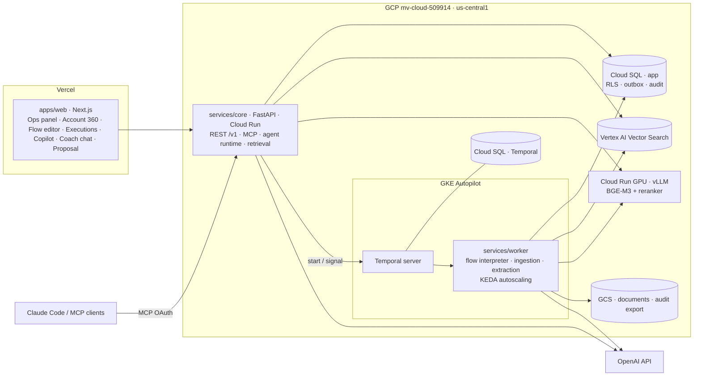

# IGS OS — Plan v3

> *"Send me the best thing you've built."* — the answer is a working operating system for Infinity Global Sports where the ops team runs tours through **agents and durable flows**, stays in control through **approvals**, and knows every client through **Account 360**.

v3 consolidates: the critical review (`reviews/plan-review.md`), ten architecture/research spikes, ten UX/UI specs and prototypes, and the decisions taken in conversation (OpenAI as LLM, Account 360, frontend patterns, GCP project and region). Earlier versions are in git history.

## 1. Value

### For Infinity Global Sports
IGS sells 10–14 day sports tours (soccer, rugby, field hockey, volleyball, basketball) in Argentina, Brazil, Costa Rica and Spain, mostly to US college and club programs, run from New York, Denver and Buenos Aires. Each tour is a project with many moving parts: qualifying the coach, a tailored proposal, level-matched opponents, hotels, buses, referees, training, stadium visits, insurance, payments, and a week of logistics abroad.

| Today (inferred) | With IGS OS | Value |
|---|---|---|
| Coach inquiries answered by hand, sometimes days later | An agent replies in minutes in English, qualifies, drafts a proposal; ops approves | More inquiries converted |
| Each proposal takes hours | Proposal built from catalog + rules (opponents ±1 level, rest days, margin) | More proposals per person, consistent pricing |
| Provider confirmations chased over WhatsApp and spreadsheets | Flows request confirmations (e.g. 30 days out) and escalate what's missing | Fewer on-tour failures |
| Knowledge lives in a few people's heads and inboxes | RAG with citations over contracts, policies, past trips — and **Account 360** per client | Less key-person risk, faster onboarding |
| Growth means more manual work | Ops builds automations in the editor without code | Scale without headcount growing at the same rate |
| Decisions leave no trail | Every agent and human action is traced and approval-gated | Control and trust |

These pains are inferred from the public site — validate with the IGS team (§12).

## 2. Demo goal

A first-time visitor opens one link, no login, and within two minutes (script: `design/demo-script.md`) sees:

1. **Ops Home** — what needs attention today: approvals, unconfirmed providers, departures.
2. **Approvals inbox** — an agent-drafted proposal for a coach inquiry, with the exact diff, approved by a human.
3. **Flow execution** — the inbound-inquiry flow, node by node, including the durable wait for approval.
4. **Copilot / Account 360** — *"¿Cómo está Lakeshore?"* → status, stakeholders, risks, next step, with citations.
5. **Proposal** — the brochure the coach receives.
6. **Evals and traces** — numbers proving it doesn't regress.

All demo data is fictional (Lakeshore University, trip `t-2711`, fictional clubs). Real IGS clients and site photos are never used.

## 3. Decisions

| Topic | Decision | Source |
|---|---|---|
| Focus | Operations run by agents + flows; coach chat is one entry point; **Account 360** is a headline feature | conversation |
| Frontend | Next.js 16 on **Vercel** (`apps/web`), UI only, calls `services/core`; no DB access, no Next API proxy | ADR-0001, review #13 |
| Frontend patterns | Container/presentational (RSC containers), controlled + uncontrolled primitives via `useControllableState`, **HOCs for cross-cutting concerns** (`withPermission`, `withApprovalGate`, `withErrorBoundary`, `withTracking`, `withFeatureFlag`), **Zustand scoped per feature instance** (flow editor, copilot, execution viewer, chat) | `architecture/frontend.md` |
| Backend | Python 3.13, uv workspace: FastAPI (`services/core`) on **Cloud Run** | ADR-0001 |
| LLM | **OpenAI** (personal key, Secret Manager). Model chosen **per role/node**; ids come from config and are verified against the Models API before use (public sources disagree on current names) | conversation |
| Durable execution | **Temporal self-hosted**: server on **GKE Autopilot** (Helm chart 1.x), persistence + visibility on its **own Cloud SQL Postgres** (`postgres12_pgx`, schema via `temporal-sql-tool` in the pipeline), 512 history shards, Web UI behind **IAP** | ADR-0002, `architecture/temporal.md` |
| Flow workers | **GKE Autopilot + KEDA** Temporal scaler (scale on task-queue backlog, to zero). Not Cloud Run — workers long-poll and don't receive HTTP | R2, R8, review #3 |
| Operational data | **Cloud SQL Postgres** (app DB), row-level security on `app.tenant_id`, PgBouncer before going public | ADR-0003, security.md, cost-and-scale.md |
| Vector store | **Vertex AI Vector Search** (Agent Retrieval, GA) **behind a `VectorStore` adapter**; **pgvector** adapter for local/tests and as fallback. Start on **KNN** (≤100k objects, no index) to keep idle cost low; deploy the ANN index before load tests. Filter fields fixed up front | ADR-0004, `architecture/rag.md`, review #5 |
| Retrieval | Built-in hybrid (vector + full-text, RRF) + reranker; tenant filter injected server-side, never by the model | rag.md, security.md |
| Embeddings | Default **BGE-M3 hybrid** (dense + 0.3·sparse) + **bge-reranker-v2-m3** for agent answers. **Re-run the bake-off on the real ops corpus** (300–500 synthetic+reviewed Q&A, train/test) with Qwen3-Embedding, **gemini-embedding-001** (auto-embeddings) and OpenAI as candidates | `research/embeddings-benchmark.md` |
| Model serving | vLLM on **Cloud Run GPU (L4)**, scale to zero for ingestion/rerank; query embeddings on CPU Cloud Run (min 1) | `architecture/model-serving.md` |
| Tools | **MCP** is the single tool surface for internal agents, the copilot and Claude/other MCP clients. Static token locally; **OAuth 2.1** (resource server, RFC 9728/8707) from the cloud phase | ADR-0006, security.md |
| Flow engine | Own engine, concepts from Voiceflow/n8n, never their code. Graph JSON (Pydantic source of truth → committed JSON Schema → TS types), **CEL** expressions | ADR-0007, `architecture/flow-engine.md`, review #15 |
| Observability | Own tables (runs, steps, node runs) are the product source; OpenTelemetry (GenAI conventions, still "Development") for infra, trace id stored on each row | `architecture/observability.md`, review #18 |
| Cloud | GCP project **`mv-cloud-509914`**, region **`us-central1`** (no South America region for Vector Search). APIs enabled: run, aiplatform, sqladmin, secretmanager, vectorsearch, discoveryengine, container | R4, R6 |
| Repo | GitHub `mauricioA0/igs-os` | conversation |
| Constraints | Nothing from the author's employer (code, services, keys). Fictional demo data only. `THIRD_PARTY.md` for model licenses (BGE-M3 MIT, Qwen3 Apache-2.0) and concept credits | ADR-0008, review #20 |

## 4. Architecture



### Repository layout (as it exists)

```
igs-os/
├─ apps/web/                 Next.js 16: prototypes (ops, flows, chat, proposal), design system, /design
├─ services/core/            igs-core — FastAPI: REST, MCP, agent runtime, retrieval API
├─ services/worker/          igs-worker — Temporal workers: flow interpreter, ingestion, extraction
├─ packages/py-common/       igs-common — db models + migrations, domain, llm, flows, seed
├─ packages/flow-schema/     flow.schema.json + 3 example flows (validated)
├─ spikes/                   temporal (4/4 tests), embeddings (bake-off)
└─ docs/                     plan, contracts, architecture, design, ADRs, research, reviews
```

pnpm workspace (`apps/*`) + uv workspace (`packages/py-common`, `services/*`), Python 3.13, Node 24.

## 5. Account 360

The copilot and the ops panel answer *"how is this client?"* with structured state plus cited narrative.

- **Data** (`CONTRACTS.md`): `accounts` (status, health), `stakeholders` (role, influence, sentiment, last contact — never minors), `interactions` (emails, calls, meetings, chats, notes — source text), `account_facts` (status/commitment/risk/preference/budget/decision, each with `source_interaction_id`, confidence, validity, supersession).
- **Pipeline**: new interaction → outbox event → Temporal **extraction workflow**: chunk + embed into Vector Search (payload: `tenant_id`, `account_id`, `stakeholder_id`, `channel`, `occurred_at`) and LLM extraction of stakeholders/facts with provenance (structured output) → **account brief** regenerated and cached.
- **Retrieval**: SQL for status (leads, trips, payments, approvals) + vector search filtered by `account_id` for narrative; the brief cites interactions; facts without a source are rejected.
- **Surfaces**: Account page (header status/health, stakeholder map, timeline, open risks and commitments, next best action, "ask about this client"), copilot context chip, MCP tools `get_account_brief`, `search_account_history`, `list_stakeholders`.
- **Evals**: per-account Q&A golden set (status, who decides, open risks), extraction precision/recall for stakeholders and facts, groundedness.
- **Privacy**: player/minor data never enters interactions or embeddings; stakeholder PII redacted from traces.

Spec and prototype: `design/account-360.md`, `/ops/accounts` (in progress, P9).

## 6. Flow engine

Spec: `architecture/flow-engine.md`; schema and examples: `packages/flow-schema/`.

- Versioned graph (draft → immutable published versions; executions and sub-flows pin a version), 5 trigger types, 19 node types, named ports, CEL expressions, per-node retry and error branches, error flow, retry-from-node on the same version.
- **Interpreter rules** (from the Temporal spike): flow version passed as workflow input (never loaded inside the workflow), `workflow.patched`/Worker Versioning for interpreter changes, continue-as-new before history limits (51,200 events / 50 MB), large node outputs stored in Postgres/GCS by reference (payload limit 2 MB), payload codec (compression + encryption) from day one, **replay tests in CI**.
- **v0 node set** (review #9, accepted): build the nodes the three demo flows use first; the rest of the catalog stays in the schema, implemented later.
- Demo flows: inbound inquiry (agent → create lead → draft trip → approval → send), pre-departure check (wait until −30 days → confirmations → wait 48 h → escalate), post-match report. Plus `notify-ops-on-failure` as the built-in error flow (R3 open question → accepted).

## 7. Security controls (from `architecture/security.md`)

- Tool classes enforced in the registry: **read / internal write / external or destructive**. The coach-facing agent gets read + propose only.
- **Publish-time check**: no path from an untrusted trigger (chat, webhook) to an external/destructive tool without an approval node.
- **Approvals bound to the exact action** (payload hash, approver); editing the payload requires re-approval; no bulk approve for external actions; MCP keys can't approve by default.
- Tenant isolation: Postgres RLS (`app.tenant_id`, separate migration role), server-injected vector filters, cross-tenant test suite.
- Append-only **audit log** of every tool call (human, flow, MCP) exported to write-once GCS.
- Minors' data in a separate encrypted store, never sent to an LLM or embedded; retention/deletion rules; legal review (COPPA, LGPD, Ley 25.326) before real customers.
- IAP for Temporal UI, private GKE, internal-only workers and GPU service, one service account per service, Cloud SQL private IP + IAM auth, no secrets in the browser (CI check on `NEXT_PUBLIC_*`).
- Supply chain: pinned model revisions (safetensors), image digests, frozen lockfiles, SHA-pinned Actions, gitleaks.
- Abuse/cost: Cloud Armor, per-tenant rate and token budgets, HMAC webhooks, budget alert on the project.
- **Red-team evals as CI gates**: injection via chat, poisoned document, instructions in lead fields, cross-tenant extraction.

## 8. LLM roles and cost

Models are chosen per role and confirmed by evals; ids are filled in from the OpenAI Models API once the key is configured.

| Role | Tier | Why |
|---|---|---|
| Coach chat / qualification, `classify`, `extract` nodes | Small/fast | High volume, latency-sensitive |
| Trip drafting, ops copilot, Account 360 brief | Mid | Reasoning over tools and retrieved context |
| Hard planning / escalations (optional) | Top | Only where evals show headroom |
| Eval user simulator | Small | Cheap, many turns |
| Eval judge | Mid (different from the agent under test) | Structured-output rubric scoring |

Cost model (`architecture/cost-and-scale.md`, re-priced with OpenAI list prices on 2026-10-22): per 1,000 coach conversations ≈ $11 on `gpt-6-luna` (role `chat`) vs ≈ $213 on `gpt-6.1-sol` (role `agent`) vs ≈ $1,090 on `gpt-6-astra` (role `reasoning`) → **the chat runs on the small tier unless evals say otherwise**. Inbound-inquiry flow ≈ $65 / 1,000 executions; flows without LLM nodes ≈ $0.40.

Idle infra: the demo scales to zero where it can (pgvector instead of Vector Search, no GPU) and can be paused. First bottlenecks: LLM rate limits (real traffic), Postgres connections (load tests → PgBouncer), then Temporal persistence writes.

## 9. Phases

Exit criteria must be green before a phase closes. Inside a phase, parallel agents own disjoint paths (`CONTRACTS.md`); integration and verification are done centrally.

| # | Phase | Deliverables | Exit criteria | Status |
|---|---|---|---|---|
| 0 | Base | Scaffold, demo catalog, first contracts | — | ✅ Done |
| D | Research & design | 10 architecture docs, 8 ADRs, plan review, Temporal spike (4/4), embeddings bake-off, flow schema + 3 validated flows, 8 UX specs, design system, clickable prototypes (`/ops`, `/flows`, `/chat`, `/proposal`, `/design`), monorepo layout | Build + lint green | ✅ Done |
| 1 | **Python core + walking skeleton** | P1 db models + migrations + RLS (incl. Account 360) · P2 domain · P3 seed/fixtures (demo tenant + 6 accounts) · P4 FastAPI skeleton · P5 local stack + CI · P6 LLM layer (OpenAI) · P7 flow schema codegen + CEL + validator · P8 worker skeleton + codec + replay harness · P9 Account 360 spec + prototype · P10 this plan. Then: **thin skeleton deployed** (Cloud Run core + Cloud SQL + Vercel) showing live seeded data | `pytest` green, migrations apply, seed loads, public URL serves data from `core-api` | ✅ Done locally (672 tests at the time; 856 Python tests today). Cloud skeleton: see phase 5 |
| 2 | Flow engine v0 + inbound-inquiry vertical slice | Interpreter on local Temporal, v0 nodes, approvals/capture signals, executions API, web execution viewer on real data | Demo script steps 1–3 work locally; replay tests in CI | ✅ Done (wave 2); live Lakeshore workflow resumes on approval after `demo_reset.py` (wave 4) |
| 3 | RAG + Account 360 | pgvector adapter, ingestion + extraction workflows, Vertex adapter (KNN), hybrid + rerank, bake-off on real corpus, retrieval and Account 360 evals | Bake-off table published; recall@5 target met; brief cites sources | ✅ Done (wave 2): BGE-M3 recall@5 0.824 vs 0.713 floor; real-corpus re-run pending real IGS documents |
| 4 | Agents + MCP | Tool registry with classes, MCP (token locally), copilot runtime, agent + red-team evals (smoke per PR, full nightly) | Thresholds green | ✅ Done (wave 2); dry evals in CI, paid full run pending |
| 5 | Cloud | Terraform: GKE Autopilot + Temporal (Helm) + KEDA workers, Cloud SQL ×2 + PgBouncer, Vector Search, GPU service, Secret Manager, IAP, WIF for GitHub Actions, MCP OAuth 2.1; remaining demo flows | Full demo script on the public URL | 🔄 Terraform/Helm/CD written and validated (wave 4); demo env apply in progress on `mv-cloud-509914` |
| 6 | Web on real data + proof of scale | Prototypes moved to `features/*` per frontend.md, editor + copilot + Account 360 on the API, nightly demo reset (Temporal schedule), load test (k6 + omes + mock LLM) | Numbers in README | ✅ Done (waves 3–4): web on the API, k6 load test with mock LLM (430 req/s reads, p95 84 ms) |
| 7 | Delivery | README + "How I built this with AI" + build log, `THIRD_PARTY.md`, 2-min video | Sent | 🔄 README, overview, video script and video done |

## 10. Plan-review findings — disposition

| # | Finding | Decision |
|---|---|---|
| 1 | Two-minute path undefined | **Accepted** — `design/demo-script.md`, demo tenant without login |
| 2 | First visible thing ships last | **Accepted** — walking skeleton deployed in phase 1; flow vertical slice moved before RAG/agents |
| 3 | Self-hosted Temporal is costly and invisible | **Partly accepted** — keep self-hosted (user decision), but workers on GKE + KEDA and own Temporal DB; Temporal Cloud stays as pre-approved escape hatch |
| 4 | Bake-off + GPU over-engineered for corpus | **Partly accepted** — bake-off done offline on CPU; GPU only for ingestion/rerank at scale; re-run on a real-sized corpus |
| 5 | Vector Search unverified | **Accepted** — verified (GA), behind adapter with pgvector fallback, KNN first |
| 6 | AI-native evidence under-specified | **Accepted** — build log, evals-as-spec, parallel-agent contracts in README |
| 7 | Two Postgres instances unplanned | **Accepted** — app DB and Temporal DB separated explicitly |
| 8 | Flow engine lacks data model/determinism rules | **Accepted** — data-model.md + interpreter rules (§6) |
| 9 | Node library too wide for v0 | **Accepted** — v0 node set = what demo flows use |
| 10 | Evals need cost and secrets planning | **Accepted** — smoke per PR, full on label/nightly, cost tracked per run |
| 11 | MCP lacks auth/tenancy | **Accepted** — OAuth 2.1 per current spec, scopes per tool class |
| 12 | Domain coverage thin | **Accepted** — travelers/rosters (encrypted), payments status, incidents, Account 360 |
| 13 | Next API proxy | **Accepted** — dropped |
| 14 | No migration step to `apps/web` | **Accepted** — done |
| 15 | Schema direction | **Accepted** — Pydantic source of truth → JSON Schema → TS |
| 16 | Region | **Accepted** — `us-central1` |
| 17 | Model choices missing | **Accepted** — §8 (now OpenAI tiers) |
| 18 | Observability duplication | **Accepted** — own tables are product source, OTel for infra |
| 19 | Demo data reset | **Accepted** — nightly Temporal schedule |
| 20 | Licensing | **Accepted** — `THIRD_PARTY.md` |
| 21 | Scale needs proof | **Accepted** — load test in phase 6 |

## 11. Data-model and API gaps (to resolve in phases 1–2)

| Gap | Raised by | Resolved by |
|---|---|---|
| `trip_items`: `completed` status + `result` field (post-match trigger) | R3, U1 | P1 (model), P2 (transitions) |
| On-tour **incidents** object | U1 | P1 |
| Approvals: `payload_hash`, `proposed_action`, `risk_class`, approver, decision payload | U2, security.md | P1 + P2 (`payload_hash`) |
| Audit endpoint per subject (trip, lead, account) | U2 | P4 (route skeleton), phase 2 |
| `trip_items.requested_at`; provider reliability stats | U2 | P1 (column), phase 2 (aggregates) |
| Aggregates on `GET /trips`; server-side `/v1/ops/queue` for Home | U2 | phase 2 |
| Quarantine fields on `document_chunks` | U2 | P1 |
| `leads.lost_reason` | U2 | P1 |
| Flow routes: draft validate, `If-Match` revision on draft save, SSE execution stream, node-runs list | U3 | P4 (skeleton), phase 2 |
| Account 360 tables (`accounts`, `stakeholders`, `interactions`, `account_facts`) | conversation | P1, P3, P9 |
| Built-in `notify-ops-on-failure` error flow | R3 | phase 2 |
| Agent approval pauses the whole execution (assumed) | R3 | confirm in phase 2 |
| ~~`inbound-inquiry.json` still names a Claude model~~ — resolved: flows use `{"role": …}` model refs | U8 | P7 ✅ |

## 12. Open questions for IGS

1. What takes the ops team the most time today? (calibrates the demo story)
2. Which tools do they use now — CRM, spreadsheets, WhatsApp, email, accounting?
3. How many tours per year, and how many people in ops/sales?
4. Who approves proposals and provider spend?
5. How do they handle rosters, medical forms and minors' data today?
6. Payments: deposit and balance flows, providers paid how?
7. Is the 2027 Women's World Cup family program a separate operation?

## 13. Risks

- **Running Temporal ourselves**: upgrades, schema migrations, shards fixed at creation, Autopilot rejecting the chart's privileged sysctl init container (disable in values). Mitigation: Helm + Terraform, runbook, replay tests, Temporal Cloud as escape hatch.
- **Idle cost**: Vector Search, Cloud SQL ×2, GKE and GPU have floors. Mitigation: demo mode (KNN, scale to zero, paused mode), budget alert.
- **Vendor churn**: Vector Search client is beta, renamed recently; OpenAI model names in flux. Mitigation: adapters, ids from config verified via APIs.
- **Unverified prices and latencies**: several costs and cold starts are estimates. Mitigation: measure in phases 3 and 5 before publishing numbers.
- **Scope**: the editor and Account 360 can absorb everything. Mitigation: demo script is the scope fence; vertical slice first.
- **Legal**: minors' data needs counsel before any real customer.
