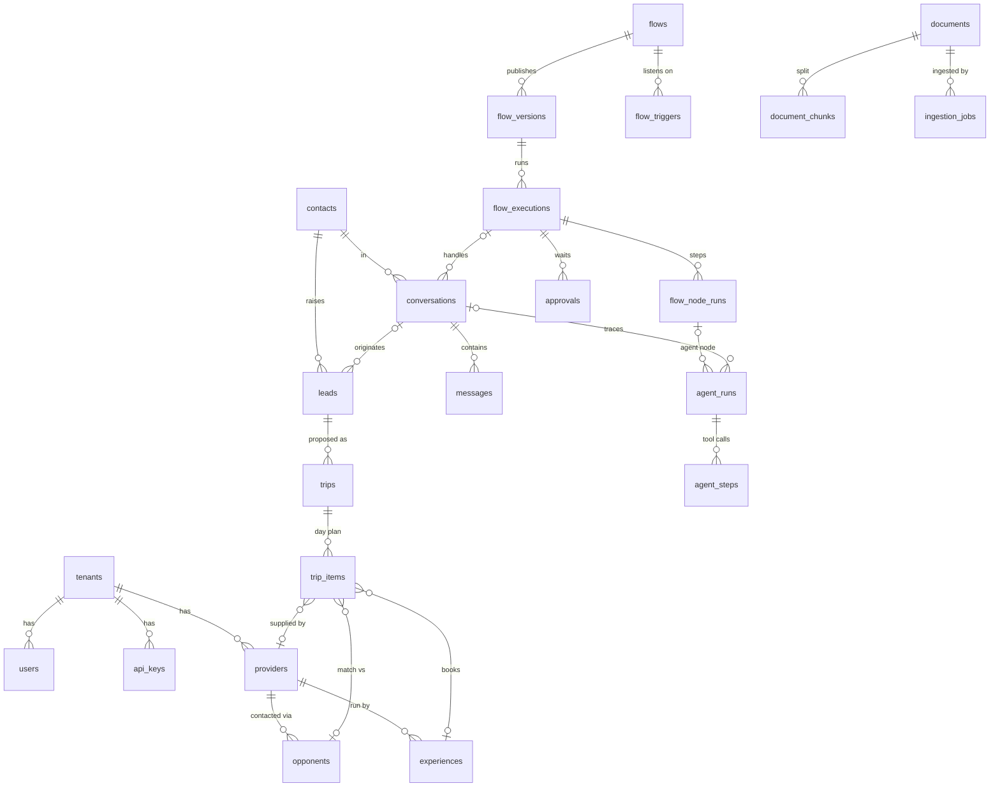

# Data model

Status: design, phase 1. Source of truth for the schema becomes `packages/py-common/igs_common/db/models.py` (SQLAlchemy 2, async) with Alembic migrations in `services/core/migrations/`. The Drizzle schema in `src/db/schema.ts` is the starting point and is removed once ported.

## 1. Where data lives

| Store | Holds | Why |
|---|---|---|
| **Cloud SQL Postgres** (`igs` database) | Everything transactional: tenants, users, catalog, leads, trips, conversations, flows and executions, approvals, documents and ingestion jobs, traces, audit log, outbox | Source of truth; joins, constraints, transactions |
| **Vertex AI Vector Search** | One collection per kind of retrievable content (`knowledge_chunks`, `catalog_items`), each object = embedding(s) + filterable payload + `pg_id` back-reference | Scales retrieval independently of the OLTP database |
| **GCS** (`igs-documents-<env>`) | Original uploaded files and parsed text snapshots | Cheap blob storage; ingestion re-runs from here |
| **Temporal persistence** (separate Cloud SQL instance) | Workflow histories, timers, task queues | Owned by Temporal; we never query it directly |

Rules:
- **Postgres owns identity.** Every vector object carries `pg_id`, `tenant_id` and the fields needed for filtering. A vector is never the only copy of anything; it can always be rebuilt from Postgres + GCS.
- **No embeddings in Postgres** in the target design. The `vector` columns of the Drizzle schema go away; `pgvector` stays installed only for the local `VectorStore` adapter used in tests and offline dev.
- Chunk text is stored in Postgres (`document_chunks.content`) and in the vector payload (so search results don't need a second round trip). Postgres wins on conflict.

## 2. Conventions

- Primary keys: UUID v7 (time-ordered, good index locality), generated in Python.
- Every business table has `tenant_id uuid not null` (FK `tenants.id`), and every unique index starts with `tenant_id`. Row-level security is not used in v0; the repository layer always filters by tenant (enforced by a `TenantScoped` base and a test that fails if a query on a scoped table lacks the filter).
- Timestamps: `created_at`, `updated_at` (`timestamptz`, server default `now()`).
- Enums: Postgres native enums mirrored as Python `StrEnum`. New values are added with `ALTER TYPE … ADD VALUE` migrations.
- Money: integer USD (`*_usd`), whole dollars, as in the draft. Multi-currency is out of scope.
- JSON payloads: `jsonb`, validated by Pydantic models at the edges.
- Soft delete only where history matters (`flows.archived_at`); everything else hard-deletes with FK `ON DELETE` rules.

## 3. Tables

### 3.1 Tenancy and access

| Table | Columns (beyond id, tenant_id, timestamps) | Notes |
|---|---|---|
| `tenants` | `slug` unique, `name`, `settings jsonb` | No `tenant_id`. IGS is tenant #1; the model is multi-tenant so the "OS" can host more operators |
| `users` | `email` (unique per tenant), `name`, `role` enum `owner\|ops\|sales\|viewer`, `auth_subject` (IdP subject), `last_seen_at` | |
| `api_keys` | `name`, `hash` (sha256), `prefix`, `scopes text[]`, `created_by`, `expires_at`, `revoked_at` | For MCP clients and service-to-service; plaintext shown once |

### 3.2 Catalog (ported from Drizzle)

| Table | Columns | Change vs draft |
|---|---|---|
| `providers` | `name`, `kind` enum (`hotel, transport, venue, referee, guide, club`), `city`, `country`, `contact`, `unit_price_usd`, `unit` | + tenant |
| `opponents` | `name`, `city`, `country`, `sport`, `gender`, `age_groups text[]`, `level_score` 1-10 (check), `description`, `provider_id` | − `embedding` (now in Vector Search `catalog_items`) |
| `experiences` | `title`, `city`, `country`, `sports text[]` (empty = any), `duration_hours`, `price_usd`, `description`, `provider_id` | − `embedding` |

`knowledge_chunks` from the draft is replaced by `documents` + `document_chunks` (3.6): seed knowledge becomes ordinary documents that go through ingestion.

### 3.3 Sales and operations (ported)

| Table | Columns | Change vs draft |
|---|---|---|
| `contacts` | `name`, `email`, `phone`, `organization`, `role` (coach, AD, parent…) | New: a coach exists before and across leads |
| `leads` | `contact_id`, `conversation_id`, `sport`, `gender`, `age_group`, `level_score`, `group_size`, `destination_country`, `travel_start`, `duration_days`, `budget_per_person_usd`, `goals`, `status` enum (`new, qualified, proposal_sent, won, lost`), `source` (`chat, webhook, manual, flow`) | coach fields move to `contacts` |
| `trips` | `lead_id`, `title`, `city`, `country`, `start_date`, `end_date`, `status` enum (`draft, proposed, confirmed, in_progress, completed, cancelled`), `price_per_person_usd`, `summary`, `pricing jsonb` (breakdown snapshot) | + pricing snapshot so a proposal never changes under the coach |
| `travelers` | `trip_id`, `full_name`, `role` enum (`player, staff, parent`), `is_minor`, `birth_year`, `email`, `phone` | New (0005): per-person roster. Minors: birth year only, never their own email/phone (check `minor_no_contact`) |
| `traveler_documents` | `traveler_id`, `requirement` (key from `igs_common/readiness/rules/*.yaml`), `status` (`missing, requested, received, verified, not_applicable`), `valid_from`, `valid_until`, `note`, `updated_by`; unique (`traveler_id`, `requirement`) | New (0007): pre-departure document **status only** — never scans or passport numbers. See docs/ops/requisitos-viaje.md |
| `trip_items` | `trip_id`, `day`, `slot` (`morning, afternoon, evening`), `kind` enum (`arrival, departure, match, training, experience, free`), `title`, `opponent_id`, `experience_id`, `provider_id`, `status` enum (`pending, requested, confirmed, cancelled`), `notes`, `confirmed_at` | + `confirmed_at` |
| `conversations` | `channel` (`web, whatsapp, email, mcp`), `contact_id`, `is_simulation`, `flow_execution_id` | link to the flow that handles it |
| `messages` | `conversation_id`, `role` (`user, assistant`), `content jsonb` (provider-agnostic content items, append-only) | unchanged semantics: history is never edited |

### 3.4 Flows (new)

| Table | Columns | Notes |
|---|---|---|
| `flows` | `key` (unique per tenant, e.g. `inbound-inquiry`), `name`, `description`, `draft_graph jsonb`, `draft_updated_by`, `published_version_id`, `archived_at` | The editable draft lives here |
| `flow_versions` | `flow_id`, `version int` (unique per flow), `graph jsonb` (immutable), `graph_hash`, `schema_version`, `published_by`, `published_at`, `changelog` | Executions pin a version |
| `flow_triggers` | `flow_id`, `kind` enum (`chat, webhook, schedule, event, manual`), `config jsonb` (cron expr / event type + filter / webhook secret hash), `enabled` | Derived from the published graph on publish; indexed for event matching |
| `flow_executions` | `flow_version_id`, `trigger_kind`, `trigger_payload jsonb`, `status` enum (`running, waiting, succeeded, failed, cancelled`), `temporal_workflow_id` unique, `temporal_run_id`, `vars jsonb` (last persisted snapshot), `error jsonb`, `started_at`, `finished_at`, `parent_execution_id` (subflows), `subject_type`/`subject_id` (e.g. `trip`, uuid) | Temporal is the executor; this row is the queryable projection |
| `flow_node_runs` | `execution_id`, `node_id`, `node_type`, `attempt`, `status` enum (`running, succeeded, failed, skipped, waiting`), `input jsonb`, `output jsonb`, `error jsonb`, `started_at`, `finished_at`, `duration_ms`, `idempotency_key` unique | Powers the n8n-style execution viewer. Large outputs (>256 KB) go to GCS and store a `gs://` ref |
| `approvals` | `execution_id`, `node_id`, `title`, `details jsonb`, `assignee_role`, `assignee_user_id`, `status` enum (`pending, approved, rejected, expired`), `decided_by`, `decided_at`, `comment`, `expires_at` | Decision → Temporal signal |

### 3.5 Agents and tracing

| Table | Columns | Notes |
|---|---|---|
| `agent_runs` | `conversation_id`, `flow_node_run_id`, `surface` (`chat, flow, mcp, eval`), `model`, `latency_ms`, `input_tokens`, `output_tokens`, `cache_read_tokens`, `cache_write_tokens`, `cost_usd numeric(10,6)`, `stop_reason`, `error`, `trace_id` (OTel) | From draft + flow link + cost + OTel correlation |
| `agent_steps` | `run_id`, `idx`, `tool`, `input jsonb`, `output jsonb`, `is_error`, `duration_ms` | unchanged |

### 3.6 Documents and ingestion (new)

| Table | Columns | Notes |
|---|---|---|
| `documents` | `title`, `source` (`policy, contract, guide, trip_report, faq…`), `gcs_uri`, `mime_type`, `content_hash` (sha256), `metadata jsonb` (country, city, provider_id, valid_until…), `status` enum (`pending, ingesting, ready, failed`), `current_job_id`, `chunk_count`, `embedding_model` | unique (`tenant_id`, `content_hash`) makes re-upload idempotent |
| `document_chunks` | `document_id`, `ordinal`, `content`, `token_count`, `heading_path text[]`, `content_hash`, `vector_object_id` | Chunk-level hash lets re-ingestion touch only changed chunks |
| `ingestion_jobs` | `document_id`, `temporal_workflow_id`, `status` enum (`queued, parsing, chunking, embedding, indexing, succeeded, failed`), `embedding_model`, `stats jsonb` (chunks added/updated/deleted, ms per stage), `error`, `started_at`, `finished_at` | One row per ingestion attempt |
| `retrieval_eval_runs` | `embedding_model`, `reranker`, `dataset_version`, `metrics jsonb` (recall@k, MRR, nDCG), `git_sha` | History behind "chose the model by measurement" |

### 3.7 Events and audit (new)

| Table | Columns | Notes |
|---|---|---|
| `outbox_events` | `type` (e.g. `lead.created`), `subject_type`, `subject_id`, `payload jsonb`, `occurred_at`, `dispatched_at`, `attempts`, `last_error` | Written in the same transaction as the change (see core-api.md §4) |
| `audit_log` | `actor_type` (`user, agent, flow, api_key, system`), `actor_id`, `action`, `subject_type`, `subject_id`, `before jsonb`, `after jsonb`, `request_id`, `at` | Every write through the API, MCP or a flow; append-only (no UPDATE/DELETE grant for the app role) |

## 4. ER diagram

(`tenant_id` on every table except `tenants` is omitted from the diagram for readability.)

## 5. Indexes

| Table | Index | Serves |
|---|---|---|
| all scoped tables | leading `tenant_id` in every composite index | tenant filter on every query |
| `opponents` | (`tenant_id`, `sport`, `gender`, `country`) + GIN on `age_groups` | hard filters before ranking by level |
| `experiences` | (`tenant_id`, `country`) + GIN on `sports` | |
| `leads` | (`tenant_id`, `status`, `created_at desc`) | ops lists |
| `trips` | (`tenant_id`, `status`, `start_date`) | upcoming departures, pre-departure flows |
| `trip_items` | (`trip_id`, `day`, `slot`); partial (`tenant_id`, `status`) where `status in ('pending','requested')` | timeline; "unconfirmed items" query |
| `messages` | (`conversation_id`, `created_at`) | history replay |
| `flow_triggers` | (`tenant_id`, `kind`, `enabled`); GIN on `config` | event → flow matching |
| `flow_executions` | unique `temporal_workflow_id`; (`tenant_id`, `flow_version_id`, `started_at desc`); (`tenant_id`, `status`); (`subject_type`, `subject_id`) | executions list, "flows running for this trip" |
| `flow_node_runs` | (`execution_id`, `started_at`); unique `idempotency_key` | viewer; exactly-once activity effects |
| `approvals` | partial (`tenant_id`, `assignee_role`) where `status = 'pending'` | approval inbox |
| `outbox_events` | partial (`occurred_at`) where `dispatched_at is null` | dispatcher poll (`FOR UPDATE SKIP LOCKED`) |
| `audit_log` | (`tenant_id`, `subject_type`, `subject_id`, `at desc`); BRIN on `at` | history per entity; time-range scans on a large append-only table |
| `documents` | unique (`tenant_id`, `content_hash`); (`tenant_id`, `status`) | idempotent upload |
| `document_chunks` | (`document_id`, `ordinal`); unique (`document_id`, `content_hash`) | diff on re-ingestion |
| `agent_runs` | (`tenant_id`, `surface`, `started_at desc`); (`conversation_id`) | traces view |

Growth plan: `flow_node_runs`, `agent_steps`, `audit_log` and `outbox_events` are the high-volume tables. They get monthly range partitioning on their timestamp once they pass ~50M rows; the schema avoids FKs *into* them so partitioning stays a migration, not a redesign.

## 6. Vector Search collections

| Collection | Object | Vectors | Payload (filterable) |
|---|---|---|---|
| `knowledge_chunks` | one per `document_chunks` row | dense (+ sparse when the chosen model provides it, e.g. BGE-M3) | `tenant_id`, `document_id`, `pg_id`, `source`, `country`, `city`, `provider_id`, `valid_until`, `embedding_model`, `content`, `title`, `heading_path` |
| `catalog_items` | one per opponent / experience | dense | `tenant_id`, `pg_id`, `item_type` (`opponent, experience`), `sport`, `gender`, `age_groups`, `country`, `city`, `level_score`, `price_usd` |

- Object ID = `pg_id`, so upserts are idempotent.
- `embedding_model` in the payload lets two models coexist during a migration or an A/B eval; queries filter on the active model (tenant setting).
- Catalog hard filters (sport, gender, age group, country) are applied in Vector Search; level-distance ordering and business rules are applied in Python after retrieval, as in the draft `findOpponents`.
- A `VectorStore` protocol (`upsert`, `delete`, `query(filters, dense, sparse, k)`) has two implementations: `VertexVectorStore` and `PgVectorStore` (local/tests).

## 7. Migrations and seed

- Alembic, one revision per change, autogenerate reviewed by hand. CI runs `alembic upgrade head` on an empty DB and `alembic check` to catch model drift.
- Seed (`uv run igs seed`) is idempotent: upsert tenant `igs`, demo users, catalog from the fixtures ported from `src/db/seed-data.ts`, and enqueue the knowledge documents through the real ingestion workflow (not direct inserts), so the seed also exercises ingestion.
