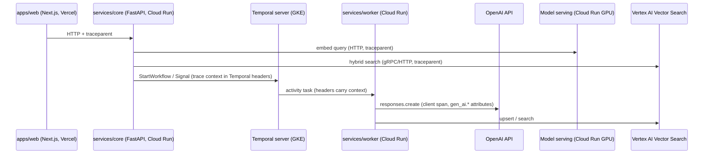

# Observability

How we see what IGS OS is doing, end to end: from a click in the ops panel, through the API, the durable flow engine, every LLM call and every vector search, down to what each run costs.

Two consumers, two stores:

| Consumer | Store | Purpose |
|---|---|---|
| Engineers / on-call | **Cloud Trace, Cloud Logging, Cloud Monitoring** (via OpenTelemetry) | Debugging, latency, SLOs, alerts |
| Ops team / IGS team (the product) | **Our own tables** in Cloud SQL (`agent_runs`, `agent_steps`, `flow_executions`, `flow_node_runs`, `ingestion_runs`) | Execution viewer, traces page, cost per run, "retry from this node" |

Both are written from the same instrumentation points and share IDs (`trace_id` is stored on every product row), so any row in the panel links straight to its Cloud Trace view.

## 1. Trace propagation



| Hop | Mechanism |
|---|---|
| Browser → Next.js | `@vercel/otel` / Next.js `instrumentation.ts`; server components and route handlers create spans |
| Next.js → FastAPI | W3C `traceparent` / `tracestate` headers on every `fetch` to `services/core` |
| FastAPI | `opentelemetry-instrumentation-fastapi`, `-httpx`, `-sqlalchemy`, `-asyncpg`; one server span per request |
| FastAPI → Temporal → workers | `temporalio.contrib.opentelemetry.TracingInterceptor` registered on **both** the client (`Client.connect(..., interceptors=[...])`) and the `Worker`. Context travels in Temporal headers, so a flow that resumes after a 30-day timer or a human approval still links to the trace that started it (as a span link, not a 30-day-long parent span) |
| Workers → OpenAI | Manual client span around each `responses.create` / stream (see §2), attribute names centralized in `igs_common.llm.telemetry`; the provider's request id is recorded as an attribute |
| → Model serving | `httpx` instrumentation; vLLM/TEI expose Prometheus metrics, scraped by Managed Service for Prometheus |
| → Vector Search | Client span per call (`db.system.name = "vertex_ai_vector_search"`, collection, top_k, filter keys — never filter values that may hold PII) |

Long-lived executions: a flow execution is **not** one giant trace. Each workflow task / activity attempt is its own trace, linked to the execution's root via span links and a `flow.execution_id` attribute. The product execution viewer stitches them by `execution_id`.

## 2. LLM spans and GenAI semantic conventions

We follow the OpenTelemetry **GenAI semantic conventions** for every model call (`gen_ai.operation.name`, `gen_ai.provider.name`, `gen_ai.request.model`, `gen_ai.response.model`, `gen_ai.usage.input_tokens`, `gen_ai.usage.output_tokens`, `gen_ai.response.finish_reasons`, tool-call spans `execute_tool {name}`).

**Status (checked October 2026):** the GenAI conventions are still **Development** (formerly "experimental"), not Stable. In June 2026 (semconv v1.42.0) they were deprecated in the main `semantic-conventions` repo and moved to a dedicated `semantic-conventions-genai` repository, which had no official release as of August 2026. Consequences for us:

- Pin the attribute names we emit in one module (`packages/py-common/telemetry/genai.py`) so a rename is a one-file change.
- Set `OTEL_SEMCONV_STABILITY_OPT_IN` per the instrumentation libraries' guidance when we adopt their GenAI instrumentation.
- Add our own namespaced attributes for what the spec doesn't cover yet: `igs.llm.cache_read_tokens`, `igs.llm.cache_write_tokens`, `igs.llm.effort`, `igs.llm.cost_usd`, `igs.llm.fallback_model`, `igs.flow.node_id`, `igs.tenant_id`.
- **No prompt or completion content in spans by default.** Message content goes to our own tables (which have tenant access control and retention), not to Cloud Trace. A debug flag can enable content capture in non-production only.

Span shape for one agent turn:

```
chat.turn                                    (FastAPI)  igs.conversation_id
└─ agent.run                                            igs.run_id
   ├─ chat gpt-6.1-sol                       gen_ai.* , igs.llm.cost_usd
   ├─ execute_tool find_opponents            igs.tool.is_error
   │  ├─ embed qwen3-embedding-0.6b          (GPU service)
   │  └─ vector_search.query opponents       top_k=10
   ├─ execute_tool draft_trip
   └─ chat gpt-6.1-sol
```

## 3. Export

- **Collector**: OpenTelemetry SDKs export OTLP to the Google-built OTel Collector (sidecar on Cloud Run services, DaemonSet/Deployment on GKE), which writes to **Cloud Trace** (`googlecloud` exporter / Telemetry API), **Cloud Logging** and **Cloud Monitoring**. Vercel exports OTLP over HTTPS to the same collector behind an authenticated endpoint.
- **Logs**: structured JSON (`structlog` in Python, `pino` in Next.js) with `trace_id` / `span_id` fields named so Cloud Logging correlates them with traces (`logging.googleapis.com/trace`).
- **Metrics**: OTel metrics → Cloud Monitoring; Temporal server and SDK metrics (Prometheus) → Managed Service for Prometheus.
- **Sampling**: parent-based; 100% for errors and for eval runs, 20% head sampling for healthy production chat turns (tunable). Product tables are always 100% — they are the audit trail.

## 4. Product-side tables

These back the ops panel (traces page, execution viewer) and the evals reports. They are written by the same code that emits spans.

| Table | One row per | Key fields |
|---|---|---|
| `agent_runs` | Agent invocation (chat turn, flow `agent` node, eval turn) | `surface`, `model`, `latency_ms`, token counts incl. cache read/write, `cost_usd`, `stop_reason`, `error`, `trace_id`, `tenant_id` |
| `agent_steps` | Tool call inside a run | `tool`, `input`, `output`, `is_error`, `duration_ms` |
| `flow_executions` | Flow execution | `flow_id`, `flow_version`, `trigger`, `status`, `started_at`, `finished_at`, `temporal_workflow_id`, `trace_id` |
| `flow_node_runs` | Node attempt | `execution_id`, `node_id`, `attempt`, `status`, `input`, `output`, `error`, `duration_ms`, `waiting_for` (signal/timer) |
| `ingestion_runs` | Document ingestion | `doc_id`, `content_hash`, `chunks`, `embed_model`, `status`, `lag_ms` (upload → searchable) |

Retention: 90 days for step/node I/O payloads (large JSON), 1 year for run-level rows. Payloads over 256 KB go to GCS with a pointer.

## 5. SLOs

| SLO | SLI | Target | Window |
|---|---|---|---|
| Chat turn latency | Time from request to first streamed token (TTFT) and to `done` event, measured at `services/core` | p95 TTFT ≤ 2.5 s; p95 full turn ≤ 20 s (tool-heavy turns) | 28 days |
| API availability | Non-5xx responses / all responses on `services/core` | 99.5% | 28 days |
| Flow node success | `flow_node_runs` that finish `succeeded` after retries / all finished node runs (excluding `approval` rejections, which are business outcomes) | 99% | 28 days |
| Flow scheduling lag | Temporal `schedule_to_start` latency for activities | p95 ≤ 5 s | 28 days |
| Ingestion lag | Upload to GCS → chunks searchable in Vector Search | p95 ≤ 5 min per document | 28 days |
| Retrieval quality | recall@5 on the golden set (eval job) | ≥ the threshold in `evals/thresholds` | per run (CI + nightly) |

Error budgets drive alerts (burn-rate), not raw thresholds.

## 6. Dashboards

1. **Product health** — chat TTFT/turn latency, API error rate, active flow executions by status, approvals waiting, ingestion backlog.
2. **LLM** — tokens and cost per day by model and surface, cache hit ratio (`cache_read / input`), tool error rate by tool, stop reasons (watch `refusal`, `max_tokens`), fallback usage.
3. **Temporal** — workflow/activity schedule-to-start latency, task queue backlog, worker slots, persistence latency, history shard health.
4. **RAG** — query latency split (embed / search / rerank), recall@k trend from nightly evals, GPU service instance count and cold starts.
5. **Cost** — daily cost per tenant and per surface (LLM from our tables, infra from Cloud Billing export to BigQuery).

## 7. Alerts

| Alert | Condition | Severity |
|---|---|---|
| Chat latency burn | SLO burn rate > 6× over 1 h and > 1× over 6 h | Page |
| API 5xx | > 2% over 10 min | Page |
| Flow node failures | Node success SLO burn > 6× over 1 h, or any node in `failed` after max retries on a confirmed trip | Page |
| Temporal backlog | `schedule_to_start` p95 > 30 s for 10 min | Page |
| Ingestion stuck | Oldest pending ingestion > 30 min | Ticket |
| LLM spend | Daily LLM cost > budget × 1.5, or a single run > $2 | Ticket |
| Retrieval regression | Nightly recall@5 below threshold | Ticket |
| Refusal spike | `stop_reason=refusal` > 2% of runs over 1 h | Ticket |
| GCP budget | mv-cloud billing budget 50/90/100% | Email |

Notification channels: email + a chat webhook; runbook link on every alert policy.

## 8. Cost tracking per run

- Each LLM call computes `cost_usd` from `usage` and a versioned price table (`packages/py-common/pricing/models.yaml`: input, output, cache read, cache write per model). Prices are data, not code, so a price change is a reviewed config change.
- `agent_runs.cost_usd` = sum of its calls; `flow_executions.cost_usd` = sum of its node runs' agent runs + embedding/rerank calls (GPU cost amortized per 1k tokens from Cloud Billing, recomputed monthly).
- Evals record cost per scenario and per suite, so a prompt change that raises cost shows up in the PR report next to quality.
- Infra cost per tenant is allocated from the billing export by labels (`tenant`, `service`, `surface`) on Cloud Run, GKE workloads and Vector Search resources.

## 9. Privacy

- Coach and provider PII (names, emails, phones) never goes into span attributes or metric labels.
- Message content lives only in product tables, scoped by `tenant_id`.
- Logs redact emails/phones with a processor in the collector as a second line of defense.
