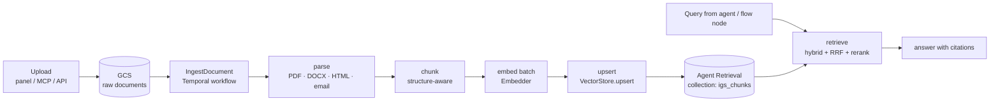

# RAG architecture

Status: design, verified against Google Cloud docs on 2026-10-22. Owner: `services/worker` (ingestion) and `services/core` (retrieval).

The vector store is **Vertex AI Vector Search 2.0**, renamed **Agent Retrieval** in April 2026 (Gemini Enterprise Agent Platform). Every call to it goes through the `VectorStore` adapter (§6), so the rest of the system never imports the Google client directly.

## 1. Pipeline



### 1.1 Ingestion (Temporal workflow `IngestDocument`)

1. **Register**: write `documents` row in Cloud SQL (`tenant_id`, `doc_id`, `source`, `gcs_uri`, `sha256`, `version`). If the hash matches the current version, finish as a no-op.
2. **Parse** (activity): text plus a structure tree (headings, tables, pages). Tables are kept as Markdown so prices and dates stay intact.
3. **Chunk** (activity): split along the structure (heading → paragraph), target ~400 tokens with ~15% overlap, never splitting a table row. Each chunk carries `heading_path` (e.g. `Contract > Cancellation > Fees`) and `page`.
4. **Embed** (activity, fan-out): batches of up to 64 chunks per call to the `Embedder` (§4). Activities are idempotent: the chunk ID is a content hash, so a retry re-sends the same objects.
5. **Upsert** (activity): `batchCreate`/`batchUpdate` in groups of ≤1000 objects (the service limit; batches are atomic). For bulk loads (>50k chunks), write JSONL to GCS and use the collection **import** job, which sends invalid records to an error URI instead of failing the whole run.
6. **Retire old version**: delete the chunks of the previous `version` of that `doc_id` only after the new ones are written, so readers never see an empty document.
7. **Record**: `ingest_runs` row with counts, durations and errors (shown in the panel).

The workflow is resumable: a crash between steps replays from Temporal history, and every write is keyed by a deterministic ID.

### 1.2 Retrieval (`services/core`)

1. Build the filter from the caller's context: **always** `tenant_id`, plus optional `source`, `country`, `city`, `doc_type`, `valid_on`.
2. Run **one** `batch_search_data_objects` call with:
   - `semantic_search` or `vector_search` on `dense` (top 50),
   - `text_search` (built-in full text, top 50) on `text` and `title`,
   - optional `vector_search` on `sparse` when the embedder produces sparse vectors (BGE-M3),
   - `combine.ranker.rrf` (weights default `1.0` each) → optional `vertex_ranker` (`semantic-ranker-default-004`, `top_n` 50, `top_k` 8).
3. If reranking fails, the service returns RRF results with a warning in `search_response_metadata.warnings`. We log the warning and mark the response as `reranked=false` in the trace.
4. Return `Hit` objects with `doc_id`, `chunk_id`, `title`, `heading_path`, `page`, `gcs_uri`, `score`. The agent gets citations as `[n]` markers mapped to these hits, and the UI links each one to the source page.

### 1.3 Reranking: built-in vs. self-hosted

Two candidates, chosen by retrieval evals (§7):

| | Vertex built-in (`semantic-ranker-*`) | Self-hosted `Qwen3-Reranker-0.6B` (Cloud Run GPU) |
|---|---|---|
| Latency | Same RPC as the search | Extra hop |
| Cost | 80,000 ranking units free per project per 30 days, then Ranking API pricing | GPU time (scale to zero) |
| Requirement | **Discovery Engine API enabled**, otherwise the whole search RPC fails with `FAILED_PRECONDITION` | None on Google's side |

## 2. Collection schema (`igs_chunks`)

One collection for all tenants. Isolation comes from a mandatory `tenant_id` filter applied in the adapter, not by the caller. If a tenant ever needs physical isolation, the adapter can route that tenant to its own collection without API changes.

```python
data_schema = {
    "type": "object",
    "properties": {
        "tenant_id": {"type": "string"},  # filter — mandatory on every query
        "doc_id": {"type": "string"},  # filter
        "doc_version": {"type": "number"},  # filter
        "source": {"type": "string"},  # filter: contract | policy | guide | trip_report | opponent
        "doc_type": {"type": "string"},  # filter: pdf | docx | html | email
        "country": {"type": "string"},  # filter
        "city": {"type": "string"},  # filter
        "valid_from": {"type": "number"},  # filter, unix days (numeric ranges only on numbers)
        "valid_until": {"type": "number"},  # filter, unix days
        "title": {"type": "string"},  # store + text search
        "heading_path": {"type": "string"},  # store
        "page": {"type": "number"},  # store
        "text": {"type": "string"},  # text search + rerank content
        "gcs_uri": {"type": "string"},  # store
    },
}
vector_schema = {
    "dense": {"dense_vector": {"dimensions": DIMS}},  # set by the chosen Embedder
    "sparse": {"sparse_vector": {}},  # only if the Embedder emits sparse vectors
}
```

**Important constraints:**
- Each data object ID is 1-63 characters, so `chunk_id = "c" + sha256(tenant_id|doc_id|doc_version|ordinal|text)[:40]`.
- **Filter fields and store fields are fixed when the index is created**, and so is the distance metric. Adding a filterable field later means building a new index. That is why the filter fields above are defined up front.
- Filters support `$eq $ne $gt $gte $lt $lte $in $nin $and $or $all`, nested **at most two levels deep**. The adapter builds `{"$and": [tenant clause, {...user clauses...}]}` and rejects deeper input.
- `$in`/`$nin` work on strings only; dates are stored as numbers (unix days) so `$gte`/`$lte` work on them.
- Use `COSINE_DISTANCE` on the dense index (performance-optimized mode). It normalizes vectors itself, so we don't set feature normalization.

### Index

- ANN index on `dense`: `PERFORMANCE_OPTIMIZED`, `COSINE_DISTANCE`, filter fields `tenant_id, doc_id, doc_version, source, doc_type, country, city, valid_from, valid_until`, store fields `title, heading_path, page, gcs_uri`.
- Autoscaling replicas: min 1 in demo (the default is 2), max sized by load.
- Below ~100k objects, KNN (no index) works; **KNN queries only work on collections with ≤100,000 data objects**. The demo can start on KNN and add the index before load tests.

## 3. Hybrid search

- **Keyword side**: the built-in full-text search (`text_search`) needs no sparse vectors. Its default dialect ANDs the terms; `enhanced_query: true` adds stemming, stop words and `OR`/`"`/`-`.
- **Optional sparse side**: if BGE-M3 wins the evals, its sparse output is stored in `sparse` and added as a third search.
- **Fusion**: Reciprocal Rank Fusion, done server-side in `batch_search_data_objects`; with reranking, `combine.ranker.rrf.weights` is required.
- Tuning: `target_recall` (0-1) on the ANN index hint once the collection has more than 100k embeddings.

## 4. Embeddings

`Embedder` is an interface (§6). The candidates are compared in §7 before one is chosen.

| Candidate | Where | Dims | Notes |
|---|---|---|---|
| `Qwen3-Embedding-0.6B` | Self-hosted, Cloud Run GPU (vLLM) | up to 1024 (Matryoshka) | Apache 2.0, strong multilingual |
| `BGE-M3` | Self-hosted, Cloud Run GPU | 1024 + sparse | MIT, dense + sparse from one model |
| `gemini-embedding-001` | **Auto-embedding inside Agent Retrieval** or the Vertex API | up to 3072 | Multilingual, 2,048-token input; nothing to host. During Preview of auto-embeddings, the embedding calls are billed |
| `text-embedding-3-large` | OpenAI API | 3072 (reducible) | Hosted baseline, personal key |

When Agent Retrieval generates the embeddings (`vertex_embedding_config` with `model_id`, `text_template`, `task_type`), the dense vector is left out of the upsert and queries use `semantic_search` with `task_type: RETRIEVAL_QUERY`. Query/document task types matter for Gemini embeddings: `RETRIEVAL_DOCUMENT` at index time, `RETRIEVAL_QUERY` (or `QUESTION_ANSWERING`) at query time.

## 5. Scale and cost levers

- Ingestion scales with Temporal workers (Cloud Run) and the GPU service (scale to zero, max instances by quota). Writes go out in batches of 1000; bulk loads use GCS import.
- Search scales through the index replicas (1-1000, autoscaling).
- Rate limits are per project, per region and per collection. Throttled calls return 429 / `RESOURCE_EXHAUSTED`. The adapter retries with exponential backoff (1 s → 32 s, with jitter). Alert at 80% of quota; increases up to 2x are usually approved automatically.
- **Idle cost**: a deployed ANN index keeps at least one replica running. The docs do not publish unit rates for the usage-based model; estimate with the Agent Retrieval pricing calculator before deploying, and set a budget alert on the project.

## 6. Adapter interfaces

```python
# packages/py-common/igs_common/rag/ports.py
from dataclasses import dataclass, field
from typing import Literal, Protocol, Sequence

Filter = dict  # Agent Retrieval filter syntax, at most two levels deep


@dataclass(frozen=True)
class SparseVector:
    indices: Sequence[int]
    values: Sequence[float]


@dataclass(frozen=True)
class Chunk:
    chunk_id: str  # ≤63 chars, content-hash based
    tenant_id: str
    doc_id: str
    doc_version: int
    source: str
    doc_type: str
    title: str
    heading_path: str
    page: int | None
    text: str
    gcs_uri: str
    country: str | None = None
    city: str | None = None
    valid_from: int | None = None  # unix days
    valid_until: int | None = None
    dense: Sequence[float] | None = None  # None when the store auto-embeds
    sparse: SparseVector | None = None


@dataclass(frozen=True)
class Hit:
    chunk: Chunk
    score: float
    rank: int


@dataclass(frozen=True)
class SearchRequest:
    tenant_id: str
    query: str
    query_dense: Sequence[float] | None = None
    query_sparse: SparseVector | None = None
    filter: Filter = field(default_factory=dict)
    top_k: int = 8
    candidates: int = 50  # per sub-search before fusion
    rerank: bool = True


@dataclass(frozen=True)
class SearchResult:
    hits: list[Hit]
    reranked: bool
    warnings: list[str]


class Embedder(Protocol):
    name: str
    dims: int
    sparse: bool

    async def embed_documents(
        self, texts: Sequence[str]
    ) -> list[tuple[list[float], SparseVector | None]]: ...
    async def embed_query(self, text: str) -> tuple[list[float], SparseVector | None]: ...


class VectorStore(Protocol):
    async def upsert(self, chunks: Sequence[Chunk]) -> None: ...
    async def delete_where(self, tenant_id: str, filter: Filter) -> int: ...
    async def search(self, req: SearchRequest) -> SearchResult: ...
```

### Implementations

| Class | Use |
|---|---|
| `AgentRetrievalStore` | Production. `google-cloud-vectorsearch` (`from google.cloud import vectorsearch_v1`: `VectorSearchServiceClient`, `DataObjectServiceClient`, `DataObjectSearchServiceClient`). Pins the client version; maps `SearchRequest` to `batch_search_data_objects`; always injects the `tenant_id` clause. |
| `InMemoryStore` | Unit tests and evals. Brute-force cosine plus a simple BM25 over `text`/`title`, fused with RRF (k = 60), same filter evaluator (the same operators and the two-level limit) so filter bugs surface in tests. No network. |
| `PgVectorStore` (fallback, not built unless needed) | Cloud SQL Postgres + pgvector HNSW + `tsvector`, RRF in SQL. See §8. |

The contract tests in `packages/py-common/tests/rag/test_store_contract.py` run against `InMemoryStore` always, and against `AgentRetrievalStore` when `IGS_RAG_LIVE=1` (a throwaway collection per run, deleted at the end).

```python
# InMemoryStore fusion (sketch)
def rrf(rankings: list[list[str]], k: int = 60) -> dict[str, float]:
    scores: dict[str, float] = {}
    for ranking in rankings:
        for rank, chunk_id in enumerate(ranking, start=1):
            scores[chunk_id] = scores.get(chunk_id, 0.0) + 1.0 / (k + rank)
    return scores
```

## 7. Retrieval evals

- **Golden set**: `evals/rag/golden.jsonl`, 80-120 questions written against the demo corpus (English and Spanish, one-hop and multi-hop, filter-dependent questions such as "cancellation fee in the Rio hotel contract"). Each item lists the relevant `doc_id`/`chunk_id`s and a reference answer.
- **Metrics**: recall@5, recall@10, MRR, nDCG@10 for retrieval; groundedness and answer correctness (LLM judge) for generation; p50/p95 latency and cost per 1k queries.
- **Matrix**: {Qwen3-0.6B, BGE-M3, gemini-embedding-001 (auto), OpenAI 3-large} × {no rerank, Vertex ranker, Qwen3 reranker} × {dense only, hybrid}. The results table goes into the README; the winner becomes the default `Embedder`.
- **CI**: runs on `InMemoryStore` with cached embeddings (deterministic, no cloud). A nightly job runs against the real collection.

## 8. Fallback options (if a blocker appears)

| Option | When it fits | Trade-off |
|---|---|---|
| **Cloud SQL Postgres + pgvector** (HNSW, `tsvector`, RRF in SQL) | Up to tens of millions of chunks; we already run Cloud SQL for operational data | Cheapest, one database, transactional with ops data. We tune HNSW and filtered search ourselves; scaling is vertical plus read replicas |
| **AlloyDB + ScaNN index** | Tens of millions to billions, heavy filtered search | Postgres-compatible, so it's the same adapter as pgvector. Higher idle cost (always-on primary instance) |
| Agent Retrieval (chosen) | Managed scale, built-in hybrid + rerank + auto-embeddings | The Python client is still Beta (§9); unit prices aren't published in the docs |

Moving between them only means another `VectorStore` implementation plus a re-ingest from GCS; the documents in GCS are the source of truth.

## 9. Verified facts (2026-10-22)

| Fact | Source |
|---|---|
| Vector Search 2.0 became **GA on 2026-03-05**, with collections, auto-embeddings, hybrid search and built-in semantic reranking in one query, plus PSC / Private Google Access / VPC-SC | [Vertex AI release notes](https://docs.cloud.google.com/vertex-ai/docs/core-release-notes) |
| Renamed to **Agent Retrieval** on 2026-04-22 (Gemini Enterprise Agent Platform) | [Agent Platform release notes](https://docs.cloud.google.com/gemini-enterprise-agent-platform/release-notes) |
| VPC-SC support was in preview on 2026-02-17 | [VPC-SC release notes](https://docs.cloud.google.com/vpc-service-controls/docs/release-notes) |
| Collections hold JSON data objects. `data_schema` is JSON Schema draft-07 with no `additionalProperties`; `vector_schema` declares `dense_vector{dimensions}` and `sparse_vector{}` fields | [Collections](https://docs.cloud.google.com/gemini-enterprise-agent-platform/build/vector-search-2/collections/collections) |
| Auto-embedding models: `gemini-embedding-001` (3072 dims, 2048 tokens, multilingual), `gemini-embedding-2` / `-2-preview` (multimodal, 8192 tokens), `text-embedding-004/005` (English), `text-multilingual-embedding-002` | [Autogenerated embeddings](https://docs.cloud.google.com/gemini-enterprise-agent-platform/build/vector-search-2/embeddings/autogenerating-embeddings) |
| During Preview, auto-embedding calls are billed as embedding service calls | [Collections](https://docs.cloud.google.com/gemini-enterprise-agent-platform/build/vector-search-2/collections/collections) |
| Search modes: vector, text (full text, no sparse needed), semantic (auto-embedded fields only), advanced text (**Preview**). Hybrid = `batch_search_data_objects` + `ReciprocalRankFusion` | [Search](https://docs.cloud.google.com/gemini-enterprise-agent-platform/build/vector-search-2/query-search/search) |
| Reranker models: `semantic-ranker-fast@latest`, `semantic-ranker-default@latest`, `-fast-004`, `-default-004`. RRF must be the primary ranker. `top_n` ranges 1-1000 and `top_k` ≤ `top_n`. 80k ranking units free per 30 days. Requires the Discovery Engine API, otherwise `FAILED_PRECONDITION`; other ranking failures fall back to RRF with a warning | [Reranking](https://docs.cloud.google.com/gemini-enterprise-agent-platform/build/vector-search-2/query-search/reranking) |
| Filter operators `$eq $ne $gt $gte $lt $lte $in $nin $and $or $all` (`$search` only in the `us` multiregion); at most 2 nesting levels; KNN only on ≤100k objects | [Query](https://docs.cloud.google.com/gemini-enterprise-agent-platform/build/vector-search-2/query-search/query) |
| Data objects: IDs of 1-63 chars; dense `{"dense":{"values":[]}}`, sparse `{"sparse":{"indices":[],"values":[]}}`; batch create/update up to 1000, atomic; GCS import (JSONL/AVRO) with an error sink; export to GCS in the same region | [Data objects](https://docs.cloud.google.com/gemini-enterprise-agent-platform/build/vector-search-2/data-objects/data-objects) |
| Indexes: one vector field each; `PERFORMANCE_OPTIMIZED` (default) or `STORAGE_OPTIMIZED` (dense only); `DOT_PRODUCT` (default) or `COSINE_DISTANCE` (performance mode only); filter/store fields and metric are immutable; replicas 1-1000, min defaults to 2 | [Indexes](https://docs.cloud.google.com/gemini-enterprise-agent-platform/build/vector-search-2/indexes/indexes) |
| Quotas: rate limits per project/region/collection, plus allocation quotas for collections/indexes/concurrent operations; 429 `RATE_LIMIT_EXCEEDED`; back off 1-32 s; increases up to 2x usually auto-approved. Numbers only in the console | [Quotas](https://docs.cloud.google.com/gemini-enterprise-agent-platform/build/vector-search-2/quotas) |
| Regions: asia-east1, asia-northeast1, asia-southeast1, europe-north1, europe-west2, europe-west4, **us-central1**, us-east4, us-west1. **No South America region** | [Overview](https://docs.cloud.google.com/gemini-enterprise-agent-platform/build/vector-search-2/overview) |
| Pricing: usage-based (smaller workloads) or resource-based (tuned performance); covers VMs for deployed indexes plus index build/update. No unit rates in the docs; use the calculator | [Overview](https://docs.cloud.google.com/gemini-enterprise-agent-platform/build/vector-search-2/overview) |
| Python client `google-cloud-vectorsearch` **0.11.5**, PyPI classifier **"Development Status :: 4 - Beta"** | [PyPI](https://pypi.org/project/google-cloud-vectorsearch/) |
| IAM roles: `roles/vectorsearch.admin`, `.collectionWriter`, `.dataObjectWriter`, `.indexWriter`, `.viewer`, `.serviceAgent` | `gcloud iam roles list` |
| Project **`mv-cloud-509914`** (display name "mv-cloud"): billing enabled; the owner account is `roles/owner`. `aiplatform`, `run`, `sqladmin`, `secretmanager`, `storage`, `pubsub`, `iap`, `cloudtrace` are enabled. **Not enabled: `vectorsearch`, `discoveryengine`, `container` (GKE)** | `gcloud` (read-only) |
