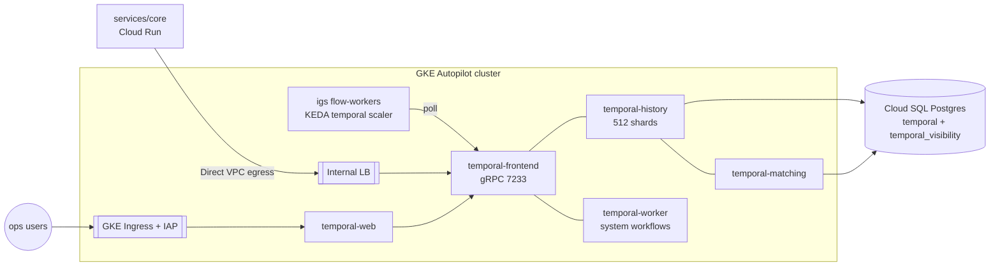
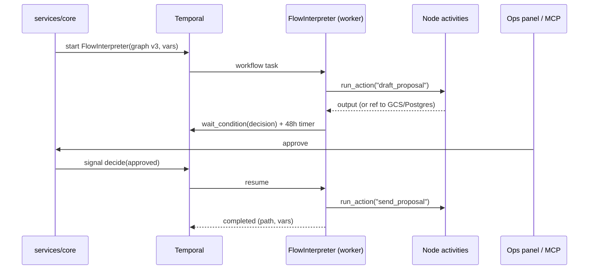

# Temporal — self-hosted on GCP

Status: **validated with a local spike** (`spikes/temporal/`, 4/4 tests green on `temporalio` 1.34 / Python 3.13). Research as of 2026-10-22; items marked *(verify)* come from secondary sources.

## 1. Why Temporal

Flows (Voiceflow-style conversations and n8n-style automations) and RAG ingestion are long-running, multi-step and must survive crashes and deploys. Temporal gives us durable timers ("30 days before departure"), human-in-the-loop waits (approvals), per-step retries and an exact execution history we can show in the execution viewer. Workers are stateless and scale on task-queue backlog.

## 2. Target deployment



| Piece | Decision |
|---|---|
| Install | Official **Helm chart 1.x** (1.0.0 released 2026-04-21, declared stable). It installs only server, Web UI and admin tools; the database is ours. Persistence lives under `server.config.persistence.datastores`. |
| Persistence | **Cloud SQL for PostgreSQL** (16/17), databases `temporal` and `temporal_visibility`. Advanced visibility on Postgres 12+ (supported since server 1.20) → **no Elasticsearch**. |
| SQL plugin | `postgres12_pgx` for plugin and driver. **`manageSchema: false`**: schema setup/upgrade runs as a pinned `temporal-sql-tool` Kubernetes Job in the deploy pipeline. Managed schema is reported to work only with the deprecated `postgres12` plugin on newer Postgres *(verify)*. |
| History shards | **512**. Fixed forever once the DB is initialized; the only fix for a wrong value is a new cluster plus multi-cluster replication. 512 is the common "small production" figure *(verify)*; the docker-compose default of 4 caps throughput permanently. |
| Network | Frontend gRPC only through an **internal** load balancer. Cloud Run (`services/core`) reaches it with Direct VPC egress. No public gRPC. mTLS + authorizer later. |
| Web UI | Behind **GKE Ingress + IAP**, allow-list by IAM. Preferred over the UI's own Google OIDC, which does not restrict *which* Google accounts can sign in. |
| Workers | **In the same GKE Autopilot cluster**, scaled by **KEDA's Temporal scaler** (task-queue backlog, scale to zero, KEDA ≥ 2.17). See §5 for why not Cloud Run. |
| Autopilot gotcha | A privileged `configure-sysctl` init container was rejected by Autopilot's policy (community report). Disable privileged init containers in values *(verify against chart 1.x)*. |
| Upgrades | One minor server version at a time: bump the image tag, run `temporal-sql-tool update-schema` Job for both DBs first, then roll pods. Keep chart and server versions pinned in Terraform. |
| Observability | Server and SDK Prometheus metrics → Managed Service for Prometheus; key alerts: `schedule_to_start_latency`, persistence latency, shard lock contention, workflow task failures. |

## 3. How the flow interpreter maps onto Temporal



- One workflow execution per flow execution; workflow ID = `flow-exec-<uuid>` (or a business key for idempotent triggers, e.g. `lead-<id>-inbound`).
- Node → activity with its own timeout/retry policy; `approval` and `capture` (wait for the next chat message) → **signal + `wait_condition(timeout=…)`**, which records a durable timer; `wait` → `workflow.sleep`.
- A query (`current_node`) lets the execution viewer show where a run is right now; per-node I/O for the viewer is written by activities to `flow_node_runs` in Postgres, not read from Temporal history.

## 4. Determinism and limits — rules for the interpreter

| Risk | Rule |
|---|---|
| Graph changes while executions are in flight | The **published graph version is workflow input**. Executions pin their version; publishing v4 never affects running v3 executions. Never load the graph from the DB inside workflow code. |
| Interpreter code changes (new node semantics, changed control flow) | Guard with `workflow.patched("<change-id>")` or roll out with **Worker Versioning** (worker deployments; the pre-2025 experimental API is being removed from the server in 2026). CI replays recorded production histories with `Replayer` before deploy — the spike's `test_history_replays_deterministically` is the template. |
| Changing a timeout from `None` to a value (or back) | Non-deterministic: it adds/removes a timer command. Treat as an interpreter change (patch). |
| History size | Defaults: warn 10,240 events / 10 MB, **terminate at 51,200 events / 50 MB**. An action node costs roughly 6–11 events. Check `workflow.info().is_continue_as_new_suggested()` each step and **continue-as-new** with the cursor + variables (implemented in the spike). Conversational flows (one execution per chat) roll over every N turns. |
| Payload size | Each argument/result: warn 512 KB, **error 2 MB**; gRPC message 4 MB. LLM transcripts, documents and big node outputs go to Postgres/GCS; workflows carry references. Add a payload codec (compression + encryption for coach PII) with a Codec Server for the Web UI. |
| Fan-out (map/loop nodes, ingestion of many files) | Max **2,000 pending activities/child workflows/signals** per execution (≤ 500 recommended). Batch, or use child workflows per item/chunk group. |
| Signals racing | First decision wins; later signals are ignored (spike test `test_rejected_ends_without_sending`). |
| Side effects | Only in activities; activities are idempotent by `(execution_id, node_id, attempt-agnostic key)`. |

## 5. Plan changes recommended

1. **Run flow workers on GKE Autopilot with KEDA, not Cloud Run services.** Cloud Run services scale on HTTP requests/CPU, which are the wrong signals for long-polling workers; Cloud Run worker pools target pull workloads but were still pre-GA as of April 2026 *(verify)* and the managed Temporal↔Cloud Run worker integration is a Temporal Cloud feature. `services/core` (HTTP API + MCP) stays on Cloud Run.
2. **Temporal DBs**: start with `temporal` + `temporal_visibility` as databases on one small Cloud SQL instance *separate from the app DB*, so Temporal load can't starve the product DB.
3. **Schema as a pipeline step** (`manageSchema: false`, `temporal-sql-tool` Job), not Helm hooks.
4. **Replay tests in CI** become an exit criterion of phase 4 (flow engine).
5. **Payload codec + external storage** for node outputs from day one (the execution viewer reads Postgres anyway).

## 6. Idle footprint

- GKE Autopilot cluster (one cluster per billing account is covered by the free-tier credit).
- Temporal pods: frontend, history, matching, worker, web — 1 replica each, ≈ 2 vCPU / 4 GiB total.
- Flow workers: KEDA scales them to zero when idle.
- Cloud SQL for Temporal: 1 vCPU / 3.75 GB, 20 GB SSD, zonal.
- Load balancers: an internal LB for the Temporal frontend.

Temporal Cloud would remove the cluster, DB and upgrades from our plate for a usage-based fee; we chose self-hosting deliberately to own the stack. Revisit if operating it costs more time than it teaches.

## 7. Local development

`temporal server start-dev` (Temporal CLI, `brew install temporal`) or the time-skipping test environment for tests (`WorkflowEnvironment.start_time_skipping()`, downloads the test server automatically). The spike runs entirely on the latter:

```bash
cd spikes/temporal && uv run pytest -q   # 4 passed
```

## Sources

- [Temporal Helm Charts 1.0.0 announcement](https://temporal.io/blog/an-important-milestone-for-temporals-helm-charts)
- [Visibility store — PostgreSQL](https://docs.temporal.io/self-hosted-guide/visibility/postgresql)
- [Self-hosted defaults and limits](https://docs.temporal.io/self-hosted-guide/defaults)
- [Temporal Server — history shards](https://docs.temporal.io/temporal-service/temporal-server)
- [Bitovi — architecture and essential metrics (512 shards)](https://bitovi.com/blog/intro-to-temporal-architecture-and-essential-metrics)
- [Community — changing numHistoryShards](https://community.temporal.io/t/can-i-increase-numhistoryshards-in-cluster/18742)
- [Community — managed schema on PostgreSQL 13+](https://community.temporal.io/t/schema-auto-management-support-for-postgresql-13-in-self-hosted-temporal/19566)
- [Community — GKE Autopilot deployment issue](https://community.temporal.io/t/issues-deploying-temporal-on-google-kubernetes-engine-autopilot-mode/8490)
- [Continue-As-New (Python)](https://docs.temporal.io/develop/python/workflows/continue-as-new)
- [Versioning (Python)](https://docs.temporal.io/develop/python/workflows/versioning.md)
- [KEDA Temporal scaler](https://keda.sh/docs/2.21/scalers/temporal/) · [Temporal blog — KEDA autoscaling](https://temporal.io/blog/announcing-keda-based-auto-scaling-for-temporal-workers)
- [Cloud Run worker pools](https://cloud.google.com/blog/products/serverless/exploring-cloud-run-worker-pools-and-kafka-autoscaler)
- [Web UI configuration (OIDC)](https://docs.temporal.io/references/web-ui-configuration)
- GKE pricing: [usage.ai](https://www.usage.ai/blogs/gcp/kubernetes/), [nOps](https://www.nops.io/blog/gke-cost-optimization/)
