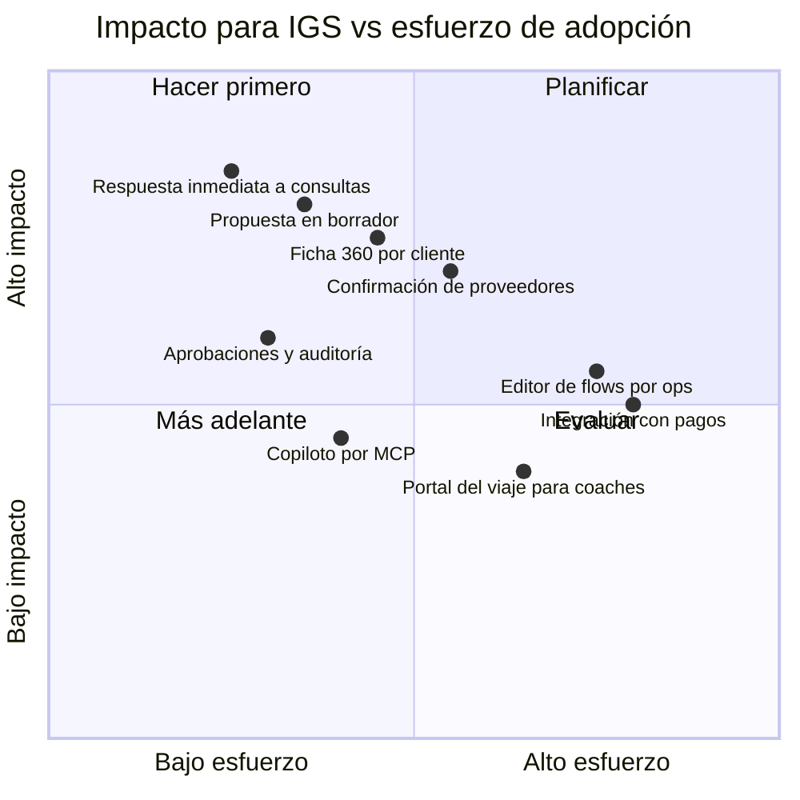

# FODA — qué resolvería IGS OS para Infinity Global Sports

> Fuente: sitio público de infinityglobalsports.com (relevado 2026-10-22) y el análisis de valor del proyecto. **Todo lo que describe la operación interna de IGS es una hipótesis inferida** desde afuera: hay que validarla con el equipo de IGS antes de presentarla como diagnóstico.

## Lo que sabemos (hechos públicos)

- **Negocio:** giras y campamentos deportivos de 10 a 14 días (fútbol principalmente; también rugby, hockey, vóley, básquet) en Argentina (Buenos Aires, La Plata, Rosario), Brasil (Río), Costa Rica y España.
- **Producto:** partidos contra rivales del mismo nivel y edad, entrenamiento con cuerpo técnico AFA, informes de scouting y análisis post-partido, estadios (Bombonera, Monumental, Maracanã), cultura (asado, tours, talleres).
- **Clientes:** programas universitarios, academias y clubes de EE.UU. y Canadá (testimonios públicos de varias universidades y academias).
- **Socios:** AFA y clubes de primera (Boca, River, Estudiantes, Newell's, Racing).
- **Nueva línea:** experiencias familiares alrededor de la Selección femenina de EE.UU. en el **Mundial Femenino 2027 en Brasil** ("Follow Team USA in Brazil").
- **Oficinas:** Nueva York, Denver y Buenos Aires. Contacto vía "Plan Your Team's Tour" / "Contact Us", sin chat ni WhatsApp visibles.

---

## (a) FODA de la operación de IGS hoy y cómo responde IGS OS

### Fortalezas (a amplificar)

| # | Fortaleza (hipótesis) | Cómo la amplifica IGS OS | Evidencia en el repo |
|---|---|---|---|
| F1 | Acceso a rivales y clubes de primera vía AFA y partners | El catálogo de rivales con nivel y edad alimenta el armado de gira: rivales a ±1 nivel, sin partidos en días seguidos | `packages/py-common/src/igs_common/domain/planner.py`, `fixtures/catalog.yaml` |
| F2 | Producto premium y emocional ("this trip meant so much more than soccer") | Propuesta editorial con la estética del sitio, imprimible y con un camino claro a reservar | `apps/web/src/app/(public)/proposal/`, `features/coach/proposal/` |
| F3 | Equipo bilingüe con presencia en EE.UU. y Buenos Aires | Panel de ops en español, superficies del coach en inglés y el mismo dato debajo de ambas | `apps/web/src/app/(app)/` (es) · `(public)/` (en) · `docs/design/content-and-accessibility.md` |
| F4 | Servicio "llave en mano" (logística resuelta por IGS) | Timeline por día con estado de cada proveedor, alertas y confirmaciones | `features/trips/`, `api/v1/trips.py` (PATCH de ítems) |

### Debilidades (a resolver)

| # | Debilidad (hipótesis a validar) | Qué hace IGS OS | Evidencia |
|---|---|---|---|
| D1 | Consultas respondidas a mano y con demora; propuestas armadas una por una | Agente que califica la consulta y arma un borrador de propuesta; ops la aprueba antes de enviar | Flow `packages/flow-schema/examples/inbound-inquiry.json`, `api/v1/public_chat.py`, `/chat` |
| D2 | Confirmaciones con proveedores por WhatsApp o mail, con seguimiento manual | Flow que pide confirmaciones a 30 días de la salida, espera 48 h y escala lo que falta | `examples/pre-departure-check.json`, worker en `services/worker/` |
| D3 | El conocimiento (contratos, historia de cada cliente, quién decide) vive en pocas personas | Ficha 360 por cliente: estado, stakeholders, riesgos y próximos pasos, con citas a la fuente | `/ops/accounts`, `igs_common/accounts/`, `api/v1/accounts_ai.py` |
| D4 | Decisiones sin registro ni trazabilidad | Toda acción de agente o persona deja auditoría; las acciones externas pasan por aprobación con hash del contenido | `api/v1/approvals.py`, `igs_common/domain/approvals.py`, tabla `audit_log` |
| D5 | Precios y márgenes calculados en planillas | Cotización determinística (proveedores, experiencias y margen) con snapshot en la gira | `igs_common/domain/pricing.py` |

### Oportunidades (a capturar)

| # | Oportunidad | Cómo ayuda IGS OS | Evidencia |
|---|---|---|---|
| O1 | Mundial Femenino 2027: volumen nuevo de familias, no solo de equipos | Chat de consultas y propuestas que escalan sin sumar coordinadores al mismo ritmo; flows reutilizables por tipo de producto | `/chat`, `packages/flow-schema/` (flows versionados) |
| O2 | Mercado universitario de EE.UU. con calendarios predecibles (spring break, verano) | Pipeline de leads y recordatorios por fecha (`wait until`) para reactivar programas de años anteriores | `/ops/leads`, `api/v1/leads.py`, nodo `wait` |
| O3 | Recompra y referidos (testimonios muy fuertes) | La ficha 360 detecta stakeholders, compromisos y señales de referido con su fuente | `fixtures/accounts.yaml` (casos de referido), `igs_common/accounts/extraction.py` |
| O4 | Nuevos destinos y deportes (España, básquet, vóley) | Catálogo y reglas de armado parametrizables; el mismo motor sirve para cualquier destino | `igs_common/domain/planner.py`, `catalog.yaml` |

### Amenazas (a mitigar)

| # | Amenaza | Cómo mitiga IGS OS | Evidencia |
|---|---|---|---|
| A1 | Competidores que responden más rápido o más barato | Respuesta inmediata en el chat y propuesta el mismo día; la ficha 360 registra la cotización de la competencia como riesgo | Historia Lakeshore: cotización de US$2.750 en `fixtures/accounts.yaml` |
| A2 | Errores logísticos durante la gira (árbitro sin confirmar, transporte) | Cola "Hoy" con alertas; incidentes y estados por ítem | `/ops` (Hoy), tabla `incidents` |
| A3 | Datos sensibles de menores (equipos U13–U19, fichas médicas) | Los datos de jugadores nunca pasan por el LLM ni se embeben; RLS por cliente; plan de retención | `docs/architecture/security.md` §3.7, migraciones con RLS |
| A4 | Dependencia de personas clave en temporada alta | Conocimiento institucional en la ficha 360 y en el RAG; flows que corren solos | `igs_common/rag/`, `services/worker/` |

---

## (b) FODA de IGS OS como solución para IGS (honesto)

| Fortalezas | Debilidades |
|---|---|
| Construido para su negocio: giras, rivales por nivel, proveedores, propuestas | **Datos de demo:** nada se probó con datos reales de IGS |
| Humano en control: la IA propone, ops aprueba; auditoría completa | Ninguna integración todavía con sus herramientas actuales (mail, CRM, planillas, pagos) |
| Calidad medida: 856 tests de Python, e2e con accesibilidad, evals de recuperación (BGE-M3: recall@5 0,82, MRR 0,73) | **Temporal autogestionado** exige operación: upgrades, migraciones de esquema, certificados |
| Escala horizontal: workers por cola con KEDA, Postgres con RLS, vectores en pgvector o Vertex | El editor de flows todavía le habla a un perfil técnico; falta el "describí la automatización" en español |

| Oportunidades | Amenazas |
|---|---|
| Ser el sistema operativo del equipo para el Mundial 2027 | **Costo y riesgo del LLM:** alucinaciones, prompt injection y costo por conversación (mitigado con citas obligatorias, tools por nivel de riesgo y modelo por rol) |
| Copiloto por MCP desde Claude: ops trabaja desde donde ya está | **Adopción:** cambiar planillas y WhatsApp por un sistema nuevo requiere acompañamiento y migración gradual |
| Producto replicable a otros operadores de giras y eventos | Cumplimiento con datos de menores (COPPA, LGPD, Ley 25.326) a revisar con un abogado antes de usar datos reales |
| Datos propios para mejorar precios y conversión con el tiempo | Costo fijo de la infraestructura sin volumen al inicio |

---

## (c) Hipótesis de impacto cuantificado (rangos, no promesas)

| Métrica | Hoy (supuesto) | Con IGS OS (rango) | Supuestos explícitos |
|---|---|---|---|
| Tiempo de primera respuesta a una consulta | 4–48 h | < 5 min (agente) · propuesta aprobada en 4–24 h | El agente califica 24/7; ops aprueba en horario laboral. Sin medir la línea base real |
| Tiempo para armar una propuesta | 2–6 h por propuesta | 20–45 min (revisión de un borrador) | Catálogo cargado y reglas de armado ajustadas a cómo trabajan hoy |
| Propuestas por coordinador por semana | 5–10 | 15–30 | El cuello de botella pasa de armar a revisar y negociar |
| Seguimientos de confirmación con proveedores | 100% manuales | 60–80% automatizados | Los proveedores responden por un canal integrable (mail o WhatsApp Business) |
| Incidentes logísticos por gira | Desconocido | −30 a −50% | Alertas a 30 días, 48 h y el día anterior; requiere la línea base de incidentes |
| Tasa de conversión consulta → seña | Desconocida | +10 a +25% relativo | Respuesta inmediata y propuesta el mismo día; varía según temporada y competencia |
| Coordinadores necesarios en temporada alta (Mundial 2027) | Crece lineal con el volumen | Crece sublineal (≈0,5–0,7× por unidad de volumen) | Flows y agentes absorben el trabajo repetitivo; las excepciones siguen siendo humanas |

Todas estas cifras son **hipótesis de trabajo** para validar con una línea base real de IGS: 4 a 6 semanas midiendo antes de comparar.

---

## (d) Las 5 preguntas para validar primero con IGS

1. ¿Qué es lo que más tiempo le come hoy al equipo de operaciones: responder consultas, armar propuestas, confirmar proveedores o resolver problemas durante la gira?
2. ¿Cuántas consultas y cuántas giras manejan por temporada, y cuánto tardan hoy desde la consulta hasta la propuesta?
3. ¿Qué herramientas usan hoy (CRM, planillas, WhatsApp, mail, sistema de pagos) y cuáles no estarían dispuestos a cambiar?
4. Para el Mundial 2027, ¿cuál es el volumen esperado de familias y qué parte del proceso los preocupa más escalar?
5. ¿Qué datos de jugadores menores manejan hoy, dónde viven y quién es responsable de su cumplimiento?

---

## (e) Mapa de prioridades

**Lectura:** empezar por la respuesta inmediata y la propuesta en borrador (D1), sumar la ficha 360 y las aprobaciones, y después automatizar las confirmaciones con proveedores (D2). El editor de flows en manos de ops y la integración con pagos vienen cuando el núcleo esté adoptado.
