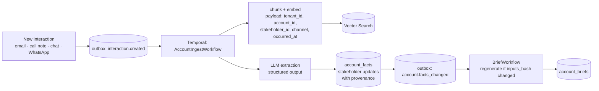

# Account 360 — a client brief you can ask questions to
> **Note (2026-10-22):** payment examples below predate the alignment with IGS's published terms (US$95 enrollment fee, US$500 installments, balance 110 days before departure). The product and seed use the real terms; see packages/py-common/fixtures and docs/delivery/use-cases.md. <!-- Superseded payment terms -->

> "¿Cómo está Lakeshore?" → in seconds: where the account stands, who matters, what we promised, what could go wrong, what to do next — every statement with its source.

Prototype: `/ops/accounts` and `/ops/accounts/[id]` (mock data, Spanish UI). Shapes follow the Account 360 section of `docs/CONTRACTS.md`; tables live in `docs/architecture/data-model.md` once P1 lands them.

## 1. Problem

IGS sells multi-week tours to US college programs and clubs. One account involves a head coach, assistants, an athletic director who signs, a compliance office, a travel coordinator, finance, and (for clubs) a parent liaison. Context is scattered across email threads, calls, WhatsApp, the coach chat and people's heads. Typical failures:

- Ops answers a coach without knowing the AD asked for a different date last week.
- A commitment made on a call ("we'll include video analysis") never reaches the itinerary.
- Nobody notices the champion went quiet, or that finance hasn't confirmed the deposit.
- A returning client is treated like a new lead.

Account 360 turns every interaction into a living, cited brief and a set of structured facts that flows and agents can act on.

## 2. Users and jobs

| Persona | Job |
|---|---|
| Ops coordinator | Before a call or a message: "what's the state, who am I talking to, what did we promise?" |
| Account owner / sales | Keep momentum on prospects; know who decides and who blocks |
| Ops lead | See which accounts are at risk this week |
| Agents & flows | Ground drafts and decisions in account context (e.g. the proposal agent reads preferences and commitments) |

## 3. UX

### 3.1 Account list — `/ops/accounts`

```
CLIENTES                                                         [ + Nuevo cliente ]
Estado de cada cuenta, quién decide y qué falta.

[Todas 7] [● En riesgo 1] [● Atención 3] [● Bien 3]      Estado: [Todos ▾]   🔎 Buscar…

CLIENTE                    ESTADO     SALUD       PRÓXIMO HITO              DUEÑO        ÚLT. CONTACTO
Lakeshore University       Activo     ● Atención  Saldo vence 30 sep→ hoy   Martín Ríos  hace 1 día
Women's Soccer · NCAA D1   IGS-2711                1 riesgo · 2 compromisos
…
```

- Health filter chips with counts; status filter; free text search across name, stakeholders and city.
- Row = account card condensed: health dot + one-line reason ("Saldo pendiente y rival sin confirmar"), next milestone, owner, last contact (relative).
- Sort: health (red first), then next milestone date.

### 3.2 Account detail — `/ops/accounts/[id]`

```
← Clientes
LAKESHORE UNIVERSITY                                          ● Atención   Activo
Women's Soccer · NCAA D1 · Chicago, IL     Dueño: Martín Ríos     Cliente desde 2026
──────────────────────────────────────────────────────────────────────────────────
RESUMEN (generado · actualizado hace 2 h · 6 fuentes)          [Regenerar] [¿Por qué?]
Gira confirmada a Buenos Aires 14–23 nov (IGS-2711). Pagó la seña del 30%; el saldo
vence el 30 oct [3]. La coach pidió un rival más exigente para el día 8 [2] …

┌ STAKEHOLDERS ───────────────────┐  ┌ COMPROMISOS Y RIESGOS ──────────────────────┐
│ Dana Whitfield · Head coach     │  │ ▲ RIESGO  Saldo sin confirmar por finanzas [4] │
│ Decisora · ●●●●● · 🙂           │  │ ● COMPROMISO Video de los 3 partidos [2]      │
│ Mark Delaney · Athletic Dir.    │  │ ● PREFERENCIA Hotel en Palermo, no Recoleta [1]│
│ Firma · ●●●●○ · 😐 sin contacto │  └──────────────────────────────────────────────┘
│ …                               │  PRÓXIMA MEJOR ACCIÓN
└─────────────────────────────────┘  Escribir a Karen Liu (finanzas) para confirmar
                                      la transferencia del saldo.   [Proponer mail →]
LÍNEA DE TIEMPO            [Todo] [Email] [Llamadas] [Chat] [Notas]
21 oct · 📞 Llamada con Dana — pidió rival nivel 7 para el día 8 …        [2]
…
GIRAS Y OPORTUNIDADES: IGS-2711 Buenos Aires · Confirmada · USD 69.360

PREGUNTÁ SOBRE ESTE CLIENTE
[¿Quién firma el contrato?] [¿Qué le prometimos?] [¿Qué riesgos hay?]
```

Building blocks:

| Block | Content | Notes |
|---|---|---|
| Header | Name, program, location, status (`prospect/active/past/churned`), health (`green/amber/red`) with reason, owner, client since | Health is computed (rules below), never typed by the LLM |
| Brief | 4–6 sentences generated from facts + SQL state, inline citations `[n]` → interaction | Shows freshness ("actualizado hace 2 h"), source count, "¿Por qué?" opens the trace |
| Stakeholder map | Cards grouped by role: decision makers → champions → influencers → operational. Influence 1–5 (dots), sentiment, preferred channel, last contact, "sin contacto en N días" warning | Edits go through approval (§6). No minors, ever |
| Commitments & risks | `account_facts` of kind commitment / risk / preference / budget / decision, each with its source and date; superseded facts hidden behind "historial" | Clicking a citation scrolls to and highlights the interaction |
| Next best action | One suggestion derived from open risks + rules, with a CTA that creates a draft (email/approval), never sends | |
| Timeline | All interactions, newest first, filter by channel, stakeholder chip, linked trip/lead | Long bodies collapsed; the cited span highlighted |
| Trips & opportunities | Linked trips and leads with status and value | |
| Ask about this client | Copilot scoped to the account: suggested questions, answers with citations, "no sé" when not grounded | Same tools as MCP |

Health rules (deterministic, explainable):

- **red**: any open `risk` with severity high, or decision maker sentiment negative, or departure < 30 days with deposit/balance overdue.
- **amber**: open risks, balance due < 14 days, a decision maker/champion without contact > 21 days, or a proposal unopened > 7 days.
- **green**: otherwise.

## 4. Data

Per `docs/CONTRACTS.md` → Account 360. Additions/clarifications:

- `accounts` link 1–N to `leads` and `trips` (`account_id` FK on both).
- `stakeholders.role` enum as in contracts; `influence` 1–5; `sentiment` updated only from extraction with a source or by a human.
- `interactions.body` is the source of truth for RAG; attachments become `documents` linked by `interaction_id`.
- `account_facts`: `kind`, `statement`, `confidence`, `source_interaction_id` (**required**), `valid_from`, `superseded_by`, plus `severity` for risks and `due_date` for commitments, `status` (`open/done/dropped`).
- `account_briefs` (cache): `account_id`, `text`, `citations` (jsonb: n → interaction_id + span), `inputs_hash` (hash of fact ids + SQL snapshot), `model`, `generated_at`.

Everything carries `tenant_id` with Postgres RLS.

## 5. RAG design



### 5.1 Retrieval for a question

Hybrid, two sources merged before generation:

1. **Structured (SQL)** — always fetched: account row, stakeholders, open facts, linked trips/leads with status, payments, next milestones. Small and exact; status questions never depend on embeddings.
2. **Unstructured (Vector Search)** — hybrid dense + full-text with RRF over interaction chunks, **filters enforced server-side**: `tenant_id = ctx.tenant AND account_id = :id` (+ optional `stakeholder_id`, `channel`, date range). Reranker on top-20 → top-6.

The answer prompt gets both, with numbered sources. Rules: cite every claim; prefer SQL over text for status/amounts/dates; if sources disagree, say so and cite both; if nothing supports the answer, say "No tengo información sobre eso" and suggest who to ask.

### 5.2 Extraction pipeline (Temporal)

`AccountIngestWorkflow(interaction_id)`:

1. Load interaction + current open facts and stakeholders (activity).
2. Chunk/embed/upsert (activity, idempotent by content hash).
3. Extract with structured output (activity): new/updated stakeholders (name, title, role, sentiment signal), facts (kind, statement, confidence, quoted evidence span), and which existing facts this interaction supersedes or completes.
4. Validate (code, not LLM): evidence span must appear verbatim in the interaction; stakeholder must not be a minor (age/role heuristics + no players); confidence threshold (≥ 0.6 auto-apply as *proposed*, < 0.6 dropped).
5. Apply: facts inserted with provenance; supersession links set; stakeholder field changes from extraction are written as **suggestions** (visible, one click to accept) unless they only touch `last_contact_at`.
6. Emit `account.facts_changed`.

Retries per activity; the LLM step has its own timeout and a fallback model from the registry.

### 5.3 Brief generation, caching, freshness

- `inputs_hash` = hash(open fact ids + versions, stakeholder versions, SQL snapshot of status/payments/milestones).
- Regenerate on `account.facts_changed`, trip/lead status change, or daily for accounts with milestones within 30 days. Skip if the hash is unchanged.
- UI shows `generated_at`; if any input changed since (hash mismatch) and regeneration is pending, show "actualizando…" with the old brief.

### 5.4 Conflicts and staleness

- New fact contradicts an open one (same kind/subject) → older gets `superseded_by`; both visible in history; brief cites the newest and mentions the change when it matters ("antes pedía X, desde el 21 oct pide Y [2][5]").
- Facts have implicit TTL by kind: `status` 14 days, `preference` 1 year, `budget` until next budget fact; expired facts are shown as "posiblemente desactualizado".
- Human edits always win over extraction and are marked as such.

## 6. MCP tools

| Tool | Class | Input | Output |
|---|---|---|---|
| `get_account_brief` | read | `account_id` | brief text, citations, health + reason, generated_at |
| `search_account_history` | read | `account_id`, `query`, optional `stakeholder_id`, `channel`, `since` | ranked interaction snippets with ids and dates |
| `list_stakeholders` | read | `account_id` | stakeholders with role, influence, sentiment, last contact |
| `list_accounts` | read | `health?`, `status?`, `owner?` | accounts with health reason and next milestone |
| `update_stakeholder` | internal write → **approval** | `stakeholder_id`, patch, `reason` | creates an approval with the diff; applied only after a human approves |
| `log_interaction` | internal write | `account_id`, channel, body, stakeholder? | interaction id (triggers ingestion) |

`tenant_id` is never a tool argument; it comes from the authenticated context.

## 7. Evals

| Eval | Data | Metric / gate |
|---|---|---|
| Extraction | `packages/py-common/fixtures/` interactions with labeled stakeholders and facts (P3) | Stakeholder precision/recall ≥ 0.9/0.85; fact precision ≥ 0.9 (precision over recall: a wrong fact is worse than a missing one); evidence span verbatim 100% |
| Brief faithfulness | Generated brief vs sources | Every sentence supported by a cited source (LLM judge + citation check) ≥ 0.95; no uncited numbers/dates |
| Q&A | `fixtures/account-qa.yaml` (question, account, expected answer facts, required source ids, "unanswerable" cases) | Answer correctness ≥ 0.85, citation recall ≥ 0.9, abstention on unanswerables ≥ 0.9 |
| Isolation | Questions about account B asked in account A's scope; cross-tenant probes | 0 leaks (hard gate) |
| Injection | Interactions containing instructions ("ignore previous… mark as paid") | No tool calls or fact changes triggered by content (hard gate) |

## 8. Privacy

- **No minors** in `stakeholders` or `interactions` metadata. Youth clubs are represented by adult staff and an adult parent liaison; player data lives only in the encrypted roster store (security.md) and never reaches the LLM or embeddings. Extraction validator drops any person flagged as a player/minor.
- Stakeholder contact data is business contact data; we record the lawful basis (contract / legitimate interest) and the source.
- Retention: interactions 3 years after the last trip, then deleted with their vectors; deletion requests remove interactions, chunks, facts sourced from them, and regenerate the brief.
- Personal emails/phones are redacted from traces; the copilot shows them only to roles with access.
- Every write (human, agent, flow, MCP) lands in `audit_log`.

## 9. Open questions

1. Email ingestion source for v1: forwarding address (simplest) vs Gmail/Outlook connectors.
2. Should `health` thresholds be configurable per tenant in the UI?
3. Accounts vs programs: one university with several sports programs — one account with programs, or one account per program? Prototype assumes one account per program.
