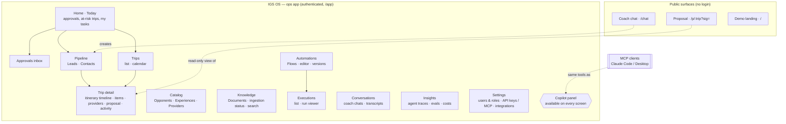
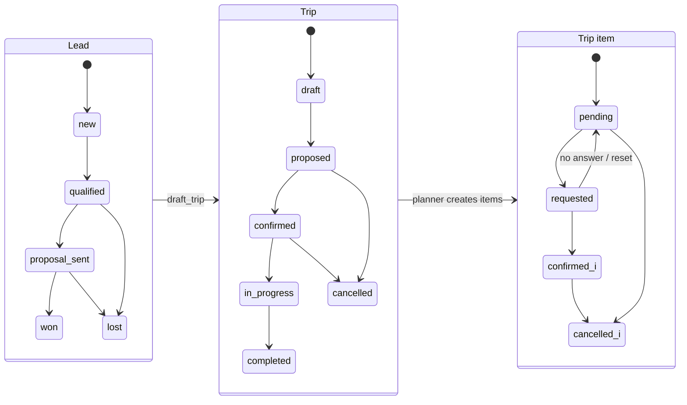
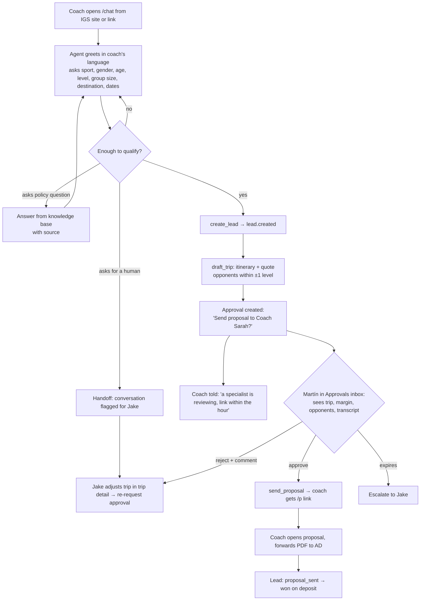
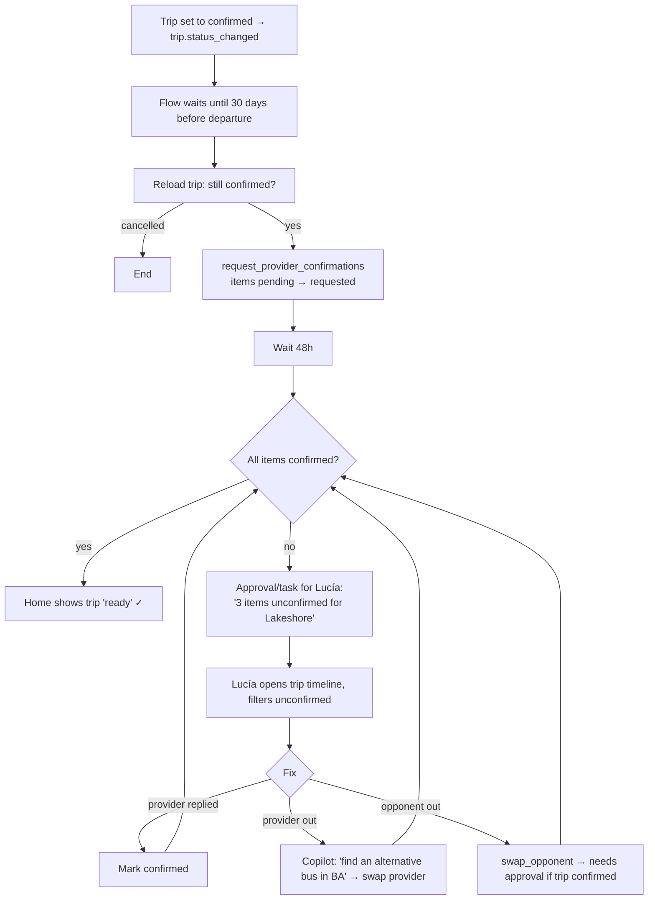
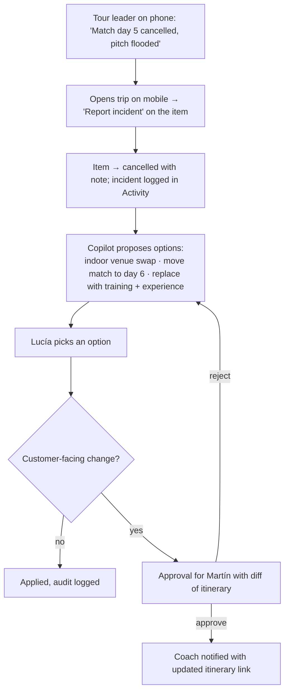
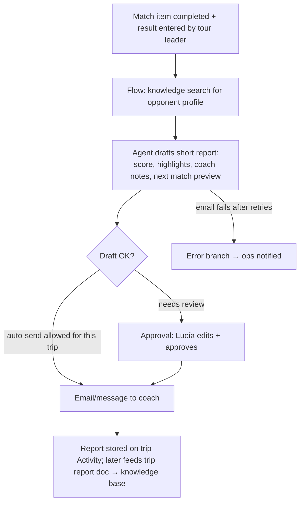

# UX foundations — IGS OS

Who uses IGS OS, what they are trying to get done, how the product is organized, and the principles every screen follows. Inputs: [PLAN.md](../PLAN.md), [flow-engine.md](../architecture/flow-engine.md), [core-api.md](../architecture/core-api.md), [data-model.md](../architecture/data-model.md), [brand-reference.md](brand-reference.md).

> Personas and pains are **inferred** from Infinity Global Sports' public site and the shape of the tour-operator business (US college/club programs traveling to Argentina, Brazil, Costa Rica, Spain; offices in New York, Denver and Buenos Aires). They are hypotheses to validate with the IGS team, not research findings.

## 1. Personas

| Persona | Where / language | Role in the business | Device | Tech comfort |
|---|---|---|---|---|
| **Lucía — Ops coordinator** | Buenos Aires · Spanish (reads English) | Turns a sold trip into a running trip: books hotels, buses, referees, opponents; chases confirmations; handles on-tour changes | Desktop all day; phone on tour | High with WhatsApp/Sheets, medium with "systems" |
| **Martín — Ops lead / approver** | Buenos Aires · Spanish | Owns quality and margin of every trip; signs off proposals, opponent changes, cancellations, refunds | Desktop + phone (approvals on the go) | High |
| **Jake — Sales rep** | New York / Denver · English | Talks to coaches and athletic directors; qualifies, quotes, closes; owns the relationship | Laptop, CRM-like habits | High |
| **Coach Sarah — US college coach** | US · English | Buyer and trip leader for a D1/D2/D3 or club team; needs a competitive, safe, affordable tour her AD will approve | Phone first, then laptop to forward the proposal | Medium; zero patience for logins |
| **Director Mike — Club director / AD** | US · English | Approves budget and risk; cares about safety, insurance, what's included, deposit/cancellation terms | Desktop, PDF/email | Medium |
| **Founder / exec** | NY / BA · English & Spanish | Growth, margin, brand; wants to see the pipeline, upcoming departures and where ops is stuck | Phone + laptop, glances | High; judges the product in two minutes |

## 2. Jobs-to-be-done and top tasks

| Persona | Job (when … I want to … so I can …) | Top tasks in IGS OS |
|---|---|---|
| Lucía | When a trip is confirmed, I want every provider booked and confirmed without chasing ten WhatsApp threads, so the team lands with nothing left open | See unconfirmed items by departure date · request confirmations in bulk · mark items confirmed · swap an opponent · ask the copilot "what's still open for Lakeshore?" · handle an on-tour incident |
| Martín | When the system or a colleague wants to commit IGS to something, I want to decide fast with the full context, so quality and margin are protected without being a bottleneck | Work the **approvals inbox** · review a proposal diff and margin · approve/reject with a comment · see why an agent proposed something · audit who changed what |
| Jake | When a coach writes in, I want a qualified lead and a credible proposal the same day, so I win the trip before a competitor answers | See new leads with what the agent already captured · review/adjust the drafted trip · send the proposal · follow up |
| Coach Sarah | When I'm planning an international tour, I want a clear itinerary with real opponents at my level and an honest price, so I can sell it to my AD and players' families | Chat (no login) · answer a few questions · open a proposal link · forward it / download PDF · ask about visas, safety, deposits |
| Director Mike | When a coach asks me to approve a trip, I want to understand cost, risk and terms in one document, so I can say yes confidently | Read the proposal: price breakdown, what's included, safety, payment & cancellation policy |
| Founder / exec | When I check on the business, I want to see pipeline, departures and blockers at a glance, so I know where to push | Overview dashboard · drill into a stuck trip · watch a flow run end to end |

## 3. Current pain (inferred)

| Pain today | Where it shows up | What IGS OS does instead |
|---|---|---|
| Inquiries arrive by web form, email and WhatsApp; qualification is manual back-and-forth | Sales | Inbound-inquiry flow: agent qualifies 24/7 in the coach's language, creates the lead, drafts the trip |
| Itineraries live in spreadsheets copied from the last similar trip | Sales + ops | Deterministic planner + catalog (opponents by level, experiences, providers) produces a consistent draft and quote |
| Opponent level matching depends on one person's memory | Ops | Opponent catalog with level scores + semantic search; mismatch is visible |
| Provider confirmations are chased one WhatsApp thread at a time; nobody knows the global state | Ops | Item statuses (`pending → requested → confirmed`) per trip, pre-departure flow that requests and escalates automatically |
| Decisions (price exceptions, cancellations) happen in chats with no record | Ops lead | Approvals inbox with context, decision, comment and audit log |
| Policies and contracts are PDFs nobody finds when the coach asks | Everyone | RAG over documents with cited answers, in the copilot and in the coach chat |
| On-tour changes (rain, injury, bus no-show) are handled by phone with no trace | Ops on tour | Incident capture from phone, copilot proposes the fix, approval when it touches the customer |
| The founder learns about problems late | Exec | Overview: pipeline, departures, blocked items, failed flows |

## 4. Information architecture

Sitemap (v0):

| Area | Route | Primary persona | Notes |
|---|---|---|---|
| Landing | `/` | First-time visitor | Two-minute demo entry: "Run the inbound flow", "Open the ops app", "Connect via MCP" |
| Coach chat | `/chat` | Coach | Mobile-first, brand-faithful, English default |
| Proposal | `/p/{trip_id}?sig=` | Coach, Director | Printable/PDF, read-only, signed link |
| Home | `/app` | Lucía, Martín, founder | "Today": pending approvals, items at risk by departure, failed executions, new leads |
| Approvals | `/app/approvals` | Martín | The heart of the product (see §7) |
| Pipeline | `/app/leads`, `/app/contacts` | Jake | Leads by status; lead detail shows conversation + captured fields |
| Trips | `/app/trips`, `/app/trips/{id}` | Lucía | List + calendar by departure; detail = day-by-day timeline |
| Catalog | `/app/catalog/{opponents\|experiences\|providers}` | Lucía | Opponents with level score and sport/gender/age filters |
| Knowledge | `/app/knowledge` | Lucía, Martín | Upload docs, see ingestion state, test search |
| Automations | `/app/flows`, `/app/flows/{id}` | Martín (power users) | Flow list, canvas editor, versions, publish |
| Executions | `/app/executions`, `/app/executions/{id}` | Martín, Lucía | n8n-style run viewer, retry from node |
| Conversations | `/app/conversations/{id}` | Jake | Transcript + linked execution + lead |
| Insights | `/app/insights` | Founder, builders | Agent traces, latency, cost, eval results |
| Settings | `/app/settings` | Owner | Users & roles, API keys (MCP), integrations |

## 5. Navigation model

Two products sharing one brand:

| | Ops app (`/app`) | Coach-facing (`/chat`, `/p/...`) |
|---|---|---|
| Audience | IGS staff | Customers |
| Auth | Google sign-in (demo tenant: open, read-mostly) | None; signed links |
| Language | Spanish UI for BA ops, English toggle; data stays in source language | English (coach's language detected in chat) |
| Density | Dense tables, timelines, keyboard shortcuts | Airy, photography, one action per screen |
| Theme | Same tokens; dark mode first-class | Light cream, closest to infinityglobalsports.com |
| Layout | Left sidebar (Home, Approvals, Pipeline, Trips, Catalog, Knowledge, Automations, Executions, Insights) + top bar (search ⌘K, tenant, user) + **copilot panel** on the right, collapsible | Single column, sticky header with IGS wordmark, footer disclaimer |
| Mobile | Approvals, Home and Trip detail must work on a phone (ops on tour); editor is desktop-only | Mobile-first |

Cross-cutting navigation rules:
- **Everything links to its subject.** An approval links to its trip and execution; an execution links to its trigger subject; a trip shows the executions and approvals that touched it (Activity tab).
- **⌘K command palette** jumps to any trip/lead/flow and runs safe commands ("request confirmations for…").
- **Badge counts** only for things that need a human: pending approvals, failed executions, items at risk.

## 6. Core objects and lifecycles

| Object | What it is | Owned by | Key states | Where the user sees it |
|---|---|---|---|---|
| Contact | A coach/AD, across leads | Sales | — | Pipeline |
| Lead | One inquiry with qualification fields | Sales | new → qualified → proposal_sent → won/lost | Pipeline, lead detail |
| Trip | The tour sold/being sold | Ops | draft → proposed → confirmed → in_progress → completed / cancelled | Trips, trip detail, proposal |
| Trip item | One slot of the itinerary (match, training, experience, arrival…) linked to opponent/experience/provider | Ops | pending → requested → confirmed / cancelled | Trip timeline |
| Provider | Hotel, bus, venue, referee, guide, club | Ops | — | Catalog, item rows |
| Flow / version | An automation; drafts edited, versions immutable | Ops lead | draft → published vN | Automations |
| Execution | One run of a flow version on a subject | System | running → waiting → succeeded / failed / cancelled | Executions, trip Activity |
| Approval | A decision a flow or agent needs from a human | Ops lead | pending → approved / rejected / expired | Approvals inbox, Home, trip Activity |
| Document | Policy, contract, guide, trip report in the knowledge base | Ops | pending → ingesting → ready / failed | Knowledge |
| Agent run | One agent turn with tool steps, tokens, cost | System | — | Insights, "Why?" drawers |

Gaps the journeys need (raised in flow-engine.md §18): a `completed` state and `result` for match items (post-match report), and an incident object or item note type for on-tour issues.

## 7. Key user journeys

### 7.1 Inbound inquiry → proposal

### 7.2 Pre-departure check

### 7.3 On-tour incident

### 7.4 Post-match report

## 8. UX principles

1. **Agent-first, human-in-control.** Agents do the drafting, searching and chasing; humans make commitments. Anything that is customer-facing, costs money or is destructive goes through an approval (tool classes in [security.md](../architecture/security.md)). The UI never hides which actor did something: every record shows *agent*, *flow*, *person* or *MCP client* as its author.
2. **The approvals inbox is the heart.** It is the first nav item after Home, has a badge, works on a phone, and each card carries everything needed to decide without clicking away: what will happen (a concrete diff or payload), why (agent rationale + sources), impact (price/margin, dates, customer touched), who asked (flow + execution link), and expiry. Approve/reject is one tap; comments are optional except on reject.
3. **Every AI action is explainable.** Each agent-produced value has a "Why?" affordance opening the run: tool calls, retrieved passages with citations, model and cost. Coach-facing answers about policy cite the document.
4. **Every AI action is reversible or previewable.** Writes show a preview before commit when interactive; executed actions offer undo where the domain allows (status changes, swaps) and otherwise a compensating action. Destructive actions are never one-click.
5. **State over chat.** Chat (copilot, coach chat) is an input method; the truth lives in structured objects (trip timeline, item statuses). After any copilot action the affected object is shown, not just a text confirmation.
6. **Show what needs a human, hide the rest.** Home and badges surface only exceptions: pending approvals, unconfirmed items near departure, failed executions, new leads. Healthy automation is quiet.
7. **One vocabulary everywhere.** The same names in UI, MCP tools, flows and docs: lead, trip, item, provider, flow, execution, approval. Status chips use the same colors in every surface.
8. **Language follows the person.** Ops UI in Spanish (BA team) with English toggle; coach surfaces in the coach's language; stored content is never auto-translated in place.
9. **Coach surfaces feel like IGS, not like software.** No login, no forms where a sentence will do, brand typography and photography, a proposal they are proud to forward to their AD. Footer disclaimer that this is a demo.
10. **Fast, keyboard-friendly ops.** ⌘K palette, keyboard approve/reject (`A`/`R`), bulk actions on items, optimistic UI with server confirmation.
11. **Honest system status.** Long-running things (ingestion, flows waiting 30 days, approvals) show what they are waiting for and until when, using the execution's `state` query; no spinners without a reason.
12. **Accessible by default.** WCAG 2.2 AA contrast with the monochrome palette plus muted status colors; status is never conveyed by color alone (icon + label).

## 9. Demo implications (two-minute path)

The first-visit demo path should exercise the principles above in order: landing → **run inbound inquiry** as a coach (chat) → switch to ops app → **approval card** appears live on Home → approve → proposal link opens → **execution viewer** shows every node → copilot / MCP answers "what's unconfirmed for this trip?". No login on the demo tenant.

## 10. Open questions for IGS

1. Who approves what today (proposal send, price exceptions, cancellations)? Defines approval routing by role.
2. Is the tour leader on the ground an IGS employee using the app, or a contractor reporting by WhatsApp?
3. Do coaches book through a single contact, or do ADs and parents interact directly (parent/family packages)?
4. Which channel do coaches actually use first: web form, email or WhatsApp? Drives which trigger to polish.
5. Spanish-only ops UI acceptable for the New York/Denver team, or full bilingual from day one?
