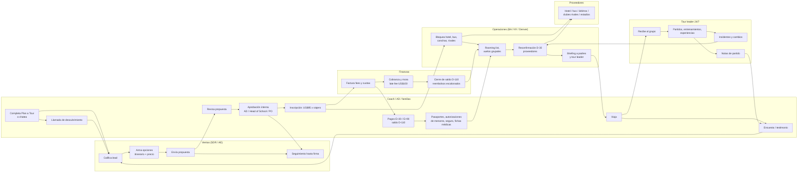

# Proceso operativo de IGS, punta a punta — y dónde entra IGS OS

> Reconstruido desde lo que IGS publica en infinityglobalsports.com (plan-a-tour, college/youth/private-school tours, family experiences, terms-and-conditions; relevado 2026-10-22, términos reflejados en `packages/py-common/fixtures/catalog.yaml`) y de cómo opera típicamente un operador de giras deportivas receptivas. Lo que es **inferencia de la industria** está marcado ⚠️ y hay que validarlo con IGS.
>
> Notación de tiempos: **E** = fecha de inscripción del viajero (pago del fee de US$95), **D** = fecha de salida. Todos los plazos de pago y cancelación salen de los T&C publicados.

## Línea de tiempo crítica de una gira (los plazos que no se pueden pasar)

| Momento | Qué vence | Fuente | Consecuencia si se pasa |
|---|---|---|---|
| Consulta + 1 día hábil | Primeras opciones de itinerario al coach | `/plan-a-tour` ("respond with sample itinerary options within 1 business day") | Promesa de marca incumplida; el coach cotiza con otro operador |
| 12–18 meses antes de D | Ventana ideal de venta para colegios | `/private-school-sports-tours` | Calendario escolar y aprobaciones internas no llegan |
| E | Fee de inscripción US$95 no reembolsable por viajero | T&C | Sin inscripción no se bloquean hotel ni rivales |
| E + 30 | Primer pago US$500 (plan manual) | T&C | Late fee US$100; mora sostenida → cancelación |
| E + 90 | Segundo pago US$500 | T&C | Ídem |
| D − 150 | Último día de reembolso total (menos US$95) | T&C | A partir de acá hay penalidad de US$300 |
| D − 110 | **Saldo final** + último día para **sustituir viajeros** (US$100 entre 149 y 110) | T&C | Viajeros con saldo impago; rooming list sin cerrar |
| D − 45 | Desde acá la cancelación cuesta 50 % del programa | T&C | Exposición financiera del cliente y de IGS |
| D − 30 | Reconfirmación de todos los proveedores | Flow `pre-departure-check` (práctica estándar ⚠️) | Lo no reconfirmado aparece el día del partido |
| D − 21 | Último día para contratar seguro | T&C | Viajeros sin cobertura médica obligatoria |
| D − 44 → D | Sin reembolso (salvo Flexible Travel Program) | T&C | — |
| D … D+n | Gira en destino, tour leader bilingüe 24/7 | `/college-soccer-tours`, `/private-school-sports-tours` | Incidentes en vivo |
| D + n + 7 ⚠️ | Encuesta, testimonio, propuesta de re-viaje | práctica estándar | Se pierde la ventana emocional para referidos/recompra |

## Swimlane del proceso

---

## Etapa por etapa

Cada etapa: dueño · entradas · artefactos · fallas típicas · plazos · **qué hace IGS OS hoy** (con ruta/flow/API reales del repo) · **gap**.

### 1. Captación del lead

- **Dueño:** marketing + SDR.
- **Entradas:** formulario `/plan-a-tour` (programa, rol, teléfono, ventana de viaje, "How did you hear about us?" con *Referral*, *Returning Customer*, *AI Assistant*), mails, ferias/showcases ⚠️, referidos.
- **Artefactos:** registro del lead en el CRM ⚠️, fuente.
- **Fallas típicas:** el formulario **no pide deporte, nivel, categoría, tamaño del grupo ni presupuesto** → hace falta una llamada solo para calificar; leads duplicados entre canales; se pierde quién refirió a quién.
- **Plazo:** el reloj de "1 business day" arranca acá.
- **IGS OS hoy:**
  - Chat público `/chat` → `POST /v1/public/chat/conversations` (`services/core/src/igs_core/api/v1/public_chat.py`) arranca el flow `inbound-inquiry` (`packages/flow-schema/examples/inbound-inquiry.json`, canales `web` y `whatsapp`).
  - El nodo agente `qualify` exige coach, email, organización, deporte, género, categoría, `levelScore`, `groupSize`, destino, fecha y duración (5–21 días).
  - Acción `create_lead` → kanban `/ops/leads` (`GET /v1/leads`, `PATCH /v1/leads/{id}`); `leads.source` modela `referral`.
- **Gap:** canales reales de entrada (el formulario actual del sitio, email, WhatsApp Business) entrando al mismo lead; dedupe por organización/contacto; captura del **decisor** (AD/Head of School) y de quién refirió.

### 2. Llamada de descubrimiento / calificación

- **Dueño:** SDR → AE.
- **Entradas:** lead + historial si es *Returning Customer*.
- **Artefactos:** notas de la llamada, objetivos deportivos (nivel de rivales, "un partido exigente"), restricciones (calendario académico, presupuesto, PO).
- **Fallas típicas:** las notas quedan en el mail de una persona; el AE que retoma la cuenta no sabe qué se prometió; no se identifica al decisor real.
- **Plazo:** dentro del día hábil de la promesa.
- **IGS OS hoy:**
  - Account 360 `/ops/accounts/{id}` (`api/v1/accounts.py`): salud determinista con motivo (`igs_common/accounts/health.py`), stakeholders con rol/influencia/sentimiento, hechos con fuente.
  - `POST /v1/accounts/{id}/ask` (`accounts_ai.py`) responde con citas o dice que no sabe.
  - Copiloto ⌘J / MCP: `find_accounts`, `account_brief`, `stakeholders`, `search_history`.
- **Gap:** ingestión de notas de llamada (transcripción → hechos y compromisos en `account_facts`); hoy las interacciones vienen del seed.

### 3. Diseño del itinerario y propuesta

- **Dueño:** AE + producto/ops local (Buenos Aires) para rivales y disponibilidad.
- **Entradas:** perfil del equipo (deporte, nivel 1–10, categoría, ciudad, fechas), catálogo de rivales/experiencias/proveedores, tabla de precios.
- **Artefactos:** itinerario día a día, precio por persona, plazas de staff (1 gratis cada 15 jugadores), inclusiones, términos de cancelación, propuesta formal (ej. IGS-2711).
- **Fallas típicas:** el matching de rivales depende de la memoria de 1–2 personas; precios armados en planilla con FX desactualizado ⚠️; propuestas sin inclusiones ni términos → el cliente no puede comparar "like for like" (caso Lakeshore vs cotización rival de USD 2.750).
- **Plazo:** 1 día hábil para opciones; propuesta formal antes de la reunión de presupuesto del cliente.
- **IGS OS hoy:**
  - Acción `draft_trip` → `igs_common.domain.planner.plan_itinerary` (rivales a ±1 nivel, sin partidos seguidos ni rival repetido, día de descanso) + `pricing.quote`.
  - Detalle `/ops/trips/{id}` (`GET /v1/trips/{id}` con ítems día a día).
  - Aprobación `ops_review` en `/ops/approvals` con el texto exacto y `payload_hash` (`POST /v1/approvals/{id}/decision`); ramas `rejected`/`expired` crean `create_ops_task`.
  - `send_proposal` → propuesta pública `/proposal/{ref}` en inglés con CTA *Reserve*.
- **Gap:** planificador **multi-ciudad/multi-país** (hoy `TeamProfile.city` es una sola); disponibilidad real de clubes rivales; costo real + margen por ítem; PDF de propuesta con marca; variantes A/B/C de precio.

### 4. Aprobación del cliente y firma

- **Dueño:** AE.
- **Entradas:** propuesta enviada.
- **Artefactos:** aceptación, alta de proveedor en el colegio/universidad (procurement), certificado de seguro nombrando al cliente como *additional insured* (pedido típico de universidades ⚠️, aparece en `fixtures/account-qa.yaml`), PO.
- **Fallas típicas:** el deal se enfría porque el champion (coach) no mueve al decisor (AD, Head of School); procurement pide documentos que nadie tiene a mano; IGS no ve quién bloquea.
- **Plazo:** la fecha de decisión del cliente y la liberación del bloqueo de hotel (Lakeshore: el hotel libera en 9 días).
- **IGS OS hoy:**
  - Regla de salud ámbar "decisor/champion sin contacto > 21 días" (`stale_contact_days`).
  - El copiloto propone el próximo paso y deja el envío en aprobación (`propose_send_proposal`, `request_approval`).
- **Gap:** checklist de procurement por cliente (W-9, COI, alta de proveedor) con vencimiento; recordatorios por stakeholder; alerta "el hotel libera el bloqueo en N días" como dato de primera clase (hoy vive en texto de interacciones).

### 5. Inscripción (fee US$95 por viajero)

- **Dueño:** finanzas + coach como coordinador del grupo.
- **Entradas:** roster del equipo, link de inscripción.
- **Artefactos:** un registro por viajero (jugador/staff/familiar), fee cobrado, aceptación de T&C, plan de pago elegido (pago total, manual 3 cuotas, automático ≥3 cuotas mensuales entre el 1 y el 26).
- **Fallas típicas:** se inscribe el equipo "en bloque" pero los pagos son por familia; datos de menores circulando por mail/planilla; fee del grupo frenado por una PO (caso Lakeshore: 24 × 95 = US$2.280 vencidos hace una semana).
- **Plazo:** antes de que el hotel libere el bloqueo; arranca E.
- **IGS OS hoy:**
  - *Reserve* en la propuesta → `POST /v1/public/proposals/{ref}/reserve` crea una aprobación de depósito.
  - Salud roja/ámbar por fees vencidos (reglas deterministas, el LLM nunca la fija).
- **Gap:** **modelo de viajero** (no existe tabla `travelers`; el precio es por gira) con roster, rol, menor/adulto, plan de pago; pasarela de pago; consentimiento de T&C por viajero.

### 6. Cobranza del plan de pagos (E+30, E+90, saldo D−110)

- **Dueño:** finanzas.
- **Entradas:** inscripciones, plan por viajero.
- **Artefactos:** facturas, recibos, estado de cuenta por viajero y por gira, late fees (US$100), cargos por pago rechazado (US$50).
- **Fallas típicas:** con 20–35 viajeros × 3 cuotas × varias giras, el seguimiento de mora es manual; recordatorios a la persona equivocada (al coach en vez del padre); nadie ve qué giras tienen saldo en riesgo a 110 días.
- **Plazos:** E+30, E+90, D−110 (también corte de sustituciones).
- **IGS OS hoy:**
  - `health.py` ya calcula `balance_due_days_before = 110` y marca rojo "saldo vencido y salida en < 30 días", ámbar "saldo vence en ≤ 14 días".
  - Flows durables con `wait` hasta fecha (patrón probado en `pre-departure-check`) sirven tal cual para recordatorios.
- **Gap:** cuotas por viajero, flow "plan de pagos" (recordatorio −7/−1/+1, late fee, escalamiento al coach), conciliación con la pasarela, tablero de cobranza por gira.

### 7. Logística pre-viaje: rooming, vuelos, seguro, documentación, menores

- **Dueño:** ops (coordinador de la gira) + familias/coach.
- **Entradas:** roster final (cerrado a D−110), pasaportes, preferencias de habitación, datos médicos.
- **Artefactos:** rooming list (twin/triple), manifiesto de vuelo grupal (los vuelos no están incluidos; IGS cotiza aparte), pólizas de seguro (obligatorio, contratable hasta D−21), fichas médicas, **autorizaciones de viaje de menores** (T&C: reglas específicas para menores; muchas aerolíneas/países piden autorización notarial cuando el menor no viaja con ambos padres ⚠️ validar por destino), e-visa de Brasil para ciudadanos de EE.UU., pasaporte con 6 meses de vigencia.
- **Fallas típicas:** un pasaporte vence antes de los 6 meses; falta la autorización de un menor el día del vuelo; e-visa de Brasil no tramitada; rooming list cambia después de enviarla al hotel; seguro no contratado a D−21.
- **Plazos:** D−110 (roster), D−21 (seguro), D−30 ⚠️ (rooming al hotel), e-visa con antelación.
- **IGS OS hoy:**
  - Conocimiento indexado con citas: `entry-requirements-for-us-citizens`, `safety-and-supervision`, políticas (`search_knowledge` en copiloto y MCP).
  - Rol `parent_liaison` existe en stakeholders.
  - Diseño de almacén cifrado de datos de menores fuera del LLM en `docs/architecture/security.md` §3.7 (no implementado).
- **Gap:** checklist de documentación **por viajero** con vencimientos y recordatorios a padres (siempre por aprobación); almacén cifrado de PII de menores; generación de rooming list y manifiesto exportables al hotel/aerolínea.

### 8. Confirmación de rivales, canchas y proveedores

- **Dueño:** ops local (Buenos Aires / Río / San José).
- **Entradas:** ítems de la gira (`trip_items`: hotel, bus, partido, entrenamiento, experiencia), contactos de proveedores.
- **Artefactos:** confirmación por ítem, árbitros certificados, horarios, direcciones.
- **Fallas típicas:** confirmaciones por WhatsApp sin registro; el rival cambia de categoría o de cancha; lo no reconfirmado aparece el día del partido.
- **Plazos:** bloqueo en E; reconfirmación D−30 con 48 h de respuesta.
- **IGS OS hoy:**
  - Flow `pre-departure-check.json`: trigger `trip.status_changed → confirmed`, `wait` durable hasta D−30, `get_trip` (por si la gira cambió), `request_provider_confirmations` (acción externa → aprobación), `wait` 48 h, `list_trip_items`, `create_ops_task` + aviso a ops por lo no confirmado.
  - Estados de ítem `pending → requested → confirmed → completed/cancelled`; `PATCH /v1/trips/{id}/items/{item}`; MCP `unconfirmed`, `update_item`.
- **Gap:** canal real hacia proveedores (email/WhatsApp) con **parseo de la respuesta** ("confirmado", "cambiamos a las 18 h") que actualiza el ítem; portal liviano de proveedor por magic link; calendario de disponibilidad de clubes.

### 9. Briefing pre-salida (coach, padres, tour leader)

- **Dueño:** ops + tour leader asignado.
- **Entradas:** itinerario final, rooming, contactos de emergencia.
- **Artefactos:** parent briefing (youth club, desde U13), packing list, itinerario imprimible, hoja de emergencias, materiales de fundraising (youth) ⚠️.
- **Fallas típicas:** versiones distintas del itinerario circulando; padres sin el contacto 24/7; el tour leader recibe la info tarde.
- **Plazo:** D−14 a D−3 ⚠️.
- **IGS OS hoy:** itinerario vivo en `/ops/trips/{id}`; propuesta pública `/proposal/{ref}` como vista del coach.
- **Gap:** portal del viaje para coach/familias (diseñado en `docs/design/coach-experience.md`, no construido); "paquete del tour leader" generado de la gira.

### 10. Gira en destino

- **Dueño:** tour leader bilingüe 24/7 + ops de guardia.
- **Entradas:** itinerario, contactos de proveedores, grupo.
- **Artefactos:** check-ins diarios, resultados y notas de partido, "daily staff updates" a padres (youth), gastos en destino ⚠️.
- **Fallas típicas:** el tour leader carga todo por teléfono; los padres reciben updates despareja; resultados y notas no quedan registrados.
- **Plazo:** diario.
- **IGS OS hoy:**
  - Ítems de partido con `result`; flow `post-match-report.json`: trigger `trip_item.status_changed` (partido confirmado con resultado) → `get_trip` → `knowledge_search` del rival → agente escribe el reporte → `send_message` al coach, con rama de falla a `create_ops_task`.
- **Gap:** **modo campo mobile** para el tour leader (marcar ítem hecho, cargar resultado/notas/fotos en 2 toques); update diario a padres generado y aprobado; envío real (hoy sale al outbox).

### 11. Incidentes y cambios en vivo

- **Dueño:** tour leader → ops de guardia → AE (aviso al coach).
- **Entradas:** "el bus no llegó", "el rival suspendió", lesión, pérdida de pasaporte.
- **Artefactos:** registro del incidente, sustitución "de valor comparable" (T&C), aviso al coach/padres, costo extra.
- **Fallas típicas:** se resuelve por teléfono y no queda registro; nadie avisa al coach qué se cambió; el costo extra no llega a finanzas.
- **Plazo:** minutos.
- **IGS OS hoy:**
  - Tabla `incidents` en la base (sin API ni pantalla).
  - Copiloto: `propose_cancel_item`, `update_item`, `find_opponents` vía planner para buscar rival alternativo al mismo nivel; cada cambio externo pasa por aprobación y queda en `audit_log`.
  - Eventos de dominio `POST /v1/events` → outbox → flows.
- **Gap:** API + pantalla + flow de incidente (alta en campo → severidad → sustitución sugerida → aviso al coach aprobado → costo a finanzas → cierre); SLA de resolución.

### 12. Post-viaje: encuesta, testimonio, recompra y referidos

- **Dueño:** AE + marketing.
- **Entradas:** gira completada, reportes de partido, incidentes.
- **Artefactos:** encuesta NPS, testimonio (los del sitio: Gustavus Adolphus, UW Oshkosh, DME Academy), fotos con consentimiento, propuesta del próximo viaje, liquidación final de la gira.
- **Fallas típicas:** la encuesta sale tarde o no sale; no se pide el testimonio en el pico emocional; no se registra quién refirió; la recompra depende de que el AE se acuerde.
- **Plazo:** D+n+1 a D+n+14 ⚠️; el próximo presupuesto del programa (estacional).
- **IGS OS hoy:**
  - Trip `completed` como trigger disponible; Account 360 con historial y salud para la reactivación; `leads.source = referral`.
- **Gap:** flow "cierre de gira" (encuesta → si NPS alto, pedido de testimonio y de referido con link trackeado; si bajo, tarea al AE) y relación explícita cuenta→cuenta referida; recordatorio de recompra atado al calendario de presupuesto del cliente.

---

## Resumen: cobertura de IGS OS por etapa

| # | Etapa | Hoy | Pieza clave existente |
|---|---|---|---|
| 1 | Captación | 🟡 | `/chat` + `inbound-inquiry` + `/ops/leads` |
| 2 | Descubrimiento | 🟡 | Account 360 + `/accounts/{id}/ask` |
| 3 | Itinerario y propuesta | ✅ | `draft_trip` (planner + pricing) + aprobación + `/proposal/{ref}` |
| 4 | Firma | 🟡 | salud por decisor sin contacto + copiloto |
| 5 | Inscripción | 🟡 | *Reserve* → aprobación; salud por fees vencidos |
| 6 | Cobranza | 🟡 | reglas de 110 días en `health.py`; `wait` durable |
| 7 | Documentación / menores | ⬜ | solo conocimiento con citas |
| 8 | Proveedores | ✅ | `pre-departure-check` + estados de ítem |
| 9 | Briefing | ⬜ | itinerario vivo |
| 10 | En destino | 🟡 | `post-match-report` |
| 11 | Incidentes | ⬜ | tabla `incidents` sin API; copiloto propone cambios |
| 12 | Post-viaje | ⬜ | trigger `completed` disponible |

Transversal: **todo envío externo hoy termina en el outbox** (`services/worker/src/igs_worker/activities/nodes.py`, `send_message`). Las aprobaciones con huella, la auditoría y la ejecución durable sí están completas.

---

## Top 10 gaps, por dolor operativo × esfuerzo

Puntaje = dolor (1–5) × (6 − esfuerzo) donde esfuerzo S=1, M=3, L=5 se mapea a 1/3/5. Más alto = hacer antes.

| # | Gap | Etapas | Dolor | Esfuerzo | Puntaje | Por qué |
|---|---|---|---|---|---|---|
| 1 | **Incidentes: API + pantalla + flow** sobre la tabla `incidents` | 11 | 5 | S | 25 | El momento de más estrés para ops; la tabla, el copiloto y las aprobaciones ya existen — es cablear |
| 2 | **Modo campo mobile para el tour leader** (marcar ítem, resultado, notas, foto, alta de incidente) | 10, 11 | 4 | S | 20 | Alimenta `post-match-report` e incidentes con datos reales; reutiliza `PATCH /v1/trips/.../items/...` |
| 3 | **Checklist de procurement y fecha de liberación de bloqueos como datos** (COI, alta de proveedor, PO; "el hotel libera en N días") | 4, 5 | 4 | S | 20 | Es exactamente lo que hace caer el caso Lakeshore; hoy vive en texto libre |
| 4 | **Canales reales de salida y entrada (email + WhatsApp) con parseo de respuestas** | 1, 4, 6, 8, 10, 11 | 5 | M | 15 | Sin esto ningún flow toca el mundo real; el parseo ("confirmado", "llegamos 20 min tarde") cierra el loop con proveedores y coaches |
| 5 | **Viajeros + plan de pagos por persona** (roster, menor/adulto, E+30/E+90/D−110, late fee, recordatorios, tablero de cobranza) | 5, 6, 7 | 5 | M | 15 | Es el seguimiento más manual y con más plata en juego; los plazos ya están en `health.py`, falta el modelo por viajero |
| 6 | **Checklist de documentación por viajero** (pasaporte 6 meses, e-visa Brasil, seguro D−21, autorización de menores, ficha médica) | 7 | 5 | M | 15 | Un pasaporte vencido deja a un jugador en tierra; requiere el modelo de viajero (#5) y almacén cifrado de menores |
| 7 | **Flow de cierre de gira** (NPS → testimonio → referido trackeado → recordatorio de recompra) | 12 | 3 | S | 15 | Barato y directo a ingresos; el trigger `trip.completed` ya está |
| 8 | **Ingesta de notas de llamada y mails a Account 360** | 2, 4 | 4 | M | 12 | Hoy Account 360 corre sobre seed; con ingesta real es el "cerebro" del AE |
| 9 | **Portal liviano de proveedor por magic link** + calendario de disponibilidad de rivales | 3, 8 | 3 | M | 9 | Saca las confirmaciones de WhatsApp y vuelve medible el matching |
| 10 | **Planificador multi-ciudad/multi-país** (tramos, vuelo interno, precio combinado) | 3 | 3 | L | 3 | Producto vendido en el sitio (Argentina + Brasil) pero menos frecuente; mayor esfuerzo |

La tabla ya está ordenada por puntaje; a igual puntaje, primero lo que desbloquea a otros (canales antes que viajeros, viajeros antes que documentación).

## A validar con IGS antes de construir

1. ¿Dónde viven hoy el roster, los pagos por viajero y la mora (planilla, QuickBooks, CRM)?
2. ¿Qué piden las universidades en procurement (COI, W-9, alta de proveedor) y cuánto tarda?
3. ¿Cómo se registran hoy los incidentes y quién avisa al coach?
4. ¿Qué canal usan los proveedores locales para confirmar (WhatsApp, mail, teléfono)?
5. ¿Qué documentación de menores exigen hoy por destino y quién la custodia?
