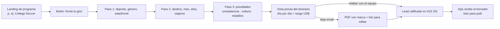

# 02 · "Armá tu gira": configurador de itinerario instantáneo

> Propuesta de negocio para Infinity Global Sports. Estado: idea para validar con IGS.
> El esfuerzo va en talles S/M/L. Las horas, si hacen falta, se hablan aparte.

## 1. En una línea

Una página pública donde el coach arma una gira de muestra en 2 minutos y se va con un PDF real: días, partidos según su nivel, experiencias y un **rango de precio por persona**. A cambio deja su email. Hoy recibe lo mismo, pero un día hábil después.

## 2. Evidencia (sitio público, relevado el 2026-10-22)

| Qué dice el sitio | Qué implica |
|---|---|
| `/plan-a-tour` pide escuela, rol, teléfono, ventana de viaje, cómo nos conoció y sitio web. **No pregunta deporte, género, nivel, tamaño del grupo ni días.** | El equipo tiene que volver a preguntar todo eso antes de mandar un itinerario. Es el cuello de botella del "1 día hábil". |
| "We will respond with sample itinerary options **within 1 business day**" | El entregable que se promete ya es un itinerario de muestra: se puede generar al instante. |
| `/college-soccer-tours`: itinerario de 9 días, 20 a 35 viajeros, planificación con **12 a 18 meses** de anticipación | La estructura es repetible (llegada → entrenamientos/partidos alternados → estadio → cierre). Encaja con el planner determinista que ya está en IGS OS. |
| Ningún precio publicado en todo el sitio | El coach no sabe si la gira entra en su presupuesto hasta hablar con alguien. Se pierden leads que no preguntan. |
| La página dice "uno o dos partidos" y el itinerario de muestra trae tres, más uno profesional | Hay inconsistencias que confunden. Un itinerario generado desde una sola fuente de verdad las elimina. |
| "How did you hear about us?" ya ofrece **"AI Assistant (ChatGPT, Gemini…)"** | IGS ya recibe tráfico desde asistentes. Una herramienta pública con contenido estructurado mejora cómo la citan. |

## 3. Experiencia



Wireframe del paso final (móvil primero, mismo estilo del sitio: fondo #0D0D0D, títulos condensados en mayúsculas):

```
┌──────────────────────────────────────┐
│  TU GIRA                             │
│  BUENOS AIRES · 9 DÍAS               │  ← type-hero, dos tonos
│  Varsity masculino · 28 viajeros     │
├──────────────────────────────────────┤
│  US$ 3.1k – 3.6k  por persona        │  ← kpi-number, siempre rango
│  Incluye hotel, traslados, comidas,  │
│  staff bilingüe. Vuelos aparte.      │
├──────────────────────────────────────┤
│  D1  Vuelo nocturno                  │
│  D2  Llegada · cena del equipo       │
│  D3  Entrenamiento · partido pro     │
│  D4  ⚽ Amistoso vs academia (nivel ≈)│
│  D5  Entrenamiento con staff pro     │
│  …                                   │
├──────────────────────────────────────┤
│  [ Recibir el PDF → ]  (email)       │  ← Button primary withArrow
│  [ Hablar con el equipo → ]          │  ← Button secondary
│  "Precio estimado. La propuesta      │
│   final la confirma IGS."            │
└──────────────────────────────────────┘
```

Detalles que importan:
- **Tres pasos y nada más.** Si el formulario es más largo que el actual, el configurador pierde.
- El itinerario se ve **antes** del email. El email destraba el PDF y el link editable. Mostrar valor primero y pedir el dato después convierte mejor que lo contrario.
- Si el lead ya cargó datos, `/plan-a-tour` llega pre-llenado.

## 4. Qué hace la IA y qué no

La regla es simple: **el modelo nunca inventa un precio ni un rival.**

| Pieza | Quién la hace | Por qué |
|---|---|---|
| Armar los días, cuántos partidos y en qué días | **Determinista**: `plan_itinerary()` / `target_match_count()` en `igs_common.domain.planner` (≈40 % de los días internos, entre 1 y 4) | Repetible, testeable, sin alucinaciones. |
| Elegir rival por nivel | **Determinista**: `eligible_opponents()` filtra por deporte, género, categoría, ciudad y diferencia de nivel (`max_level_gap`). En la vista pública se muestra genérico ("academia profesional de nivel similar"), nunca el nombre del club. | No se promete un rival que todavía no confirmó. |
| Precio | **Determinista**: `pricing.quote()` (proveedor × unidades, margen sobre subtotal, redondeo hacia arriba, solo `Decimal`). Lo público es un **rango** (p. ej. −5 % / +10 % sobre el quote, bandas configurables por ops) y se redondea a centenas. | El precio es la promesa más sensible. Se calcula con el mismo código que usa ops. |
| Traducir "queremos algo competitivo y que conozcan La Bombonera" a parámetros | **IA** (modelo rápido, salida estructurada con schema cerrado) | Es lo que sí hace bien: entender texto libre. El resultado son campos validados, no texto suelto. |
| Redactar el resumen de cada día y el texto del PDF | **IA**, sobre el itinerario ya calculado. Se le pasan los ítems y solo puede describirlos. | Tono de marca sin tocar los hechos. Un eval verifica que no aparezcan números ni nombres que no vengan del input. |
| Responder preguntas en la vista previa ("¿se puede en marzo?") | **IA + RAG** sobre la base de conocimiento pública (políticas, FAQ), con citas | Reutiliza `search_knowledge()`. Si la respuesta no está en las fuentes, deriva al equipo. |

Evals nuevos: (a) cero precios en el texto generado que no coincidan con el quote; (b) cero nombres de rivales en la vista pública; (c) el extractor de prioridades acierta ≥ 90 % sobre un set de frases de coaches.

## 5. Captura de leads

- **Gate suave**: itinerario visible sin email; PDF, link editable y "guardar" con email.
- **Lead enriquecido**: en vez de 6 campos sueltos, ops recibe deporte, nivel, tamaño, fechas, presupuesto implícito (si eligió la versión de 7 o de 12 días) y prioridades. Entra a IGS OS como lead con el **borrador ya armado**: la respuesta del "1 día hábil" pasa a ser revisar y mandar.
- **Scoring**: ventana de 12 a 18 meses + grupo ≥ 20 + rol de decisión (Head Coach, AD) = prioridad alta. Configurable.
- **Seguimiento**: si a los 7 días no respondió, el flow de nurturing que ya existe manda una variante ("¿y si fueran 7 días?") con el precio recalculado, siempre con aprobación humana.
- **Atribución**: se guarda el `utm_*` y la respuesta de "cómo nos conoció", para medir canal por canal.

## 6. Valor para SEO y para los asistentes de IA

- Una página pública por combinación útil (`/tours/buenos-aires/college-soccer-9-dias`) con itinerario de muestra, rango y FAQ. Se generan desde los mismos datos, con `noindex` en las variantes finas para no hacer contenido delgado.
- Datos estructurados (`TouristTrip`, `Offer` con `priceSpecification` como rango, `FAQPage`). Es lo que leen Google y los asistentes que ya mandan tráfico.
- Responde la búsqueda que hoy queda sin respuesta: **"cuánto cuesta una gira de fútbol universitario a Argentina"**.

## 7. KPIs

| Métrica | Hoy | Objetivo del piloto |
|---|---|---|
| Visitas a programa → lead | sin medir | medir la línea base el primer mes |
| Tiempo hasta el primer itinerario | ≤ 1 día hábil | < 1 minuto (automático) + revisión humana en el mismo día |
| % de leads con datos completos para cotizar | bajo (el form no los pide) | > 80 % |
| Tiempo de ops por lead hasta la primera propuesta | sin medir | −50 % |
| Lead → propuesta formal → seña (US$95 por viajero) | sin medir | comparar cohortes configurador vs. formulario |
| Divergencia rango público vs. propuesta final | n/a | ≥ 90 % de propuestas dentro del rango |

## 8. Impacto (rangos con supuestos explícitos)

Supuestos, **todos para validar con datos reales de IGS**: 30 leads web por mes; tasa lead → gira cerrada del 5 %; gira típica de 28 viajeros a US$3.300 por persona (≈ US$92k de facturación); margen bruto 22 % (el `DEFAULT_MARGIN` del modelo de pricing).

| Escenario | Supuesto | Giras extra por año | Margen bruto extra |
|---|---|---|---|
| Conservador | +10 % de leads (gente que hoy no pregunta) y misma conversión | ≈ 2 | ≈ US$40k |
| Base | +25 % de leads y +1 punto de conversión por respuesta inmediata | ≈ 6 | ≈ US$120k |
| Optimista | +40 % de leads y +2 puntos de conversión | ≈ 10 | ≈ US$200k |

Aparte de las giras extra, hay ahorro de tiempo de ops: cada lead llega con borrador y sin ida y vuelta de preguntas. Ese tiempo va a cerrar y no a armar.

## 9. Esfuerzo: **M**

- Reutiliza el planner, el pricing, el RAG, los flows de nurturing y la bandeja de leads de IGS OS. Lo nuevo es la UI pública, la API pública con límite de uso, el PDF y el extractor de prioridades.
- **S** si arranca con un solo programa (College Soccer · Buenos Aires) y sin páginas SEO.
- **L** si se suman todos los destinos y deportes con catálogo de proveedores real y mantenido.

Requisito previo: un catálogo mínimo de proveedores y experiencias con costos reales por ciudad. Sin eso, el rango no es honesto.

## 10. Riesgos y mitigaciones

| Riesgo | Mitigación |
|---|---|
| **Expectativa de precio**: el coach se queda con el número bajo del rango | Siempre rango y nunca un número exacto. Texto claro sobre qué incluye y qué no (vuelos). Ops ajusta las bandas. Se mide la divergencia (KPI). |
| **Competidores que scrapean** costos y estructura | Solo rangos redondeados a centenas, nada de precio por proveedor. Rate limit por IP, Turnstile/hCaptcha al generar PDF, rivales y hoteles nunca nombrados en público. |
| Lead de baja calidad ("solo mirando") | Scoring + el gate del PDF. La vista previa no le cuesta nada a ops. |
| Promesa de rival o fecha que no se puede cumplir | Lenguaje de "muestra" y "sujeto a confirmación". El rival concreto lo confirma ops en la propuesta formal (aprobación humana, como hoy). |
| La IA redacta algo incorrecto | La IA solo describe ítems ya calculados. El eval de "sin números inventados" corre en CI y los textos se cachean por combinación. |
| Costos desactualizados | Fecha de vigencia visible ("precios estimados para temporada 2027"). Alerta en ops si un proveedor no se actualizó en 90 días. |

## 11. Piloto

1. **Alcance**: College Soccer · Buenos Aires · 7, 9 y 12 días. Un botón en `/college-soccer-tours` al lado de "Request Sample Itinerary".
2. **Duración**: 8 semanas, con A/B a 50 % entre configurador y formulario actual.
3. **Antes de arrancar**: catálogo de costos validado por ops, bandas de rango definidas por la dirección de IGS, textos revisados.
4. **Criterio para seguir**: más leads completos sin bajar la tasa de propuesta formal, y ≥ 90 % de propuestas dentro del rango.
5. **Después**: sumar destinos (Rio, San José, Barcelona/Madrid) y las páginas SEO.
