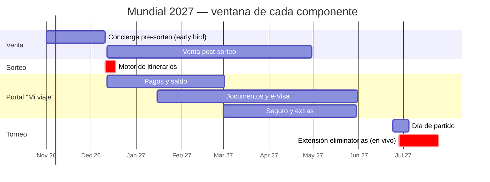
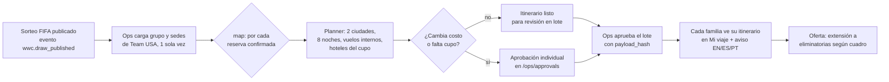

# Propuesta 03 — Portal familiar con IA para el Mundial Femenino 2027

> Un concierge con IA y un portal "Mi viaje" para las familias que siguen a la USWNT en Brasil. El concierge vende antes del sorteo, el motor de itinerarios trabaja el día del sorteo y el portal acompaña a cada familia hasta el partido, todo sobre IGS OS. No hace falta un constructor tipo Voiceflow: alcanzan **un agente con herramientas, una base de conocimiento con citas y workflows durables**.

**Estado:** propuesta. Lo que sigue sobre la operación interna de IGS es una hipótesis inferida del sitio público (relevado el 2026-10-22) y hay que validarlo con IGS. Las cifras de negocio son rangos con supuestos explícitos, no datos de IGS.

## 1. Lo que IGS ya publica

| Hecho (cita del sitio) | Fuente | Implicancia |
|---|---|---|
| *"Follow Team USA in Brazil… Wherever Team USA goes, we go."* | Home | El itinerario depende del sorteo y del fixture, no de IGS |
| Incluye **2 partidos de fase de grupos** de Team USA, **8 noches** en hoteles 4★ (habitaciones dobles o triples), vuelos internos, guía bilingüe por ciudad, traslados y city tour | `/family-experiences` | Hay un paquete estándar, así que se puede armar el itinerario con reglas y el LLM no tiene que inventarlo |
| No incluye vuelos internacionales, almuerzos ni cenas, gastos personales ni seguro (que *"strongly recommends"*) | `/family-experiences` | Hay cuatro upsells naturales ya identificados por IGS |
| Ventana publicada: **25 jun – 5 jul 2027**. El torneo completo va del 24 jun al 25 jul | `/family-experiences`, FIFA (prensa) | El paquete cubre la fase de grupos, y la **extensión a eliminatorias** queda como producto aparte |
| Sorteo el **11 de diciembre**, que define las ciudades de Team USA. *"Your journey will include the cities where Team USA plays, not all 8."* | `/family-experiences` | Después del sorteo hay que re-planificar a todas las familias en pocos días |
| *"Early bird pricing"* al reservar antes del sorteo y *"Lock your price"*, sin precios publicados | `/family-experiences` | La ventana de venta más valiosa es **ahora → 11-dic** |
| Pasos: info session de 20 min (*"every Tuesday at 7pm"*), *Reserve Your Spot*, sorteo, itinerario | `/family-experiences` | El embudo tiene un cuello de botella: una sesión semanal en vivo |
| *"Speak with Jo, our tour specialist"* / *"Text Jo"* | `/family-experiences` | Hoy una persona atiende por SMS, así que el concierge tiene que **descargar a Jo** y no reemplazarlo |
| Entradas: *"included in every Family Experience, subject to the official fixture calendar"* | `/family-experiences` | Entradas y fixture son dependencias externas y riesgo central |
| Pestaña "Hospitality Package" sin contenido | `/family-experiences` | Hay un producto premium pendiente de definir |
| Términos: fee de inscripción US$95, cuotas de US$500 a 30 y 90 días, saldo 110 días antes, reembolsos escalonados (150/110/45 días), seguro hasta 21 días antes, menores de 15 viajan con un adulto | `/terms-and-conditions` | Son muchos vencimientos por viajero y conviene automatizar el seguimiento |
| Ciudadanos de EE.UU. necesitan **e-Visa a Brasil** (desde el 10-abr-2025, US$80,90, hasta 10 días hábiles, la aerolínea la controla al embarcar) | Guías de visa (ver Fuentes) | Si falta una visa, la familia no viaja. Es el documento crítico del checklist |

**Inconsistencias del sitio** que el concierge no puede repetir sin control: el horario de la sesión figura como EST en un lugar y EDT en otro, y se promete *lock your price* sin publicar precios. Por eso el agente responde **solo desde una base de conocimiento curada por IGS**, con fecha de revisión.

## 2. Por qué ahora

Hoy es 22-oct-2026 y faltan **7 semanas para el sorteo**. Los vencimientos de los términos de IGS, calculados con una salida supuesta el **20-jun-2027**, son:

| Hito | Fecha estimada | Qué automatizar |
|---|---|---|
| Fin de *early bird* / sorteo | 11-dic-2026 | Concierge de venta, reservas y recordatorio "tu precio vence" |
| Itinerario por familia | 12 → 18-dic-2026 | Motor de itinerarios post-sorteo con aprobación de ops |
| Límite de reembolso (tramo de 150 días) | ~21-ene-2027 | Aviso claro de qué cambia en la política |
| **Saldo** (110 días antes) | ~2-mar-2027 | Recordatorios escalonados y link de pago |
| Pedido de e-Visa recomendado | antes del 1-abr-2027 | Checklist por viajero con un estado de visa por persona |
| Tramo de reembolso de 45 días | ~6-may-2027 | Último aviso de cambios |
| Límite para el seguro (21 días antes) | ~30-may-2027 | Upsell de seguro con explicación neutral |
| Partidos de grupo | 24-jun → ~5-jul-2027 | Compañero de día de partido (ver [07](07-on-tour-companion.md)) |
| Eliminatorias | ~8 → 25-jul-2027 | Venta en vivo de la extensión si Team USA avanza |

Si el concierge no está en línea antes de mediados de noviembre, se pierde la mejor ventana de venta. Esa fecha es la restricción que ordena todo el plan.

## 3. Qué hace (5 componentes)

### 3.1 Concierge de venta en el portal (EN / ES / PT)

- Un widget en `/family-experiences` y un canal SMS/WhatsApp (*"Text Jo"* sigue existiendo: el concierge contesta primero y le pasa la conversación a Jo con un resumen).
- Contesta lo que hoy ocupa la info session: qué incluye y qué no, ciudades posibles, cómo funciona el sorteo, habitaciones triples, si pueden ir viajeros solos, vuelos internacionales. **Cada respuesta va con cita** a la página o a los términos.
- Califica en la charla, sin formulario: cantidad de adultos y de chicos (por rango de edad, sin nombres), ciudad de origen en EE.UU., interés en eliminatorias y en hospitality, presupuesto, y si viaja con otras familias.
- Agenda la info session (y ofrece la grabación on-demand para quien no puede los martes) y manda el link de *Reserve Your Spot*.
- **Nunca cotiza un precio que IGS no cargó** y nunca promete entradas fuera de lo que dicen los términos.

### 3.2 Motor de itinerarios del día del sorteo

- Usa lo que ya existe en IGS OS: un evento de dominio dispara el flow, el nodo `map` recorre las reservas, el planner es determinístico y hay aprobaciones con huella del payload. El LLM **redacta** el aviso a cada familia, pero ni el itinerario ni el precio salen del modelo.
- El dato del sorteo lo carga ops: no se scrapea FIFA y no se le pide al modelo que "lea" el fixture.

### 3.3 Portal "Mi viaje" (por hogar)

| Bloque | Qué ve la familia | Qué hace la IA | Qué no hace la IA |
|---|---|---|---|
| **Línea de pagos** | Fee de inscripción, cuotas a 30 y 90 días, saldo a 110 días, todo con fecha y monto | Recordatorios con tono humano y en el idioma de la familia, y responde "¿cuánto me falta?" | No cambia montos ni fechas. Una excepción o prórroga pasa por aprobación |
| **Política de reembolso** | En qué tramo están hoy (150/110/45) | Explica qué pasa si cancelan *hoy*, citando los términos | No decide reembolsos |
| **Checklist de documentos** | Por viajero: pasaporte vigente, e-Visa, autorización para menores, seguro | Recordatorios, explica cada trámite y enlaza el portal oficial | No lee números de pasaporte ni datos de menores (ver §4) |
| **Habitaciones** | Doble o triple, quién duerme dónde | Ayuda a armar la distribución | — |
| **Extras** | Vuelos internacionales, seguro, noches extra, excursiones, hospitality, extensión | Recomienda según el perfil de la familia y explica el porqué | No cobra sin un *checkout* explícito |
| **Familias juntas** | Grupos de varias familias (*"small groups"*) | Coordina: quién pagó, quién tiene visa, chat del grupo de adultos | No comparte datos de una familia con otra sin opt-in |

### 3.4 Día de partido

Lo resuelve el compañero de gira de la [propuesta 07](07-on-tour-companion.md), con un perfil "familia". Este perfil suma la hora de salida al estadio, qué se puede entrar (política de bolsos), clima y calor, dónde está la entrada digital, punto de encuentro si un chico se pierde (protocolo fijo, no generado) y la ruta de vuelta al hotel. Acá no hace falta construir nada aparte.

### 3.5 Extensión a eliminatorias (el upsell grande)

- El paquete publicado termina el 5-jul, pero Team USA puede seguir jugando hasta el 25-jul.
- Al reservar se ofrece una **reserva condicional**: un depósito chico y reembolsable si Team USA no avanza, que da prioridad en el cupo de eliminatorias.
- Cuando Team USA clasifica, el motor de §3.2 vuelve a correr, ahora con el partido de octavos, y la familia acepta o no en el portal en menos de 24 h. Cada propuesta con costo pasa por aprobación de ops.
- Así se convierte un riesgo operativo (re-planificar en 48–72 h) en ingreso.

## 4. Menores y datos personales: reglas duras

- **Las cuentas del portal son solo de adultos.** El agente nunca le escribe a un menor, y ningún menor de 13 años tiene cuenta (COPPA en EE.UU.). Si un menor escribe, recibe un mensaje fijo que lo deriva al adulto responsable.
- **Los pasaportes, fechas de nacimiento y fichas de menores no pasan por el LLM ni por embeddings**, en línea con `docs/architecture/security.md` §3.7. Esos documentos se guardan cifrados y los valida un humano de ops o un lector determinístico de la zona MRZ. El agente solo ve estados: `pasaporte: ok`, `e-Visa: pendiente`.
- Para menores que viajan con un solo progenitor, el checklist pide la carta de consentimiento notariada. El texto lo fija IGS con su asesor legal y el agente no lo redacta.
- Términos de IGS: los menores de 15 viajan con un adulto, y el checklist lo valida por hogar antes de confirmar.
- Las fotos del torneo con chicos siguen las reglas de la propuesta 07: carpeta privada, sin etiquetar y con consentimiento escrito del tutor para cualquier uso público.

## 5. Diseño de la IA (sin Voiceflow)

| Pieza | Elección | Por qué |
|---|---|---|
| Conversación | **Un agente** (OpenAI Responses API, rol `agent`) con herramientas tipadas: `search_family_kb`, `get_household_status`, `book_info_session`, `create_lead`, `start_checkout`, `handoff_to_specialist` | Un agente con buenas herramientas cubre lo que en Voiceflow serían decenas de bloques, y se testea con evals |
| Conocimiento | RAG híbrido existente (BGE-M3 + reranker, pgvector) sobre una KB **curada**: página de familias, términos, guías de ciudad, FAQ de visa con **fecha de revisión** | Las respuestas salen con cita, y si no hay fuente el agente dice "no sé" y deriva |
| Plazos | Workflows de Temporal por hogar (timers durables: 30/90 días, saldo a 110, e-Visa, seguro) | Un recordatorio de pago no puede perderse porque se reinició un servidor |
| Reglas fijas | Flows JSON del motor propio para recordatorios y protocolos de seguridad (texto fijo, sin LLM) | Lo que tiene que decir siempre lo mismo no lo genera un modelo |
| Dinero | Toda acción con costo pasa por **aprobación** (`/ops/approvals`, `payload_hash`) | Ya existe y ya está probado en la demo |
| Idioma | EN por defecto, ES y PT según la familia. Los textos legales los traduce un humano una vez y no se generan | Evita traducciones creativas de los términos |
| Calidad | Evals: 50+ preguntas reales de familias (visa, reembolso, triples, menores) con juez y *recall* del RAG | Mide alucinaciones antes de que lleguen a la familia |

**Lo que no se construye:** un editor visual de conversaciones, intents, NLU propio ni bloques por pregunta. Si IGS quiere cambiar una respuesta, edita la KB. Si quiere cambiar un plazo, edita un flow JSON que ya tiene editor en IGS OS.

## 6. Números (rangos con supuestos explícitos)

**Supuestos** (todos a validar con IGS):
- Precio del paquete de grupo: **US$4.500–6.500 por persona** (8 noches 4★, 2 partidos, vuelos internos, sin vuelo internacional). IGS no publica precios y este rango sale de comparar con operadores similares.
- Hogar promedio: **3 viajeros**.
- Volumen base: **60 / 120 / 200 hogares** (bajo / medio / alto).
- Extensión a eliminatorias: **US$2.000–3.500 por persona** por tramo, con una adopción de **15–30 %** de los hogares *si Team USA avanza* (la USWNT llegó a eliminatorias en todos los Mundiales).

| Palanca | Bajo | Medio | Alto | Supuesto de la palanca |
|---|---|---|---|---|
| Más conversión del embudo (concierge 24/7, sesión on-demand) | +6 hogares | +15 hogares | +30 hogares | +10–15 % relativo sobre la base |
| Ingreso por esa conversión extra | ~US$80k | ~US$250k | ~US$580k | 3 viajeros × precio bajo/medio/alto |
| Extensión a eliminatorias | ~US$55k | ~US$190k | ~US$630k | Adopción 15/20/30 % × 3 viajeros × US$2.000/2.750/3.500 |
| Seguro de viaje (comisión) | ~US$5k | ~US$15k | ~US$35k | 50–70 % de adopción, comisión de US$30–60 por viajero |
| Vuelos internacionales y noches extra | ~US$10k | ~US$40k | ~US$100k | Margen sobre el adicional, 15–35 % de adopción |
| **Total incremental estimado** | **~US$150k** | **~US$500k** | **~US$1,3M** | Ingreso bruto, no margen |

Hay ingreso que no se pierde y que la tabla no cuenta: cada familia que no embarca por falta de e-Visa es un paquete entero en disputa. Con el checklist bien hecho, la meta es **cero embarques denegados por documentación**.

## 7. KPIs

| KPI | Meta del piloto |
|---|---|
| % de consultas resueltas sin Jo (con cita y sin queja) | ≥ 60 % |
| Tiempo a primera respuesta en el portal y por SMS | < 1 min, 24/7 |
| Conversión consulta → reserva antes del sorteo | +10 % relativo contra el período anterior |
| Tiempo desde el sorteo hasta tener todos los itinerarios publicados | ≤ 72 h |
| Saldos pagados a tiempo (110 días) | ≥ 95 % |
| Viajeros con e-Visa aprobada 30 días antes de la salida | 100 % |
| Adopción de la extensión a eliminatorias (si Team USA avanza) | ≥ 15 % de los hogares |
| Respuestas sin fuente o incorrectas en las evals semanales | < 2 % |

## 8. Qué ya existe en IGS OS y qué falta

| Ya existe | Falta |
|---|---|
| Chat público con flows y agente con herramientas | Modelo B2C de **hogar/viajero** (hoy el modelo es por equipo) |
| RAG híbrido con citas y evals de *retrieval* | KB curada de familias, visas y ciudades, con fecha de revisión |
| Eventos de dominio, outbox y nodo `map` | Evento `wwc.draw_published`, catálogo del cupo de hoteles y vuelos por sede |
| Planner determinístico y pricing | Reglas del paquete familiar (2 ciudades, 8 noches, triples) |
| Aprobaciones con `payload_hash`, copiloto de ops | Checkout y links de pago (proveedor a definir con IGS) |
| Timers durables en Temporal | Canal SMS/WhatsApp y bóveda de documentos cifrada |

## 9. Esfuerzo (S / M / L)

| Componente | Talla | Comentario |
|---|---|---|
| Concierge de venta + KB curada + evals | **M** | Lo más urgente, porque tiene que salir antes de mediados de noviembre |
| Modelo hogar/viajero + portal "Mi viaje" (pagos y checklist) | **L** | El trabajo de fondo está acá |
| Motor de itinerarios del sorteo | **M** | Reutiliza el planner y el `map` y necesita el catálogo del cupo |
| Recordatorios de plazos (Temporal + flows) | **S** | Se apoya casi entero en piezas existentes |
| Extensión a eliminatorias (reserva condicional + re-planificación) | **M** | Depende de la política comercial de IGS |
| Bóveda de documentos y lector MRZ | **M** | Necesita revisión de seguridad |
| Día de partido | **S** | Sale de la propuesta 07 con un perfil "familia" |

## 10. Riesgos

| Riesgo | Mitigación |
|---|---|
| Entradas: la asignación y las reglas de FIFA y las leyes de reventa en Brasil escapan a IGS | El agente cita solo los términos de IGS, y ninguna promesa sobre entradas sale del modelo |
| Fechas contradictorias (sitio 25-jun→5-jul vs. torneo 24-jun→25-jul; EST vs. EDT) | La KB la valida IGS, y una contradicción detectada abre una tarea para ops en vez de llegar a la respuesta |
| Reglas de visa que cambian | FAQ de visa con fecha de revisión, link al portal oficial y revisión mensual |
| Team USA eliminada antes de lo previsto | Depósito condicional reembolsable y textos ya aprobados para ese escenario |
| Uso de marcas FIFA en marketing generado | Plantillas revisadas por IGS. El agente no genera piezas con marcas oficiales |
| Datos de menores | §4: fuera del LLM, cifrados, cuentas solo de adultos |
| Que el concierge "venda de más" | Precio solo desde el catálogo, extras con checkout explícito y evals de tono |
| Saturación el día del sorteo | Escalado ya resuelto en IGS OS (KEDA, Temporal), lote de aprobación único para los casos sin cambio de costo |

## 11. Piloto propuesto

1. **Antes del 15-nov-2026:** concierge en `/family-experiences` (EN) con KB curada, agenda de la info session y handoff a Jo. Se mide contra las semanas anteriores.
2. **Antes del 11-dic-2026:** modelo de hogar y portal con pagos, ensayo del motor del sorteo con un sorteo simulado y 20 hogares de prueba.
3. **12 al 18-dic-2026:** el motor corre de verdad y ops aprueba en lote.
4. **Enero a mayo de 2027:** checklist de documentos y e-Visa, saldo, seguro, ES/PT.
5. **Junio y julio de 2027:** día de partido y extensión a eliminatorias en vivo.

**Preguntas para IGS:** ¿cuántas reservas familiares tienen hoy y cuántas esperan? ¿Qué precio tiene el paquete y qué incluye hospitality? ¿Tienen cupo de entradas asignado o lo compran por hogar? ¿Con qué cobran hoy? ¿Ya pensaron la extensión a eliminatorias? ¿Cuántos mensajes por semana atiende Jo?

## Fuentes

- [Family Experiences — Infinity Global Sports](https://infinityglobalsports.com/family-experiences) (relevado 2026-10-22)
- [Home — Infinity Global Sports](https://infinityglobalsports.com/) y [Términos y condiciones](https://infinityglobalsports.com/terms-and-conditions)
- [2027 Women's World Cup in Brazil will run from June 24 to July 25 — KSTP](https://kstp.com/?p=3466945)
- [2027 FIFA Women's World Cup Schedule — Netflix Tudum](https://www.netflix.com/tudum/articles/fifa-womens-world-cup-2027-match-schedule)
- [FIFA announces schedule for 2027 Women's World Cup in Brazil — Morocco World News](https://www.moroccoworldnews.com/2026/08/335519/fifa-announces-schedule-for-2027-womens-world-cup-in-brazil/)
- [Venues for the 2027 FIFA Women's World Cup — Remezcla](https://remezcla.com/sports/2027-fifa-womens-world-cup-cities-venues-announced/)
- [Brazil e-Visa for US citizens (2026) — Wego](https://blog.wego.com/brazil-evisa-requirements-us-canada-australia-2026/)
- [Brazil visa for US citizens 2026 — Rio Times](https://www.riotimesonline.com/brazil-visa-us-citizens-e-visa-2026/)
- [Brazil e-Visa cost, processing time, validity — Peninsula Visa](https://www.peninsulavisa.com/newsroom/brazil-evisa-us-citizens-cost-processing-time-validity)
- [Brazil visa for US citizens 2026 — VisaRun](https://visarun.ai/blog/brazil-visa-for-us-citizens-2026)
