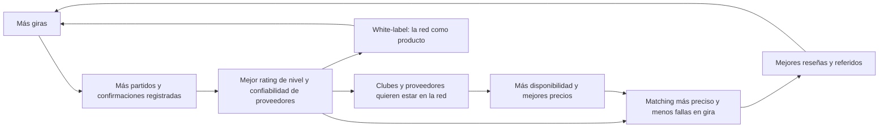

# 09 — Crecer por redes: portal de proveedores, red de clubes rivales y partners

> Propuesta de estrategia de marketplace/partnerships para Infinity Global Sports (IGS).
> Todo lo que se dice sobre la operación interna de IGS es **hipótesis** inferida del sitio público
> (infinityglobalsports.com) y debe validarse con IGS. Las cifras de impacto son **rangos con supuestos explícitos**, no promesas.

## 1. Por qué redes y no solo software

IGS vende una experiencia que depende de terceros en cada día del itinerario: hoteles, micros, árbitros,
canchas, clubes rivales, guías y estadios (La Bombonera, El Monumental, Maracanã). El sitio lo dice:
"competitive matches carefully matched to your level, age group, and competitive goals", "AFA-certified
coaching staff", destinos Argentina, Brasil, Costa Rica y España, y deportes fútbol, rugby, hockey, vóley y básquet.

Hipótesis: el activo más difícil de copiar de IGS no es la web ni el precio, es **su red**:
quién le confirma un rival del nivel justo un martes de marzo, qué hotel le sostiene un bloqueo, qué árbitro
AFA aparece. Si esa red vive en WhatsApp y en la memoria de dos personas, no escala y no se puede defender.
Convertirla en una red digital con datos (disponibilidad, nivel, confiabilidad) crea **efectos de red**:
cada gira mejora los datos, mejores datos hacen mejores giras, y más proveedores quieren estar adentro.

## 2. Las cinco jugadas

### 2.1 Portal de proveedores (magic link + IA sobre WhatsApp/email) — esfuerzo **M**

**Qué es.** Cada proveedor (hotel, micro, árbitros, cancha, club) recibe un link mágico por gira, sin crear
cuenta, donde ve *solo sus ítems* (fecha, horario, cantidad, notas) y confirma, propone cambio o rechaza.
Para los que nunca van a abrir un link, la IA lee sus respuestas de WhatsApp/email
("dale, confirmado el micro del 7 a las 9") y propone el cambio de estado.

**Cómo funciona con IGS OS hoy.**
- Ya existen `providers`, `trip_items` con estados `pending → requested → confirmed → completed`
  y `PATCH /v1/trips/{id}/items/{item}` con auditoría y evento `trip_item.status_changed`.
- El flow `pre-departure-check` (packages/flow-schema/examples) ya pide confirmaciones a 30 días,
  espera 48 h y escala lo que falta.
- Falta: el portal público por token (patrón ya usado en `/v1/public/*`), el canal WhatsApp Business
  y un nodo `extract` que convierta la respuesta libre en `{item_id, status, nota}`.

**Regla de seguridad.** La IA **propone**, no confirma sola: la confirmación inferida de un texto libre
crea una aprobación de baja fricción para ops (ya existe el patrón de aprobaciones con `payload_hash`),
salvo que el proveedor confirme por el portal (acción explícita = confirmación directa).

**Valor.** Menos tiempo persiguiendo confirmaciones, trazabilidad ("quién confirmó y cuándo"),
y un historial de confiabilidad por proveedor que alimenta la jugada 2.4.

### 2.2 Red de clubes rivales con calendario y rating de nivel (matching con IA) — esfuerzo **M/L**

**Qué es.** Un directorio vivo de clubes y selecciones universitarias en Argentina, Brasil, Costa Rica
y España, cada uno con: deporte, género, categorías, **nivel (1–10)**, estilo de juego, sede,
**ventanas de disponibilidad** y reputación como anfitrión (puntualidad, fair play, tercer tiempo).

**Matching con IA.** Dado un equipo visitante (deporte, género, categoría, nivel, fechas, ciudad),
el sistema propone rivales a ±1 de nivel con disponibilidad confirmada, explicando el porqué
("nivel 7 vs 7, estilo de presión alta, disponible martes 9/3 a la tarde").

**Cómo funciona con IGS OS hoy.**
- Ya existen `opponents` con `level_score`, `age_groups`, descripción con embeddings y la búsqueda
  por nivel/edad/deporte; el planificador (`igs_common.domain.planner`) ya respeta ±1 de nivel y
  no programa partidos en días consecutivos.
- Falta: calendario de disponibilidad por club (tabla `opponent_availability`), invitación del club al
  portal (misma mecánica que 2.1) y un **rating de nivel que aprende**: después de cada partido
  (flow `post-match-report`, ya existe), el resultado y la diferencia de goles ajustan el nivel estimado
  de ambos equipos (tipo Elo, auditable, con override humano).

**Por qué es defendible.** Cada partido jugado mejora el rating; nadie más tiene esos datos
de partidos entre equipos universitarios de EE.UU. y clubes sudamericanos. Es el foso competitivo.

### 2.3 Partnerships en EE.UU.: clubes, federaciones, showcases — esfuerzo **S/M**

**Qué es.** Canal de demanda B2B: acuerdos con clubes de EE.UU. (ECNL, MLS Next, academias),
ligas y federaciones estatales, organizadores de showcases y camps (IGS ya vende "USA camps"),
y programas universitarios que viajan cada 1–4 años.

**IA aplicada.**
- **Account 360** ya existe: cada partner es una cuenta con stakeholders (director técnico, AD,
  travel coordinator, finanzas), hechos citados y salud por reglas.
- Agente de prospección asistida: a partir de calendarios públicos (temporada universitaria,
  spring break, ventana post-temporada) sugiere a quién contactar y cuándo, y redacta el primer
  mensaje para que una persona lo revise y envíe (nunca envío automático en frío).
- Programa de referidos medible: el formulario de IGS ya pregunta "Returning Customer / Referral";
  IGS OS puede atribuir cada lead a su referente y medir el valor por partner.

### 2.4 Programas para school districts y colegios privados — esfuerzo **M**

**Qué es.** IGS ya tiene página de "private school sports tours". Los colegios compran distinto:
comité, aprobación del board, autorización de padres, menores de 15 con adulto, seguro, pagos por viajero.

**IA aplicada.**
- Paquete "listo para el comité": la propuesta se genera también como documento para el board
  (objetivos educativos, seguridad, supervisión 24/7, costos por familia, calendario de pagos con el
  fee de inscripción de US$95 y cuotas de US$500 de los términos reales de IGS).
- Portal de familias (fase posterior): checklist de formularios por viajero. **Los datos de menores
  nunca pasan por el LLM ni por embeddings** (regla ya definida en docs/architecture/security.md),
  se guardan cifrados y con retención limitada.
- Flow de seguimiento de pagos por viajero (vencimientos a 30/90/110 días): recordatorios
  automáticos internos, envíos a familias con aprobación.

### 2.5 Tours white-label para otros operadores — esfuerzo **L**

**Qué es.** IGS opera para terceros (agencias de viaje deportivo de EE.UU., operadores europeos que
quieren Sudamérica, clubes grandes que arman su propia gira) usando su red de rivales y proveedores
bajo la marca del tercero, cobrando por gira o por cupo.

**Cómo lo habilita IGS OS.** El sistema ya es multi-tenant con RLS por tenant; un operador partner
sería un tenant con acceso a un subconjunto del catálogo (rivales, sedes, experiencias) y propuestas
con su marca. **Es la jugada que más escala ingresos y la que más riesgo trae**: canibalización,
calidad de servicio bajo otra marca y dependencia de un tercero en la relación con el cliente final.
Recomendación: piloto con **un** operador no competidor directo (por ejemplo, de otro deporte o
de otro mercado de origen) recién cuando 2.1 y 2.2 estén maduros.

## 3. Efectos de red (por qué cada jugada refuerza a las otras)

- **Lado oferta:** proveedores y clubes con buena reputación reciben más giras → incentivo a
  confirmar rápido y bien.
- **Lado demanda:** coaches y partners reciben rivales mejor emparejados y menos imprevistos.
- **Datos propietarios:** el rating de nivel y la confiabilidad por proveedor solo existen si
  hay volumen; es lo que un competidor no puede comprar.

## 4. Piezas de IA (y qué es humano)

| Pieza | Qué hace la IA | Qué decide una persona | Estado en IGS OS |
|---|---|---|---|
| Lectura de respuestas de proveedores | Extrae `{ítem, estado, nota}` de WhatsApp/email | Aprueba confirmaciones inferidas | Nodo `extract` y aprobaciones existen; falta canal |
| Matching de rivales | Propone rivales ±1 nivel con disponibilidad y explica el porqué | Elige y confirma con el club | Planner + búsqueda existen; falta calendario |
| Rating de nivel | Ajusta nivel tras cada partido (tipo Elo) | Override y revisión de outliers | `post-match-report` existe; falta el ajuste |
| Prospección de partners | Sugiere a quién y cuándo, redacta borrador | Revisa y envía | Account 360 + copiloto existen |
| Documentos para comités | Genera versión "board" de la propuesta | Revisa antes de enviar | Propuesta existe; falta plantilla |
| Riesgo de gira | Detecta ítems sin confirmar cerca de la fecha y escala | Resuelve | Flow `pre-departure-check` existe |

Principio que se mantiene en todo: **la IA propone, una persona aprueba lo externo**
(regla de seguridad ya implementada: un flow con trigger externo no puede llegar a una acción
externa sin pasar por un nodo de aprobación).

## 5. KPIs

| KPI | Definición | Para qué jugada |
|---|---|---|
| Tasa de confirmación a T-30 | % de ítems confirmados 30 días antes de la salida | 2.1 |
| Tiempo medio de confirmación | horas entre pedido y confirmación por proveedor | 2.1 |
| Confirmaciones sin intervención | % confirmadas por portal o por IA aprobada en un clic | 2.1 |
| Precisión de matching | % de partidos con diferencia final ≤ 2 goles / nivel percibido "parejo" por el coach | 2.2 |
| Rivales con disponibilidad cargada | nº de clubes activos con calendario actualizado | 2.2 |
| Incidentes en gira | partidos o servicios caídos por cada 10 giras | 2.1 + 2.2 |
| Leads por partner | leads atribuidos por canal/partner y su conversión | 2.3 |
| Tasa de referidos | % de giras que vienen de un cliente anterior o partner | 2.3 |
| Ciclo de venta colegios | días desde primer contacto a inscripción | 2.4 |
| Giras white-label | giras operadas para terceros y margen por gira | 2.5 |

## 6. Hipótesis de impacto (rangos, con supuestos)

> Supuestos base (a validar): IGS opera del orden de decenas de giras por año; cada gira tiene
> 25–60 ítems con proveedor; hoy la mayoría de las confirmaciones se persiguen a mano por
> WhatsApp/email; un coordinador gestiona varias giras en paralelo.

| Jugada | Impacto esperado | Supuestos |
|---|---|---|
| 2.1 Portal + IA | −40% a −70% del tiempo de seguimiento de confirmaciones; tasa de confirmación a T-30 de "variable" a >90% | 60–80% de proveedores responde por link o por un mensaje que la IA interpreta bien; ops aprueba en un clic |
| 2.2 Red de rivales | −30% a −50% en tiempo de armado de rivales; menos partidos desparejos | Al menos 30–50 clubes con calendario cargado en Buenos Aires para que el matching tenga opciones |
| 2.3 Partners EE.UU. | +10% a +25% de leads calificados en 12 meses | 5–10 partners activos con atribución; referidos medidos desde el formulario actual |
| 2.4 Colegios | +1 a +3 programas escolares por temporada | El paquete "board-ready" acorta el ciclo; los requisitos de menores ya resueltos en el diseño |
| 2.5 White-label | Ingreso incremental por gira operada para terceros; difícil de estimar antes de un piloto | Requiere 2.1 y 2.2 maduros y un partner no competidor |

## 7. Esfuerzo y secuencia

| Orden | Jugada | Esfuerzo | Por qué en este orden |
|---|---|---|---|
| 1 | Portal de proveedores (2.1) | M | Ahorro inmediato y datos de confiabilidad; reutiliza flows y aprobaciones |
| 2 | Partners EE.UU. (2.3) | S/M | Usa Account 360 y el copiloto existentes; impacta demanda rápido |
| 3 | Red de rivales con calendario (2.2) | M/L | Necesita volumen de clubes; el rating mejora con cada gira |
| 4 | Colegios (2.4) | M | Requiere portal de familias y cuidado con datos de menores |
| 5 | White-label (2.5) | L | Solo con la red madura; piloto acotado |

## 8. Riesgos

| Riesgo | Mitigación |
|---|---|
| Proveedores que no adoptan el portal | WhatsApp sigue siendo canal válido; la IA interpreta respuestas libres; nada obliga a instalar nada |
| IA que interpreta mal una confirmación | Confirmaciones inferidas pasan por aprobación; el portal da confirmación explícita; auditoría de quién confirmó |
| Rating de nivel percibido como injusto por clubes | Rating interno, no público; override humano; explicación del ajuste |
| Datos de menores en colegios | Fuera del LLM y de embeddings, cifrado, retención limitada, revisión legal (COPPA, LGPD, Ley 25.326) antes de clientes reales |
| Canibalización con white-label | Piloto con un operador no competidor, cláusulas de exclusividad por mercado |
| Dependencia de pocos proveedores clave | El historial de confiabilidad muestra concentración y sugiere alternativas |
| Costo de operar la plataforma | Modo demo/pausa ya existe; el portal y los flows corren sobre la misma infraestructura |

## 9. Preguntas para validar con IGS

1. ¿Cuántos proveedores distintos usan por gira y cómo confirman hoy (WhatsApp, email, llamada)?
2. ¿Cómo eligen hoy a los rivales y cuánto tarda conseguir uno del nivel justo?
3. ¿Qué parte de las giras viene de referidos o de clientes que repiten?
4. ¿Tienen hoy colegios o school districts como clientes, y qué les traba la venta?
5. ¿Alguna vez operaron giras para otra agencia u operador?
